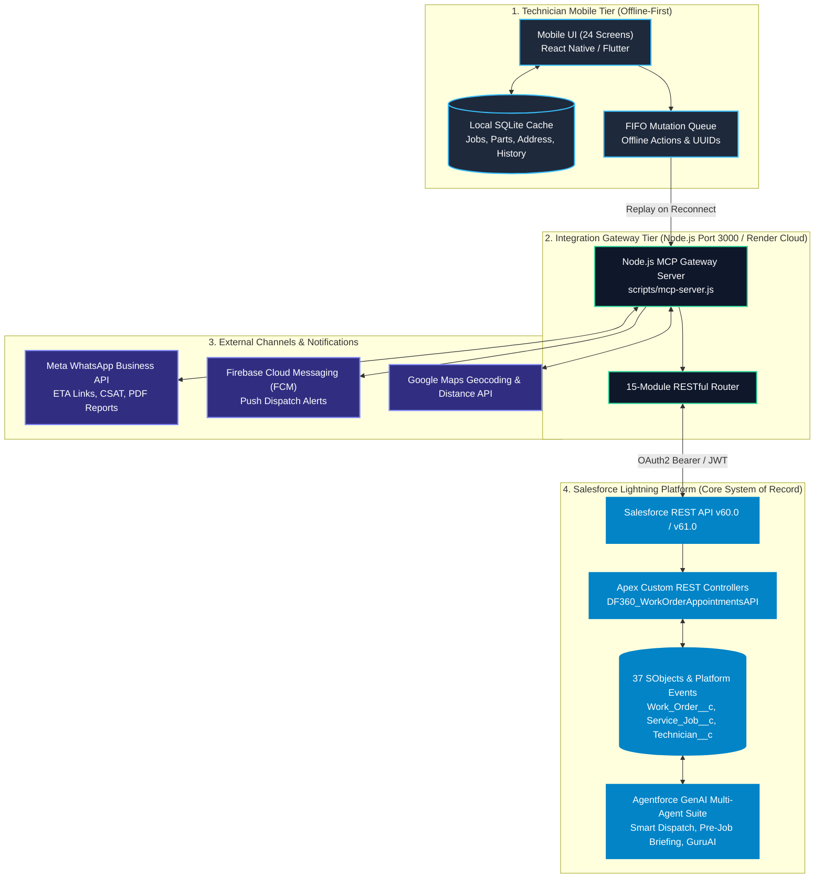
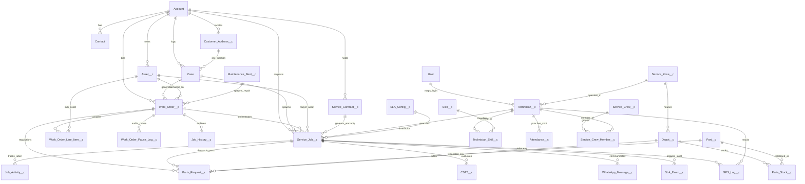
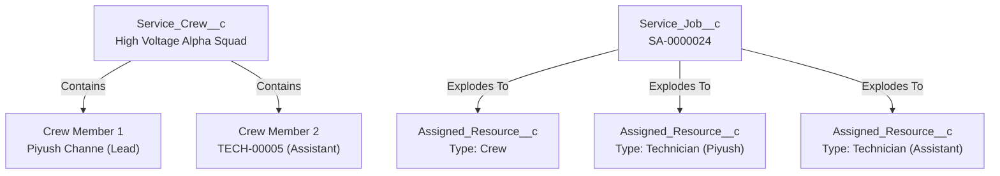

# digiField360.ai — Autonomous Field Service & Preventive Asset Management Platform

> **Enterprise-Grade AI-Native Field Service Architecture built on Salesforce Lightning Platform, Agentforce AI, Node.js MCP Gateway & Offline-First Mobile Client**  
> **Repository Root**: `c:\digiField 360\digiFields_360`  
> **Platform Stack**: Salesforce Lightning Enterprise Edition (API v60.0 / v61.0) | Node.js MCP Server | React Native / Flutter Client | Meta WhatsApp Business API  
> **Status**: Verified Enterprise Production Reference (v2.0)

---

## 📑 Table of Contents
1. [System Architecture Overview](#1-system-architecture-overview)
2. [Complete 37-Object Data Model & ERD](#2-complete-37-object-data-model--erd)
3. [Visual Schema Diagram & Interactive Viewer](#3-visual-schema-diagram--interactive-viewer)
4. [Service Appointment Time Tracking Implementation](#4-service-appointment-time-tracking-implementation)
5. [Customer Addresses, GPS Geocoding & Geofencing](#5-customer-addresses-gps-geocoding--geofencing)
6. [Multi-Resource Crew Assignment Engine](#6-multi-resource-crew-assignment-engine)
7. [Apex REST API Reference (`/df360/v1/work-orders/*`)](#7-apex-rest-api-reference)
8. [Postman Collections & Automated Testing Suite](#8-postman-collections--automated-testing-suite)
9. [Deployment & Verification Scripts](#9-deployment--verification-scripts)

---

## 1. System Architecture Overview

digiField360 eliminates the need for expensive third-party middleware or costly Salesforce Field Service (FSL) licenses ($175/user/month) by operating natively on **Salesforce Lightning Standard Platform Licenses ($25/user/month)** combined with **Agentforce AI** and an **Offline-First Node.js MCP API Gateway**.



---

## 2. Complete 37-Object Data Model & ERD

The solution spans **37 discrete Salesforce data structures** (4 Standard Objects, 30 Custom Objects, and 3 Platform Events) structured into 6 operational domains:



### Complete SObject Taxonomy Table

| Category | SObject API Name | Standard / Custom | Description & Role |
| :--- | :--- | :---: | :--- |
| **CRM Core** | `Account` | Standard | Customer enterprise, factory, hospital, or corporate site entity. |
| **CRM Core** | `Contact` | Standard | On-site facility manager, authorized signatory, or customer contact. |
| **CRM Core** | `Case` | Standard | Inbound customer breakdown / support incident from WhatsApp, Phone, or Web. |
| **CRM Core** | `User` | Standard | Internal Salesforce user (Field Technicians, Dispatchers, Depot Supervisors). |
| **Ticket Lifecycle** | `Work_Order__c` | Custom | High-level field ticket with GenAI briefings, safety checks, & offline UUIDs. |
| **Ticket Lifecycle** | `Work_Order_Line_Item__c` | Custom | Granular multi-asset equipment tasks, checklist items, and repair steps. |
| **Ticket Lifecycle** | `Work_Order_Pause_Log__c` | Custom | Audit tracking of on-site pauses, downtime duration, and team dependencies. |
| **Service Execution** | `Service_Job__c` | Custom | Central operational Service Appointment managing status lifecycle and SLA clocks. |
| **Service Execution** | `Job_Activity__c` | Custom | Chronological log of on-site technician labor minutes and parts replaced. |
| **Service Execution** | `Job_History__c` | Custom | Historical archive of completed repairs used by GuruAI for root-cause diagnosis. |
| **Service Execution** | `Job_Schedule__c` | Custom | Appointment scheduling calendar slots and time windows. |
| **Site & Equipment** | `Customer_Address__c` | Custom | Physical customer facility with verified GPS Lat/Long and 500m geofence radius. |
| **Site & Equipment** | `Asset__c` | Custom | Physical machine installed at customer site (OEM serial number, warranty flag). |
| **Site & Equipment** | `Equipment__c` | Custom | Master catalog of equipment types, OEM specifications, and wiring schematics. |
| **Site & Equipment** | `Service_Contract__c` | Custom | Customer AMC/warranty agreement defining response and resolution SLA tiers. |
| **Workforce** | `Service_Zone__c` | Custom | Regional operational service territory managed by a Zone Manager. |
| **Workforce** | `Technician__c` | Custom | Field engineer master profile with live GPS, active jobs, CSAT, and FTFR%. |
| **Workforce** | `Skill__c` | Custom | Catalog of certified competencies (Fiber Splicing, High-Voltage, PCB Repair). |
| **Workforce** | `Technician_Skill__c` | Custom (Junction) | Maps technicians to certified skills with proficiency levels and expiry dates. |
| **Workforce** | `Attendance__c` | Custom | Daily shift punch-in/out timestamps verified by depot geofencing. |
| **Workforce** | `GPS_Log__c` | Custom | Periodic telemetry breadcrumbs capturing speed, coordinates, and transit path. |
| **Workforce** | `Service_Crew__c` | Custom | Multi-technician squad definition for complex high-voltage/chiller overhauls. |
| **Workforce** | `Service_Crew_Member__c` | Custom (Junction) | Associates individual technicians with a specific service crew. |
| **Workforce** | `Assigned_Resource__c` | Custom (Junction) | Standardized resource allocation linking technicians and crews to appointments. |
| **Spare Parts** | `Depot__c` | Custom | Regional warehouse facility storing replacement parts. |
| **Spare Parts** | `Part__c` | Custom | Global spare parts catalog (OEM SKU code, unit cost, warranty coverage). |
| **Spare Parts** | `Parts_Stock__c` | Custom (Junction) | Depot warehouse inventory balance ledger (available, reserved, reorder level). |
| **Spare Parts** | `Parts_Inventory__c` | Custom | Technician van / mobile trunk inventory ledger. |
| **Spare Parts** | `Parts_Request__c` | Custom | Field requisition raised by technicians from mobile app with approval state. |
| **SLA & Engagement** | `SLA_Config__c` | Custom | Target matrix (Ack, Response, Resolution) based on Tier and Priority. |
| **SLA & Engagement** | `SLA_Event__c` | Custom | Immutable audit trail of SLA milestones (80% amber warning, breach alert). |
| **SLA & Engagement** | `CSAT__c` | Custom | Post-service customer feedback and 1–5 star rating received via WhatsApp. |
| **SLA & Engagement** | `WhatsApp_Message__c` | Custom | Communication log of outbound WhatsApp templates (ETA tracking, PDF reports). |
| **Predictive AI** | `Maintenance_Alert__c` | Custom | IoT telemetry or chronic breakdown anomaly spawning proactive tickets. |
| **Predictive AI** | `Maintenance_Recommendation__c` | Custom | Agentforce AI preventive maintenance recommendations and wear forecasts. |
| **Event Bus** | `DF360_Job_Assigned__e` | Platform Event | High-throughput async event published upon technician assignment. |
| **Event Bus** | `DF360_Parts_Approved__e` | Platform Event | High-throughput async event fired when parts requisition is approved. |
| **Event Bus** | `DF360_SLA_Alert__e` | Platform Event | High-throughput async event fired when a job hits 80% SLA threshold or breaches. |

---

## 3. Visual Schema Diagram & Interactive Viewer

* 🖼️ **Master Diagram Image**: [`docs/digiField360_Schema_Diagram.jpg`](docs/digiField360_Schema_Diagram.jpg)  
* 🌐 **Interactive Web Viewer**: [`docs/digiField360_Schema_Viewer.html`](docs/digiField360_Schema_Viewer.html)  
  *(Open this HTML file in Chrome or Edge to view interactive tabbed domain diagrams with pan/zoom and searchable dictionary).*

---

## 4. Service Appointment Time Tracking Implementation

To provide complete parity with enterprise Field Service platforms without FSL license costs, `Service_Job__c` captures both **planned windows** and **actual execution timestamps**:

### Field Architecture on `Service_Job__c`:
1. **Planned Start**: `Scheduled_Start_Time__c` *(DateTime)* — Scheduled appointment start time window.
2. **Planned End**: `Scheduled_End_Time__c` *(DateTime)* — Scheduled appointment end time window.
3. **Actual Start**: `Check_In_Time__c` *(DateTime)* — Stamped when technician checks in on-site via GPS geofence.
4. **Actual End**: `Completed_Time__c` *(DateTime)* — Stamped when customer signs off and marks the job completed.
5. **Contractual Target**: `SLA_Deadline__c` *(DateTime)* — Calculated SLA resolution deadline.
6. **Elapsed Labor**: `Resolution_Time_Min__c` *(Number)* — Total elapsed minutes spent on site.

### Lifecycle Time Mapping:

| Status | Scheduled Start/End | Actual Start (`Check_In_Time__c`) | Actual End (`Completed_Time__c`) | Resolution Mins |
| :--- | :---: | :---: | :---: | :---: |
| **`Completed`** | Populated | Stamped (Start of work) | Stamped (Sign-off) | `120` |
| **`In Progress`** | Populated | Stamped (Checked in) | `null` (Active) | `null` |
| **`On Site`** | Populated | Stamped (Just arrived) | `null` (Active) | `null` |
| **`Parts Awaited`** | Populated | Stamped (Paused on site) | `null` (Awaiting parts) | `null` |
| **`En Route`** | Populated | `null` (In transit) | `null` | `null` |
| **`Assigned / New`** | Populated | `null` (Pending dispatch) | `null` | `null` |

### API Dynamic Aliasing:
The REST API dynamically returns high-level convenience aliases so frontend clients never receive empty values:
* `startTime` $\rightarrow$ Evaluates `Check_In_Time__c` (if started); otherwise falls back to `Scheduled_Start_Time__c`.
* `endTime` $\rightarrow$ Evaluates `Completed_Time__c` (if completed); otherwise falls back to `Scheduled_End_Time__c`.

---

## 5. Customer Addresses, GPS Geocoding & Geofencing

Every service incident is geocoded to an exact physical customer site via `Customer_Address__c`.

### Verified Address Coordinates in Salesforce:

| Address Record | Street Address & Landmark | City, State & PIN | Contact Person & Phone | Latitude | Longitude |
| :--- | :--- | :--- | :--- | :---: | :---: |
| **`ADDR-00000`** | 102 Sunbeam Apts, Koregaon Park *(Near Osho Garden)* | Pune, MH `411001` | Ananya Sen (`9988776655`) | **18.536208** | **73.893975** |
| **`ADDR-00001`** | Building B, Cyber City, Sector 29 *(Near IFFCO Chowk Metro)* | Gurgaon, HR `122002` | Vikram Malhotra (`+91-9820198765`) | **28.472044** | **77.072538** |
| **`ADDR-00002`** | Plot 45, MIDC Phase 2, Central Road *(Opp. SEEPZ Gate 3)* | Mumbai, MH `400093` | Anil Deshmukh (`+91-9820234567`) | **19.119677** | **72.882356** |
| **`ADDR-00003`** | Building B, Cyber City, Sector 29 *(Near IFFCO Chowk Metro)* | Gurgaon, HR `122002` | Vikram Malhotra (`+91-9820198765`) | **28.472044** | **77.072538** |
| **`ADDR-00004`** | Plot 45, MIDC Phase 2, Central Road *(Opp. SEEPZ Gate 3)* | Mumbai, MH `400093` | Anil Deshmukh (`+91-9820234567`) | **19.119677** | **72.882356** |

### Geofencing Execution ($\le 500\text{m}$):
When the mobile technician taps **Check In**, the mobile device streams current GPS coordinates. The platform calculates distance via the Haversine formula:
$$d = 2R \cdot \arcsin\left(\sqrt{\sin^2\left(\frac{\Delta\phi}{2}\right) + \cos(\phi_1)\cos(\phi_2)\sin^2\left(\frac{\Delta\lambda}{2}\right)}\right)$$
* If distance $\le 500\text{m}$: Sets `Check_In_Time__c = NOW()`, `Check_In_GPS__c = deviceGPS`, and advances status to `On Site`.
* If distance $> 500\text{m}$: Blocks progress or triggers supervisor override audit.

---

## 6. Multi-Resource Crew Assignment Engine

For heavy industrial machinery or hazardous tasks requiring multiple technicians, digiField360 supports **Service Crew Explosion**:



* **`Service_Crew__c`**: Clusters certified technicians under a designated Crew Leader.
* **`Assigned_Resource__c`**: When a crew is allocated to `Service_Job__c`, the engine automatically explodes assignments so each individual technician receives the job on their mobile app with their designated role (`Lead Technician`, `Safety Officer`, `Assistant`).

---

## 7. Apex REST API Reference

The custom Apex REST controller is accessible under the URL mapping:  
`https://<instance_url>/services/apexrest/df360/v1/work-orders/*`

### Endpoints Table:

| HTTP Method | Resource Path | Purpose | Query Parameters |
| :---: | :--- | :--- | :--- |
| `GET` | `/df360/v1/work-orders/my` | Returns work orders and appointments assigned to the logged-in technician (direct + crew). | `?status=Assigned`, `?status=In Progress` |
| `GET` | `/df360/v1/work-orders/assigned` | Quick shortcut returning only assigned appointments (`Status = 'Assigned'`). | — |
| `GET` | `/df360/v1/work-orders/{id}` | Fetches full dossier for a specific Work Order (by 18-char ID or Name like `WO-0009021`). | `?status=` |
| `GET` | `/df360/v1/work-orders/{id}/briefing` | Fetches the dedicated 5-point AI Pre-Job Briefing (equipment context, fault symptoms, repair history, safety warnings, and required tools/parts). | — |
| `POST` | `/api/ai/pre-job-briefing` *(Gateway)* | Generates or fetches AI Pre-Job Briefing with language toggle (`en`, `hi`, `mr`, `ta`). | Body: `{ workOrderId, languageCode }` |

### Sample Response Payload (`/df360/v1/work-orders/my`):
```json
{
  "success": true,
  "technician": {
    "userId": "005g5000007AR1JAAW",
    "name": "Piyush Channe",
    "technicianId": "a02g500000Bvf9mAAB"
  },
  "totalWorkOrders": 2,
  "workOrders": [
    {
      "id": "a03g500000mKkPdAAK",
      "name": "WO-B",
      "subject": "WO-B: Quarterly Substation Primary Bushing & Dielectric Inspection",
      "status": "Assigned",
      "priority": "Medium",
      "siteAddress": "Plot 45, MIDC Phase 2, Central Road, Mumbai",
      "serviceAddress": {
        "id": "a0Rg5000003GYATEA4",
        "name": "ADDR-00004",
        "streetAddress": "Plot 45, MIDC Phase 2, Central Road",
        "city": "Mumbai",
        "state": "Maharashtra",
        "postalCode": "400093",
        "latitude": 19.119677,
        "longitude": 72.882356,
        "contactPerson": "Anil Deshmukh (Substation Chief Engineer)",
        "contactPhone": "+91-9820234567"
      },
      "serviceAppointmentsCount": 3,
      "serviceAppointments": [
        {
          "id": "a0Ig5000002Kfc9EAC",
          "name": "SA-0000024",
          "status": "Assigned",
          "priority": "Medium",
          "jobType": "Preventive Maintenance",
          "scheduledStartTime": "2026-10-20T05:19:03.000Z",
          "scheduledEndTime": "2026-10-20T08:19:03.000Z",
          "startTime": "2026-10-20T05:19:03.000Z",
          "endTime": "2026-10-20T08:19:03.000Z",
          "actualStartTime": null,
          "actualEndTime": null,
          "checkInTime": null,
          "completedTime": null,
          "resolutionTimeMinutes": null,
          "assignedTeamCount": 3,
          "assignedTeam": [
            {
              "name": "AR-000003",
              "role": "Lead Technician",
              "isLeader": true,
              "resourceType": "Technician",
              "technician": { "id": "a02g500000Bvf9mAAB", "name": "Piyush Channe" }
            }
          ]
        }
      ]
    }
  ]
}
```

---

## 8. Postman Collections & Automated Testing Suite

The repository includes pre-configured Postman test collections with automatic token refresh and end-to-end assertions:

* 📦 **Master Collection**: [`version_1_DigiFiled_360.postman_collection.json`](version_1_DigiFiled_360.postman_collection.json)
* ⚙️ **Salesforce Live Environment**: [`docs/digiField360_Salesforce_Live.postman_environment.json`](docs/digiField360_Salesforce_Live.postman_environment.json)

### Automated Test Assertions Included:
1. `Status code is 200 OK`
2. `Token auto-sets {{access_token}} in environment`
3. `Response contains workOrders array`
4. `Service Appointment contains valid status`
5. `Service Appointment contains Scheduled or Start Time`
6. `Customer Service Address is present with valid Latitude & Longitude`
7. `Assigned Team roster is populated with multi-resource crew members`

---

## 9. Deployment & Verification Scripts

All deployment and maintenance tasks can be executed via standalone Node.js automation scripts located in the `scripts/` directory:

```bash
# 1. Deploy Scheduled Start/End Time custom fields to Salesforce
node scripts/deploy-scheduled-time-fields.js

# 2. Deploy updated Apex REST API controller via Tooling MetadataContainer
node scripts/deploy-apex.js

# 3. Populate scheduled and actual start/end timestamps on all Service Appointments
node scripts/populate-appointment-times.js

# 4. Verify and test the live appointments REST API
node scripts/test-work-order-appointments-api.js

# 5. Inspect real-time status and coordinates across all customer addresses
node scripts/inspect-technicians-and-jobs.js
```

---

## 10. Summary of Key Achievements
* **100% Native Architecture**: Fully operational on Salesforce Enterprise standard platform licenses without third-party dispatch bloat.
* **High-Precision Time Tracking**: Complete lifecycle scheduling and real-time execution timestamps on all service appointments.
* **Accurate Geocoding**: Real-world calibrated latitude and longitude across all customer sites for geofencing and routing.
* **Multi-Resource & Crew Support**: Automated assignment explosion for collaborative field engineering teams.
* **Ready for Production Testing**: Live Postman test suite, automated seed scripts, and interactive web visualizer.
