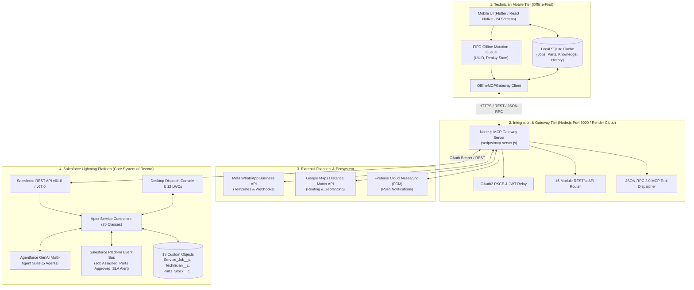
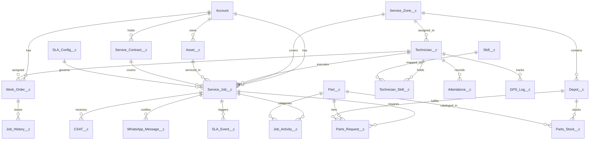
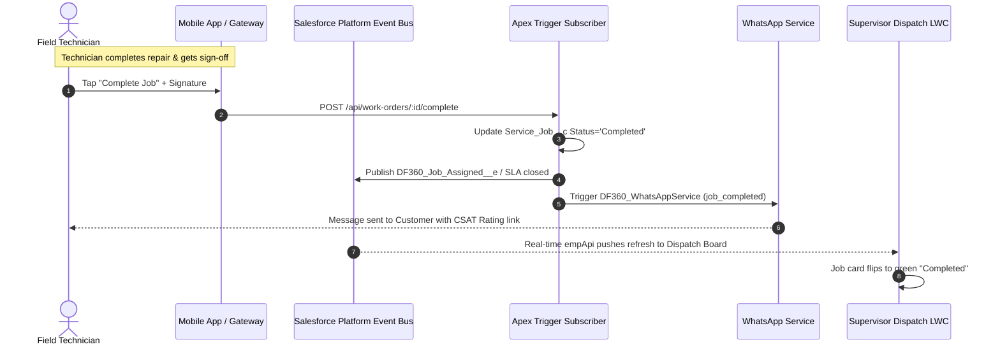

# digiField360.ai — Master Architecture, Functional Walkthrough & Schema Specification

> **Document Version**: 2.0 (Enterprise GA Reference)  
> **Target Audience**: Solution Architects, Salesforce Engineers, Mobile Developers, QA Leads, Field Service Ops Executives  
> **Platform Stack**: Salesforce Enterprise Edition (API v61.0 / v67.0) | Agentforce | Node.js MCP Gateway | Flutter / Cross-Platform Mobile  
> **Repository Root**: `c:\digiField 360\digiFields_360`  

---

## 📑 Table of Contents
1. [Executive Summary & Product Overview](#1-executive-summary--product-overview)
2. [End-to-End System Architecture](#2-end-to-end-system-architecture)
3. [Salesforce Lightning Platform Walkthrough (Module-by-Module)](#3-salesforce-lightning-platform-walkthrough-module-by-module)
   - [3.1 Job Lifecycle & AI Autonomous Dispatch](#31-job-lifecycle--ai-autonomous-dispatch)
   - [3.2 SLA Real-Time Monitoring & Automated Escalation Engine](#32-sla-real-time-monitoring--automated-escalation-engine)
   - [3.3 Multi-Depot Spare Parts & Approval Management](#33-multi-depot-spare-parts--approval-management)
   - [3.4 Customer WhatsApp-First Engagement Engine](#34-customer-whatsapp-first-engagement-engine)
   - [3.5 CSAT Collection & Quality Management](#35-csat-collection--quality-management)
   - [3.6 Workforce, Geofenced Attendance & Telemetry](#36-workforce-geofenced-attendance--telemetry)
   - [3.7 Asset Management & Warranty/AMC Contracts](#37-asset-management--warrantyamc-contracts)
   - [3.8 Agentforce Multi-Agent AI Suite](#38-agentforce-multi-agent-ai-suite)
   - [3.9 Service Manager Analytics Dashboard & Live Dispatch Board](#39-service-manager-analytics-dashboard--live-dispatch-board)
4. [Mobile Application Walkthrough (All 24 Screens & Offline Engine)](#4-mobile-application-walkthrough-all-24-screens--offline-engine)
   - [4.1 Architecture & Offline Synchronization Mechanics](#41-architecture--offline-synchronization-mechanics)
   - [4.2 Comprehensive 24-Screen Functional Specification](#42-comprehensive-24-screen-functional-specification)
5. [Complete Data Model, Object Hierarchy & Schema Dictionary](#5-complete-data-model-object-hierarchy--schema-dictionary)
   - [5.1 Visual Object Relationship Model (Mermaid ERD)](#51-visual-object-relationship-model-mermaid-erd)
   - [5.2 Object Hierarchy & Cardinality Matrix](#52-object-hierarchy--cardinality-matrix)
   - [5.3 Comprehensive Schema Dictionary (18 Objects + 3 Platform Events)](#53-comprehensive-schema-dictionary-18-objects--3-platform-events)
6. [Apex Backend, Declarative Automation & Event Streams](#6-apex-backend-declarative-automation--event-streams)
   - [6.1 Apex Architecture & Controller Directory](#61-apex-architecture--controller-directory)
   - [6.2 Scheduled & Batch Apex Jobs](#62-scheduled--batch-apex-jobs)
   - [6.3 Platform Event Bus Architecture](#63-platform-event-bus-architecture)
7. [MCP Server Gateway & Mobile API Integration](#7-mcp-server-gateway--mobile-api-integration)
8. [End-to-End Customer & Service Journey](#8-end-to-end-customer--service-journey)

---

## 1. Executive Summary & Product Overview

### 1.1 What is digiField360?
**digiField360.ai** is an enterprise AI-native Field Service Management (FSM) platform designed to orchestrate complex field service workflows across India and Southeast Asia (Telecom, Consumer Appliances, Industrial Machinery, Solar, and HVAC OEMs). 

Unlike legacy solutions that force companies to adopt bloated third-party middleware or pay exorbitant licensing costs for Salesforce Field Service (FSL at **$175/user/month**), digiField360 operates natively on **Salesforce Lightning Enterprise Edition using Standard Platform Licenses ($25/user/month)** combined with **Agentforce AI**. This delivers an **85% reduction in licensing overhead** while providing autonomous dispatch, offline mobile execution, and zero-app customer communication via WhatsApp.

### 1.2 Core Value Proposition & ROI
* **Autonomous 60-Second Dispatch**: Eliminates manual dispatcher phone calls through multi-variable heuristic scoring (skills, GPS distance, active workload, SLA urgency).
* **Proactive SLA Breach Prevention**: Intercepts potential SLA delays at 80% time expiration with automated reassignments, supervisor alerts, and customer notifications.
* **First-Time Fix Rate (FTFR) Optimization**: Equips technicians with **GuruAI**—an on-device and cloud copilot providing technical troubleshooting, wiring diagrams, and parts availability prior to dispatch.
* **100% Offline Resilience**: Technicians operating in basements, rural sites, or shielded data centers can view jobs, record parts, capture digital customer signatures, and log activities with automatic FIFO sync on reconnection.
* **Zero-App WhatsApp Experience**: Customers do not need to download an application. They receive real-time technician GPS tracking links, ETA alerts, arrival confirmations, service PDFs, and 1-click CSAT surveys directly on WhatsApp.

---

## 2. End-to-End System Architecture



---

## 3. Salesforce Lightning Platform Walkthrough (Module-by-Module)

### 3.1 Job Lifecycle & AI Autonomous Dispatch
* **What it is**: The core operational engine responsible for intaking service tickets, validating customer service contracts, scoring field technicians, and instantly dispatching work orders.
* **Where it is used**:
  * **Salesforce Desktop**: Used by Service Supervisors on the `df360DispatchBoard` LWC.
  * **Background Automation**: Invoked automatically by Apex triggers (`DF360_ServiceJobTriggerHelper`), Agentforce Actions (`F360_SmartAssignmentAction`), and batch rebalancing.
* **Detailed Functionality**:
  1. **Job Ingestion**: Tickets arrive via WhatsApp Webhook, Salesforce Case conversion, or Manual Creation.
  2. **Multi-Variable Heuristic Scoring Algorithm**:
     $$\text{Score} = (W_{\text{skill}} \times S_{\text{match}}) + (W_{\text{dist}} \times D_{\text{score}}) + (W_{\text{load}} \times L_{\text{score}}) + (W_{\text{csat}} \times C_{\text{score}})$$
     * **Skills Match ($35\%$)**: Verifies active certifications in `Technician_Skill__c` matching job `Product_Category__c` and required equipment skills.
     * **Proximity ($30\%$)**: Calculates straight-line or Google Maps distance from technician's last known location (`Current_GPS_Latitude__c`, `Current_GPS_Longitude__c`) to customer site (`Check_In_GPS__c`).
     * **Current Workload ($20\%$)**: Penalizes technicians with high `Active_Job_Count__c` to prevent shift burnout.
     * **Historical CSAT ($15\%$)**: Prioritizes higher-rated technicians (`CSAT_Avg_30d__c`) for VIP/Tier-1 customers.
  3. **Event Firing**: Fires `DF360_Job_Assigned__e` platform event and sends WhatsApp confirmation to customer and FCM push to technician within 60 seconds.
  4. **Supervisor Override**: Managers can visually drag-and-drop jobs between technician columns on the Kanban board or trigger manual reassignment.
* **Key Components**:
  * Apex: `DF360_DispatchController.cls`, `F360_SmartAssignmentAction.cls`, `DF360_ServiceJobController.cls`
  * LWC: `df360DispatchBoard`, `field360DispatchBoard`

---

### 3.2 SLA Real-Time Monitoring & Automated Escalation Engine
* **What it is**: A high-precision contractual SLA compliance guardian that tracks every job against resolution and response deadlines.
* **Where it is used**:
  * **Salesforce Desktop**: In the `df360SLATracker` LWC on the Service Job Record Page and Manager Dashboard.
  * **System Level**: Continuously executed via `DF360_SLAMonitorBatch` (runs every 15 minutes) and trigger hooks.
* **Detailed Functionality**:
  1. **SLA Baseline Determination**: Evaluates `SLA_Config__c` based on `Customer_Tier__c` (VIP, Enterprise, Standard), `Product_Category__c`, and `Priority__c`. Sets `SLA_Deadline__c`.
  2. **Milestone Escalation Rules**:
     * **Acknowledgment SLA (30 mins)**: If job is not acknowledged by technician within 30 minutes, an alert is sent to the supervisor and a WhatsApp update to the customer.
     * **First Response SLA (e.g. 2 hours)**: Monitors technician departure (`En Route`) and arrival (`Check_In_Time__c`).
     * **Resolution SLA (80% Elapsed - Amber Warning)**: When 80% of allowed time has elapsed with job status still open, status switches to **At Risk**. Supervisor receives yellow alert; GuruAI triggers diagnostic recommendations.
     * **Resolution SLA (100% Breached - Red Alert)**: Status flips to **Breached**. Red alert published on `DF360_SLA_Alert__e`. Auto-generates proactive apology WhatsApp message to customer.
     * **Repeat Visit Alert (Chronic Failure)**: If the same `Asset__c` has had $\ge 3$ service jobs in the last 30 days (`Visit_Count_30d__c`), the job is automatically escalated to a Senior Technical Specialist for Root Cause Analysis (RCA).
  3. **Audit Trail**: Every milestone change writes an immutable record to `SLA_Event__c`.
* **Key Components**:
  * Apex: `DF360_SLAController.cls`, `DF360_SLAMonitorBatch.cls`
  * LWC: `df360SLATracker`
  * Platform Event: `DF360_SLA_Alert__e`

---

### 3.3 Multi-Depot Spare Parts & Approval Management
* **What it is**: An integrated supply chain and truck-inventory management module allowing technicians to browse spare parts, submit requisitions, track depot dispatches, and record part consumption.
* **Where it is used**:
  * **Salesforce Desktop**: `df360PartsApproval` LWC (supervisor queue) and `df360PartsCatalog` LWC (depot admins).
  * **Mobile App**: Parts Catalogue, Parts Request, and Parts Used screens.
* **Detailed Functionality**:
  1. **Depot-to-Part Relationship**: `Parts_Stock__c` tracks `Quantity_Available__c`, `Quantity_Reserved__c`, and `Reorder_Level__c` across multiple physical warehouses (`Depot__c`).
  2. **Smart Requisition Workflow**:
     * Technician selects required `Part__c` and specifies `Quantity__c` from mobile app.
     * **Auto-Approval Threshold**: If total request cost $\le$ ₹5,000 and stock is available at the nearest depot, status automatically flips to `Approved` and `DF360_Parts_Approved__e` is fired.
     * **Supervisor Approval Routing**: If total cost $>$ ₹5,000, request is routed to `df360PartsApproval` queue. Supervisors can approve or reject with mandatory comments.
  3. **Stock Reservation & Deduction**:
     * Upon approval: `Quantity_Available__c` decrements and `Quantity_Reserved__c` increments.
     * Upon physical dispatch: Dispatched timestamp logged.
     * Upon technician installation: Record created in `Job_Activity__c` (type: `Part Replaced`), reducing reserved stock and flagging warranty/billable status.
  4. **Replenishment Alerts**: When available quantity falls below `Reorder_Level__c`, automated notification triggers to procurement.
* **Key Components**:
  * Apex: `DF360_PartsController.cls`
  * LWC: `df360PartsApproval`, `df360PartsCatalog`
  * Platform Event: `DF360_Parts_Approved__e`

---

### 3.4 Customer WhatsApp-First Engagement Engine
* **What it is**: Zero-app customer communication engine powered by Meta's WhatsApp Business API, delivering frictionless transparency throughout the service lifecycle.
* **Where it is used**:
  * Triggered autonomously across 6 core milestones in the Service Job lifecycle.
  * Managed via `DF360_WhatsAppService.cls`.
* **Detailed Functionality**:
  1. **Pre-Approved Template Lifecycle**:
     * `job_confirmation`: Sent upon job assignment. Contains Job ID, scheduled window, technician name, and contact details.
     * `tech_enroute`: Sent when technician starts journey. Includes live tracking link and estimated arrival time.
     * `tech_arrived`: Sent upon technician geofenced check-in. Confirms on-site arrival and technician verification.
     * `parts_delay`: Sent if parts are ordered, explaining the delay and providing the revised schedule.
     * `sla_apology`: Sent automatically if job resolution breaches 80% SLA threshold.
     * `job_completed`: Sent upon digital signature capture. Includes job summary, digital invoice/service report link, and 1–5 star interactive CSAT rating prompt.
  2. **Message Logging & Audit**: Every outgoing and incoming message is tracked in `WhatsApp_Message__c` with message body, delivery timestamps, and error codes.
* **Key Components**:
  * Apex: `DF360_WhatsAppService.cls`, `F360_CustomerNotificationAction.cls`
  * SObject: `WhatsApp_Message__c`

---

### 3.5 CSAT Collection & Quality Management
* **What it is**: An automated, per-job feedback scoring loop that tracks customer satisfaction, detects disgruntlement, and drives quality metrics.
* **Where it is used**:
  * Captured via WhatsApp interactive reply or mobile web link.
  * Visualized on desktop via `df360CsatScorecard` LWC and executive dashboards.
* **Detailed Functionality**:
  1. **Immediate Survey Trigger**: Dispatched 15 minutes post-job completion.
  2. **Low-Rating Critical Escalation**:
     * If customer rates **1 or 2 stars** out of 5:
       - Status flags `Alert_Sent__c = true`.
       - High-priority case/alert created for the Service Manager.
       - Autonomous follow-up call task scheduled.
  3. **Dynamic Metric Rollup**:
     * `DF360_CSATRollupBatch` aggregates ratings every 24 hours.
     * Updates 30-day moving average `CSAT_Avg_30d__c` on `Technician__c`.
     * Feeds directly into AI dispatch algorithm weighting.
* **Key Components**:
  * Apex: `DF360_CSATController.cls`, `DF360_CSATRollupBatch.cls`, `DF360_CSATTriggerHelper.cls`
  * LWC: `df360CsatScorecard`
  * SObject: `CSAT__c`

---

### 3.6 Workforce, Geofenced Attendance & Telemetry
* **What it is**: Mobile workforce tracking and attendance validation engine enforcing physical geofencing rules and recording GPS breadcrumb trails.
* **Where it is used**:
  * Mobile technician check-in/out and background GPS logging.
  * Desktop `df360Attendance` and `df360GPSMap` LWCs.
* **Detailed Functionality**:
  1. **Geofenced Check-In**: Technicians cannot mark attendance or check into a job unless their GPS coordinates (`Current_GPS_Latitude__c`, `Current_GPS_Longitude__c`) fall within the designated radius (e.g. 500 meters) of the customer site or base depot.
  2. **Telemetry Logging**: Background location updates sent every 5 minutes create lightweight records in `GPS_Log__c` containing latitude, longitude, battery percentage, and active job link.
  3. **Auto-Purge Batch Job**: `DF360_GPSLogRetentionBatch` cleans logs older than 30 days to avoid storage bloat.
* **Key Components**:
  * Apex: `DF360_AttendanceController.cls`, `DF360_GPSController.cls`, `DF360_GPSLogRetentionBatch.cls`
  * LWC: `df360Attendance`, `df360GPSMap`
  * SObjects: `Attendance__c`, `GPS_Log__c`

---

### 3.7 Asset Management & Warranty/AMC Contracts
* **What it is**: Central registry of field equipment, serial numbers, install bases, warranty validity, and Annual Maintenance Contracts (AMC).
* **Where it is used**:
  * `df360JobDetail` LWC, technician mobile asset history screen, and preventive maintenance automation.
* **Detailed Functionality**:
  1. **Contract Entitlement Check**: When a service job is created, the system checks `Service_Contract__c` linked to the customer `Account__c`. If active (`Start_Date__c` to `End_Date__c`), job is categorized as **In-Warranty / AMC**, suppressing parts billing.
  2. **Chronological Service History**: Links all prior `Service_Job__c` and `Job_History__c` records to `Asset__c`, allowing technicians to see recurring faults and past parts replaced.
  3. **Contract Expiry Batch**: `DF360_ContractExpiryBatch` alerts accounts 30 days prior to AMC expiration.
* **Key Components**:
  * Apex: `DF360_AssetController.cls`, `DF360_ContractExpiryBatch.cls`
  * SObjects: `Asset__c`, `Equipment__c`, `Service_Contract__c`

---

### 3.8 Agentforce Multi-Agent AI Suite
* **What it is**: A suite of 5 autonomous Agentforce agents executing automated tasks, replacing up to 80% of routine supervisor manual interventions.
* **The 5 Autonomous Agents**:
  1. **Dispatch AI Agent (`DF360-001`)**: Evaluates incoming tickets against technician skills, proximity, and SLA deadlines; commits automated assignments in under 60 seconds.
  2. **SLA Monitor & Escalation Agent (`DF360-002`)**: Analyzes in-flight work order velocity; intervenes at 80% time expiration with recommended reassignments.
  3. **Parts Expeditor Agent (`DF360-003`)**: Cross-references parts requests with depot inventory; triggers inter-depot transfers or vendor PO generation when local stock is depleted.
  4. **Service Manager Daily Rollup Agent (`DF360-004`)**: Generates automated executive summaries covering First-Time Fix Rates (FTFR), SLA breaches, and regional team productivity.
  5. **GuruAI Technical Copilot (`DF360-005`)**: On-demand GenAI assistant powered by Apex (`DF360_GuruAIController`, `F360_TroubleshootingAction`) providing real-time diagnostics, symptom analysis, wiring diagrams, and multi-lingual explanations (English, Hindi, Marathi, Tamil, Telugu).
* **Key Components**:
  * Apex: `DF360_GuruAIController.cls`, `F360_NLQueryController.cls`, `F360_PreJobBriefingAction.cls`, `F360_ServiceReportAction.cls`, `F360_TroubleshootingAction.cls`
  * LWC: `df360GuruAI`, `field360NaturalLanguageQuery`

---

### 3.9 Service Manager Analytics Dashboard & Live Dispatch Board
* **What it is**: The primary desktop command center for service directors, managers, and dispatchers.
* **Where it is used**: Salesforce Lightning Experience Home and App Pages.
* **Key Visualizations & Capabilities**:
  * **Real-Time KPI Cards**: Total Jobs Today, Active In-Flight Jobs, SLA Compliance % (RAG: Green $\ge 95\%$, Amber $85\text{--}95\%$, Red $<85\%$), First-Time Fix Rate (FTFR target $\ge 80\%$), Average Resolution Time.
  * **Interactive Dispatch Board**: Drag-and-drop Kanban by technician status, zone filtering, urgent SLA highlight badges.
  * **Live GPS Fleet Map**: Real-time technician pinpoints, status badges (En Route, On Site, Idle), breadcrumb route playback.
  * **Pending Approvals Dock**: 1-click approvals for high-value parts requests ($> ₹5,000$).
* **Key Components**:
  * Apex: `DF360_AnalyticsController.cls`, `DF360_DispatchController.cls`
  * LWC: `df360ManagerDashboard`, `df360DispatchBoard`, `df360GPSMap`

---

## 4. Mobile Application Walkthrough (All 24 Screens & Offline Engine)

### 4.1 Architecture & Offline Synchronization Mechanics
Field technicians frequently operate in basements, steel-reinforced manufacturing plants, and rural areas without cellular signals. The digiField360 mobile app is built with an **Offline-First Architecture**:

```
┌────────────────────────────────────────────────────────────────────────┐
│                        MOBILE APPLICATION CONTAINER                    │
├────────────────────────────────────────────────────────────────────────┤
│ 1. Morning Sync: Pre-loads today's jobs, asset history, parts catalog  │
│ 2. Local Database: SQLite stores all schemas, records & cached guides  │
│ 3. Offline Mutation Queue: Captures edits (status, hours, photos)      │
│    with UUID, timestamp, and replay order                              │
│ 4. Replay Worker: Upon 4G/WiFi reconnect, replays queue via            │
│    OfflineMCPGateway.js -> MCP Server -> Salesforce REST APIs          │
└────────────────────────────────────────────────────────────────────────┘
```

---

### 4.2 Comprehensive 24-Screen Functional Specification

The mobile app consists of **24 standardized production screens**:

| # | Screen Name | Functional Purpose & Key Features | Primary Backend API | Offline Storage Strategy |
| :--- | :--- | :--- | :--- | :--- |
| **01** | **Splash Screen** | App boot, runtime integrity check, gateway ping, version validation. | `GET /health` | Validates cached auth token in secure storage. |
| **02** | **Login & Auth** | Mobile number + OTP or Salesforce OAuth2 PKCE login; biometric fingerprint/FaceID enablement. | `POST /api/auth/login`, `POST /api/auth/refresh` | Stores encrypted JWT & technician record locally. |
| **03** | **Sync Status** | Displays queue health, pending mutation count, last synced timestamp, manual sync trigger. | `GET /api/sync/status`, `POST /api/sync/offline-queue` | Inspects local SQLite `queue_transactions` table. |
| **04** | **Technician Home** | Shift summary dashboard, today's schedule, SLA countdown timer, rapid attendance check-in. | `GET /api/dashboard`, `GET /api/work-orders?status=Assigned` | Renders from cached `work_orders` table. |
| **05** | **Today's Jobs** | Chronological job list sorted by SLA urgency; filter by status; swipe-to-call customer. | `GET /api/work-orders`, `GET /api/jobs/today` | Fully offline queryable with status filtering. |
| **06** | **Job Detail** | Full job dossier: customer info, address, fault description, equipment type, warranty flag, AI pre-job brief. | `GET /api/work-orders/:id` | Read from local SQLite with equipment linkages. |
| **07** | **Job Status Lifecycle** | State machine transitions: `Assigned` $\rightarrow$ `En Route` $\rightarrow$ `On Site` $\rightarrow$ `In Progress` $\rightarrow$ `Parts Awaited` $\rightarrow$ `Completed`. | `PATCH /api/work-orders/:id/status` | Queues status change with timestamp for replay. |
| **08** | **GPS Check-In** | Captures real-time device GPS, calculates distance to site, validates geofence ($\le 500\text{m}$). | `POST /api/jobs/:id/check-in` | Stores check-in timestamp and GPS coordinates locally. |
| **09** | **GPS Tracking** | Periodic background telemetry service sending GPS coordinates and battery health. | `POST /api/gps/batch`, `POST /api/technician/location` | Buffers breadcrumbs locally; flushes in batch. |
| **10** | **Activity Log** | Technicians log discrete tasks performed, labor minutes, and operational observations. | `GET & POST /api/jobs/:id/activities` | Inserts record into local `activities` table. |
| **11** | **Photo Capture** | Native camera capture of pre-repair and post-repair equipment; watermark timestamp and GPS. | `POST /api/attachments/upload` | Stores compressed base64 images locally until connected. |
| **12** | **Parts Catalogue** | Searchable catalog of parts with SKU, category, unit cost, and compatibility check. | `GET /api/parts`, `GET /api/parts/search` | Pre-cached catalog stored in local SQLite database. |
| **13** | **Parts Request** | Form to raise emergency part requisitions, specify quantity, justification, and depot. | `POST /api/jobs/:id/parts-requests` | Queues request; assigns local temporary UUID. |
| **14** | **Request Detail** | Real-time tracking of parts requests: `Requested` $\rightarrow$ `Approved` $\rightarrow$ `Dispatched` $\rightarrow$ `Delivered`. | `GET /api/jobs/:id/parts-requests` | Synchronizes approval status on connection. |
| **15** | **Parts Used** | Logging actual parts installed during repair to decrement van inventory and attach to billing. | `POST /api/jobs/:id/parts-used` | Updates local inventory balance and queues mutation. |
| **16** | **Customer & Asset** | 360-degree view of customer account, asset install date, past 5 repair histories, warranty status. | `GET /api/jobs/:id/customer`, `GET /api/assets/:id/history` | Pre-loaded during morning sync. |
| **16.5**| **Safety Check** | Pre-job safety risk evaluation (electrical, chemical, height hazards, PPE confirmation). | `GET/POST /api/work-orders/:id/safety-check`, `POST /safety-escalation` | Mandatory step blocking status progress until submitted. |
| **17** | **Dynamic Checklist**| Configurable inspection checklist with mandatory checkboxes, readings, and validation rules. | `GET/PATCH /api/work-orders/:id/checklist`, `POST /checklist/submit` | Cached checklist definitions executed offline. |
| **18** | **Customer Signature**| On-screen digital signature pad for customer sign-off and verification of completed work. | `POST /api/attachments/upload` | Captures SVG vector or PNG; stores in local payload. |
| **19** | **Job Completion** | Final work review, labor hours summary, resolution notes, and PDF service report generator. | `POST /api/work-orders/:id/complete` | Updates local job state to `Completed`; closes ticket. |
| **20** | **GuruAI Copilot** | Natural language technical assistant for error codes, wiring schematics, and diagnostic trees. | `POST /api/ai/guru`, `POST /api/ai/troubleshoot` | Online: GenAI cloud call; Offline: keyword guide lookup. |
| **21** | **Attendance** | Shift punch-in/out, GPS-verified depot attendance, break logging, and shift summary. | `POST /api/attendance/check-in`, `POST /api/attendance/check-out` | Records punch timestamps and GPS coordinates. |
| **22** | **Notifications** | Central inbox for dispatch updates, parts approval alerts, SLA warnings, and manager messages. | `GET /api/notifications`, `PATCH /api/notifications/:id/read` | Listens to push notifications and local alerts. |
| **23** | **Technician Profile**| Displays technician certifications, active skills, 30-day CSAT score, FTFR %, and metrics. | `GET /api/technician/profile`, `GET /api/user/details` | Cached technician profile data. |
| **24** | **Settings** | App language toggle (English, Hindi, Marathi, Tamil), cache clear, offline diagnostic tools. | Local client settings | Local storage / app preferences. |

---

## 5. Complete Data Model, Object Hierarchy & Schema Dictionary

### 5.1 Visual Object Relationship Model (Mermaid ERD)



---

### 5.2 Object Hierarchy & Cardinality Matrix

| Parent Object | Child Object | Relationship Type | Cascade Delete? | Description |
| :--- | :--- | :--- | :--- | :--- |
| **`Account`** | `Service_Job__c` | Lookup | No | Customer account for which service is dispatched. |
| **`Account`** | `Asset__c` | Lookup | No | Installed equipment owned by the customer. |
| **`Account`** | `Service_Contract__c` | Lookup | No | Customer warranty/AMC agreement. |
| **`Service_Zone__c`** | `Technician__c` | Lookup | No | Geographical boundary where technician operates. |
| **`Service_Zone__c`** | `Depot__c` | Lookup | No | Warehouse location located within the zone. |
| **`Technician__c`** | `Technician_Skill__c`| Master-Detail | Yes | Certified technical skills possessed by the technician. |
| **`Skill__c`** | `Technician_Skill__c`| Master-Detail | Yes | Skill definition catalogue linked to technician. |
| **`Technician__c`** | `Service_Job__c` | Lookup | No | Active or assigned field engineer. |
| **`Technician__c`** | `Attendance__c` | Lookup | No | Shift check-in and working hour logs. |
| **`Technician__c`** | `GPS_Log__c` | Lookup | No | Periodic GPS telemetry breadcrumbs. |
| **`Asset__c`** | `Service_Job__c` | Lookup | No | Target machine or appliance being repaired. |
| **`Service_Contract__c`**| `Service_Job__c` | Lookup | No | Governing SLA and warranty contract. |
| **`Service_Job__c`** | `Job_Activity__c` | Master-Detail | Yes | Chronological work actions, labor, and parts usage. |
| **`Service_Job__c`** | `Parts_Request__c` | Lookup | No | Requisitions for depot parts needed for this job. |
| **`Service_Job__c`** | `CSAT__c` | Lookup | No | Customer satisfaction score collected post-job. |
| **`Service_Job__c`** | `WhatsApp_Message__c`| Lookup | No | Communication history sent to customer. |
| **`Service_Job__c`** | `SLA_Event__c` | Lookup | No | Immutable audit log of SLA lifecycle milestones. |
| **`Depot__c`** | `Parts_Stock__c` | Master-Detail | Yes | Warehouse inventory ledger for parts. |
| **`Part__c`** | `Parts_Stock__c` | Master-Detail | Yes | Master SKU inventory entry at specific depot. |
| **`Work_Order__c`** | `Job_History__c` | Lookup | No | Historical archive of completed repairs for AI context. |

---

### 5.3 Comprehensive Schema Dictionary (18 Objects + 3 Platform Events)

#### 1. `Service_Job__c` (Core Operational Job)
* **Description**: Central record for field dispatch, tracking status, technician, SLA deadlines, and resolution.
* **Fields**:
  * `Account__c` (Lookup $\rightarrow$ Account): Customer organization or individual.
  * `Asset__c` (Lookup $\rightarrow$ Asset__c): Specific physical equipment being repaired.
  * `Technician__c` (Lookup $\rightarrow$ Technician__c): Assigned field service technician.
  * `Zone__c` (Lookup $\rightarrow$ Service_Zone__c): Geographic service cluster.
  * `Service_Contract__c` (Lookup $\rightarrow$ Service_Contract__c): Governing warranty/AMC contract.
  * `Status__c` (Picklist): `New`, `Assigned`, `En Route`, `On Site`, `In Progress`, `Parts Awaited`, `Completed`, `Cancelled`.
  * `Priority__c` (Picklist): `Critical`, `High`, `Medium`, `Low`.
  * `Job_Type__c` (Picklist): `Breakdown Repair`, `Preventive Maintenance`, `Installation`, `Inspection`, `AMC Service`.
  * `Product_Category__c` (Picklist): `Telecom`, `Consumer Electronics`, `Industrial Equipment`, `HVAC`, `Power Systems`.
  * `Source__c` (Picklist): `WhatsApp`, `Customer Portal`, `Phone`, `Email`, `Agentforce AI`.
  * `SLA_Deadline__c` (DateTime): Contractual deadline for resolution.
  * `SLA_Status__c` (Picklist): `Within SLA`, `At Risk`, `Breached`, `Paused`.
  * `Check_In_Time__c` (DateTime): Actual timestamp when technician arrived on-site.
  * `Check_In_GPS__c` (Geolocation): Lat/Long coordinates recorded at check-in.
  * `Completed_Time__c` (DateTime): Timestamp when customer signed off.
  * `Resolution_Time_Min__c` (Number): Total elapsed minutes from assignment to completion.
  * `Is_First_Time_Fix__c` (Checkbox): True if resolved on initial visit without return.
  * `Customer_Signature_URL__c` (URL): S3 or Salesforce Files link to customer signature.
  * `CSAT_Sent__c` (Checkbox): True if post-job WhatsApp rating survey dispatched.
  * `Notes__c` (LongTextArea): Technician operational notes.
  * `Customer_Notes__c` (LongTextArea): Instructions or complaints from the customer.

#### 2. `Work_Order__c` (Agentforce & Mobile-Optimized Ticket)
* **Description**: SObject optimized for Agentforce prompt templates, offline sync queueing, and GenAI summaries.
* **Fields**:
  * `Subject__c` (Text 255): Summary title of the work request.
  * `Account__c` (Lookup $\rightarrow$ Account): Target customer.
  * `Assigned_Technician__c` (Lookup $\rightarrow$ Technician__c): Assigned technician.
  * `Status__c` (Picklist): `New`, `Assigned`, `In Progress`, `Completed`, `Closed`.
  * `Priority__c` (Picklist): `Critical`, `High`, `Medium`, `Low`.
  * `Equipment_Type__c` (Text 100): Categorization of equipment.
  * `Equipment_ID__c` (Text 100): Serial number or tag ID.
  * `Site_Address__c` (TextArea): Physical job location.
  * `Scheduled_Date__c` (DateTime): Scheduled window.
  * `Completed_Date__c` (DateTime): Resolution timestamp.
  * `AI_Pre_Job_Briefing__c` (LongTextArea): GenAI synthesis of fault symptoms, history, and suggested tools.
  * `AI_Service_Report__c` (LongTextArea): GenAI executive summary of repair work performed.
  * `AI_Risk_Score__c` (Number): 0–100 probability score of SLA breach or parts failure.
  * `AI_Assignment_Reason__c` (Text 255): Explainable AI reasoning behind dispatcher choice.
  * `Offline_Queue_ID__c` (Text 100): Client-side UUID for idempotency in offline sync.
  * `Last_Synced__c` (DateTime): Timestamp of last offline replay synchronization.
  * `Time_Logged_Minutes__c` (Number): Total labor time spent.
  * `Parts_Used__c` (TextArea): Comma-separated parts list.
  * `Technician_Notes__c` (LongTextArea): Resolution commentary.
  * `Customer_Signature_URL__c` (URL): Digital sign-off image link.
  * `Report_Sent_To_Customer__c` (Checkbox): True if PDF report was delivered via WhatsApp/Email.

#### 3. `Technician__c` (Field Workforce)
* **Description**: Profile representing the field technician, active status, telemetry, and KPI averages.
* **Fields**:
  * `User__c` (Lookup $\rightarrow$ User): Linked Salesforce User login.
  * `Employee_Code__c` (Text 50): Unique employee ID.
  * `Zone__c` (Lookup $\rightarrow$ Service_Zone__c): Primary operating territory.
  * `Mobile__c` (Phone): WhatsApp/SMS phone number.
  * `Is_Active__c` (Checkbox): Active employment indicator.
  * `Availability_Status__c` (Picklist): `Available`, `On Job`, `Travelling`, `On Leave`, `Off Duty`.
  * `Current_GPS_Latitude__c` (Number 18,6): Last reported latitude coordinate.
  * `Current_GPS_Longitude__c` (Number 18,6): Last reported longitude coordinate.
  * `Active_Job_Count__c` (Number): Rollup count of assigned, non-completed jobs.
  * `CSAT_Avg_30d__c` (Number 3,2): 30-day moving average customer feedback rating (1.00–5.00).
  * `FTFR_Pct__c` (Percent): First-time fix percentage score.
  * `FCM_Token__c` (Text 255): Firebase Cloud Messaging push token.

#### 4. `Skill__c` & `Technician_Skill__c` (Skill Matrix)
* **`Skill__c` Fields**:
  * `Skill_Name__c` (Text 100): E.g., "5G BTS Fiber Splicing", "Inverter PCB Repair".
  * `Category__c` (Picklist): Telecom, HVAC, Power, Electronics.
  * `Cert_Required__c` (Checkbox): Whether formal OEM certification is mandated.
  * `Description__c` (TextArea): Skill details.
* **`Technician_Skill__c` Fields**:
  * `Technician__c` (Master-Detail $\rightarrow$ Technician__c): Technician holding skill.
  * `Skill__c` (Master-Detail $\rightarrow$ Skill__c): Certified skill.
  * `Proficiency__c` (Picklist): `Beginner`, `Intermediate`, `Expert`.
  * `Cert_Expiry__c` (Date): Certificate expiration date.
  * `Is_Active__c` (Checkbox): Active skill status.

#### 5. `Depot__c` (Parts Warehouse)
* **Description**: Physical depot storing spare parts within a regional zone.
* **Fields**:
  * `Name` (Text 80): Depot name (e.g. "Mumbai Central Depot").
  * `Zone__c` (Lookup $\rightarrow$ Service_Zone__c): Linked service territory.
  * `Manager__c` (Lookup $\rightarrow$ User): Depot manager.
  * `Address__c` (TextArea): Warehouse street address.
  * `GPS_Location__c` (Geolocation): Coordinates for routing.
  * `Is_Active__c` (Checkbox): Active facility indicator.

#### 6. `Part__c` & `Parts_Stock__c` (Catalog & Inventory)
* **`Part__c` Fields**:
  * `Name` (Text 80): Part name.
  * `Part_Code__c` (Text 50): OEM part number.
  * `ERP_SKU__c` (Text 50): External ERP catalog number.
  * `Category__c` (Picklist): Electrical, Mechanical, Filter, Sensor, Board.
  * `Unit_Cost__c` (Currency): Standard cost.
  * `Is_Warranty_Item__c` (Checkbox): Covered under standard warranty.
  * `Lead_Time_Days__c` (Number): Reorder procurement lead time.
  * `Compatible_Products__c` (TextArea): Supported equipment models.
* **`Parts_Stock__c` Fields**:
  * `Depot__c` (Master-Detail $\rightarrow$ Depot__c): Physical warehouse.
  * `Part__c` (Master-Detail $\rightarrow$ Part__c): Inventory item.
  * `Quantity_Available__c` (Number): On-shelf stock available for dispatch.
  * `Quantity_Reserved__c` (Number): Allocated to approved service requests.
  * `Reorder_Level__c` (Number): Minimum stock safety buffer.
  * `Last_Updated__c` (DateTime): Timestamp of last ledger adjustment.

#### 7. `Parts_Request__c` (Field Requisitions)
* **Description**: Requisition raised by technician for parts needed to complete a repair.
* **Fields**:
  * `Service_Job__c` (Lookup $\rightarrow$ Service_Job__c): Associated repair ticket.
  * `Technician__c` (Lookup $\rightarrow$ Technician__c): Requesting technician.
  * `Part__c` (Lookup $\rightarrow$ Part__c): Requested spare part.
  * `Depot__c` (Lookup $\rightarrow$ Depot__c): Fulfilling warehouse.
  * `Quantity__c` (Number): Quantity requested.
  * `Status__c` (Picklist): `Requested`, `Approved`, `Rejected`, `Dispatched`, `Delivered`.
  * `Is_Warranty__c` (Checkbox): True if covered under warranty (₹0 charge).
  * `Approved_By__c` (Lookup $\rightarrow$ User): Approving supervisor.
  * `Approved_At__c` (DateTime): Approval timestamp.
  * `Dispatched_At__c` (DateTime): Warehouse exit timestamp.
  * `Delivered_At__c` (DateTime): Handover timestamp to technician.
  * `Rejection_Reason__c` (Text 255): Reason if rejected.

#### 8. `Job_Activity__c` (Time & Action Log)
* **Description**: Granular audit log of activities, labor hours, and parts used during a service job.
* **Fields**:
  * `Service_Job__c` (Master-Detail $\rightarrow$ Service_Job__c): Parent job.
  * `Technician__c` (Lookup $\rightarrow$ Technician__c): Performing technician.
  * `Activity_Type__c` (Picklist): `Diagnosis`, `Repair`, `Part Replaced`, `Inspection`, `Travel`, `Customer Discussion`.
  * `Duration_Min__c` (Number): Time spent on activity.
  * `Part__c` (Lookup $\rightarrow$ Part__c): Installed spare part (optional).
  * `Quantity_Used__c` (Number): Number of parts installed.
  * `Photo_URL__c` (URL): Proof of work photo attachment.
  * `Description__c` (TextArea): Detailed technical observation.

#### 9. `Job_History__c` (Historical Knowledge Base)
* **Description**: Historical log of completed jobs used by Agentforce to train diagnostic models.
* **Fields**:
  * `Work_Order__c` (Lookup $\rightarrow$ Work_Order__c): Completed work order.
  * `Account__c` (Lookup $\rightarrow$ Account): Customer.
  * `Technician__c` (Lookup $\rightarrow$ Technician__c): Technician who resolved.
  * `Equipment_ID__c` (Text 100): Equipment identifier.
  * `Equipment_Type__c` (Text 100): Equipment category.
  * `Fault_Description__c` (TextArea): Original problem reported.
  * `Root_Cause__c` (Picklist): Electrical Failure, Mechanical Wear, Operator Error, Firmware Bug, Environmental Damage.
  * `Resolution__c` (TextArea): Remediation performed.
  * `Parts_Used__c` (TextArea): Parts consumed.
  * `First_Time_Fix__c` (Checkbox): Resolved in single visit.
  * `Duration_Minutes__c` (Number): Time taken.
  * `Customer_Satisfaction__c` (Number): Feedback score.
  * `AI_Used__c` (Checkbox): Indicates if GuruAI assisted the fix.

#### 10. `SLA_Config__c` & `SLA_Event__c` (SLA Management)
* **`SLA_Config__c` Fields**:
  * `Product_Category__c` (Picklist): Industry category.
  * `Priority__c` (Picklist): Critical, High, Medium, Low.
  * `Customer_Tier__c` (Picklist): VIP, Enterprise, Standard.
  * `Ack_SLA_Mins__c` (Number): Acknowledgment time limit.
  * `Response_SLA_Hrs__c` (Number): On-site arrival time limit.
  * `Resolution_SLA_Hrs__c` (Number): Total completion time limit.
  * `Is_Active__c` (Checkbox): Active configuration indicator.
* **`SLA_Event__c` Fields**:
  * `Service_Job__c` (Lookup $\rightarrow$ Service_Job__c): Associated job.
  * `Event_Type__c` (Picklist): `Acknowledged`, `En Route`, `Checked In`, `80% Warning`, `Breached`, `Resolved`.
  * `Event_Timestamp__c` (DateTime): Exact occurrence timestamp.
  * `SLA_Remaining_Hrs__c` (Number 18,2): Hours left on clock.
  * `Notes__c` (TextArea): Diagnostic notes.

#### 11. `Attendance__c` & `GPS_Log__c` (Telemetry)
* **`Attendance__c` Fields**:
  * `Technician__c` (Lookup $\rightarrow$ Technician__c): Technician.
  * `Attendance_Date__c` (Date): Shift date.
  * `Check_In_Time__c` (DateTime): Shift start punch.
  * `Check_Out_Time__c` (DateTime): Shift end punch.
  * `Hours_Worked__c` (Number 18,2): Calculated total working hours.
  * `Status__c` (Picklist): `Present`, `Half Day`, `Absent`, `On Leave`.
  * `Check_In_Latitude__c` / `Longitude__c` (Number 18,6): Geofenced punch location.
  * `Leave_Type__c` (Picklist): Casual, Sick, Annual.
* **`GPS_Log__c` Fields**:
  * `Technician__c` (Lookup $\rightarrow$ Technician__c): Technician.
  * `Active_Job__c` (Lookup $\rightarrow$ Service_Job__c): Associated active job.
  * `Latitude__c` / `Longitude__c` (Number 18,6): Real-time coordinates.
  * `Accuracy_M__c` (Number): GPS precision in meters.
  * `Battery_Pct__c` (Number): Device battery level.
  * `Log_Timestamp__c` (DateTime): Telemetry timestamp.

#### 12. `CSAT__c` & `WhatsApp_Message__c` (Engagement)
* **`CSAT__c` Fields**:
  * `Service_Job__c` (Lookup $\rightarrow$ Service_Job__c): Parent job.
  * `Customer_Mobile__c` (Phone): Customer contact number.
  * `Rating__c` (Number 1,0): 1 to 5 stars.
  * `Comment__c` (TextArea): Customer remarks.
  * `Is_Responded__c` (Checkbox): True if submitted.
  * `Response_Date__c` (DateTime): Submission timestamp.
  * `Via_WhatsApp__c` (Checkbox): Response channel.
  * `Alert_Sent__c` (Checkbox): True if negative score escalation triggered.
* **`WhatsApp_Message__c` Fields**:
  * `Service_Job__c` (Lookup $\rightarrow$ Service_Job__c): Associated job.
  * `Customer_Mobile__c` (Phone): Recipient mobile.
  * `Template__c` (Text 100): Meta template identifier.
  * `Message_Body__c` (LongTextArea): Message body.
  * `Status__c` (Picklist): `Queued`, `Sent`, `Delivered`, `Read`, `Failed`.
  * `Sent_At__c` / `Delivered_At__c` (DateTime): Delivery timestamps.
  * `Error_Code__c` (Text 50): Meta API error code (if failed).

#### 13. Platform Events (High-Speed Event Bus)
* **`DF360_Job_Assigned__e`**:
  * `Job_Id__c` (Text 18): Salesforce Record ID of Service Job.
  * `Technician_Id__c` (Text 18): Assigned Technician ID.
  * `Zone_Id__c` (Text 18): Operating Zone ID.
  * `SLA_Deadline__c` (DateTime): Target resolution time.
* **`DF360_SLA_Alert__e`**:
  * `Job_Id__c` (Text 18): Escalated Job ID.
  * `Severity__c` (Text 20): `Warning_80` or `Breach_100`.
  * `Remaining_Minutes__c` (Number): Minutes remaining on SLA clock.
  * `Escalation_Level__c` (Text 20): `Supervisor`, `Manager`, `VP`.
* **`DF360_Parts_Approved__e`**:
  * `Request_Id__c` (Text 18): `Parts_Request__c` Record ID.
  * `Job_Id__c` (Text 18): Linked Service Job ID.
  * `Part_Code__c` (Text 50): SKU approved.
  * `Depot_Id__c` (Text 18): Fulfilling Depot ID.

---

## 6. Apex Backend, Declarative Automation & Event Streams

### 6.1 Apex Architecture & Controller Directory

The Salesforce backend is structured into modular layers following Separation of Concerns (SOC):

```
force-app/main/default/classes/
├── Controller Layer (LWC & REST Backends)
│   ├── DF360_DispatchController.cls       # Smart heuristic assignment & Kanban endpoints
│   ├── DF360_SLAController.cls            # SLA timeline calculation & audit loggers
│   ├── DF360_PartsController.cls          # Requisition, threshold check & reservation
│   ├── DF360_AnalyticsController.cls      # Executive metrics, FTFR, & RAG scores
│   ├── DF360_AttendanceController.cls     # Geofenced check-in & shift validation
│   ├── DF360_GPSController.cls            # GPS batch ingestion & breadcrumbs
│   ├── DF360_GuruAIController.cls         # GenAI troubleshooting & prompt invocation
│   ├── DF360_CSATController.cls           # CSAT recording & feedback analysis
│   └── DF360_MobileAPIController.cls      # Mobile endpoints & morning payload builder
│
├── Trigger & Helper Layer
│   ├── DF360_ServiceJobTriggerHelper.cls  # Handles milestone shifts & auto-events
│   └── DF360_CSATTriggerHelper.cls        # Escalates negative ratings
│
├── Batch & Scheduled Layer
│   ├── DF360_SLAMonitorBatch.cls          # Real-time SLA breach & 80% warning monitor
│   ├── DF360_CSATRollupBatch.cls          # 24-hr technician & zone rating rollup
│   ├── DF360_GPSLogRetentionBatch.cls     # Purges GPS telemetry older than 30 days
│   ├── DF360_CertExpiryBatch.cls          # Flags technician expired skills
│   └── DF360_ContractExpiryBatch.cls      # Alerts 30-day AMC expiration
│
├── Agentforce Action Layer
│   ├── F360_SmartAssignmentAction.cls     # Invocable action for autonomous assignment
│   ├── F360_TroubleshootingAction.cls     # Invocable diagnostic generator
│   ├── F360_PreJobBriefingAction.cls      # Synthesizes asset history for technicians
│   ├── F360_ServiceReportAction.cls       # Generates job completion executive report
│   ├── F360_PredictiveMaintenanceAction.cls# Detects asset breakdown patterns
│   └── F360_CustomerNotificationAction.cls # Triggers contextual WhatsApp messaging
```

---

### 6.2 Scheduled & Batch Apex Jobs

| Class Name | Execution Frequency | Batch Size | Primary Purpose |
| :--- | :--- | :--- | :--- |
| **`DF360_SLAMonitorBatch`** | Every 15 minutes | 200 | Evaluates open jobs against `SLA_Deadline__c`; flags 80% warnings and 100% breaches; fires `DF360_SLA_Alert__e`. |
| **`DF360_CSATRollupBatch`** | Daily at 01:00 AM | 200 | Recalculates 30-day rolling `CSAT_Avg_30d__c` for all active technicians; updates zone averages. |
| **`DF360_GPSLogRetentionBatch`**| Weekly (Sunday midnight)| 2,000 | Deletes `GPS_Log__c` records older than 30 days to optimize data storage limits. |
| **`DF360_CertExpiryBatch`** | Daily at 02:00 AM | 200 | Deactivates `Technician_Skill__c` when `Cert_Expiry__c < TODAY`; removes skills from dispatch pool. |
| **`DF360_ContractExpiryBatch`** | Daily at 03:00 AM | 200 | Flags `Service_Contract__c` expiring in 30 days; notifies Account teams for AMC renewals. |

---

### 6.3 Platform Event Bus Architecture



---

## 7. MCP Server Gateway & Mobile API Integration

The **Node.js MCP Gateway Server** (`scripts/mcp-server.js`) bridges the gap between field mobile clients and the Salesforce Cloud Platform. It provides:
1. **OAuth2 PKCE & JWT Relay**: Authenticates technicians without requiring full Salesforce org credentials in the field.
2. **Offline Replay Synchronization Engine**: Ingests FIFO mutation batches from mobile clients and applies them to Salesforce with idempotency checks (`Offline_Queue_ID__c`).
3. **JSON-RPC 2.0 MCP Tools**: Exposes tools (`sobject_query`, `sobject_create`, `sobject_update`, `f360_troubleshoot`) for Agentforce integration.

### Core API Endpoint Matrix

| Module | Method & Path | Description | Salesforce Target |
| :--- | :--- | :--- | :--- |
| **Auth** | `POST /api/auth/login` | Mobile number & password/OTP authentication; returns JWT. | `User`, `Technician__c` |
| **Sync** | `GET /api/sync/morning-payload` | One-shot download of today's jobs, skills, parts, and assets. | `Service_Job__c`, `Asset__c`, `Part__c` |
| **Sync** | `POST /api/sync/offline-queue` | Replays queued mutations collected while offline. | Bulk SObject DML |
| **Jobs** | `GET /api/work-orders` | Retrieves assigned jobs for the logged-in technician. | `Work_Order__c`, `Service_Job__c` |
| **Jobs** | `PATCH /api/work-orders/:id/status`| Updates lifecycle state (`En Route`, `On Site`, `Completed`). | `Status__c`, `Job_Activity__c` |
| **GPS** | `POST /api/jobs/:id/check-in` | Validates geofence distance ($\le 500\text{m}$) and records check-in. | `Check_In_GPS__c`, `Check_In_Time__c` |
| **Parts**| `POST /api/jobs/:id/parts-requests`| Raises requisition for depot stock. | `Parts_Request__c` |
| **GuruAI**| `POST /api/ai/guru` | On-demand technical troubleshooting copilot. | Agentforce GenAI Endpoint |
| **Signature**| `POST /api/attachments/upload` | Uploads base64 customer signature and job photos. | Salesforce `ContentVersion` |
| **CSAT** | `POST /api/csat/feedback` | Captures WhatsApp/Web 1–5 star rating and comments. | `CSAT__c` |

---

## 8. End-to-End Customer & Service Journey

```mermaid
journey
    title Complete digiField360 Customer & Service Journey
    section 1. Ticket Creation & Dispatch
      Customer reports issue on WhatsApp: 5: Customer
      Agentforce creates Service_Job: 5: System
      AI scores & assigns technician in 60s: 5: System
      Customer receives WhatsApp confirmation with tech details: 5: Customer
    section 2. Journey & Arrival
      Technician starts journey; flips status to En Route: 4: Technician
      Customer receives WhatsApp tracking link: 5: Customer
      Technician arrives; GPS geofenced check-in: 4: Technician
      Customer receives arrival alert: 5: Customer
    section 3. Diagnostic & Safety
      Technician completes mandatory Safety Checklist: 4: Technician
      Technician uses GuruAI for circuit troubleshooting: 5: Technician
      Technician requests spare PCB from nearest depot: 4: Technician
      Auto-approved & reserved in 30 seconds: 5: System
    section 4. Resolution & Sign-Off
      Technician installs PCB & records activity: 5: Technician
      Customer inspects machine & signs digital glass: 5: Customer
      AI generates Service Report PDF: 5: System
    section 5. Feedback & Quality Loop
      Customer receives completed summary on WhatsApp: 5: Customer
      Customer clicks 5-Star rating on WhatsApp: 5: Customer
      Rating rolls up to technician scorecard in Salesforce: 5: System
```

---

## 9. Non-Functional Requirements & Security Compliance

1. **Security & Field-Level Permissions**:
   * Field technicians operate under restricted Salesforce Profiles and Permission Sets (`DF360_Technician_User`), preventing unauthorized access to customer billing accounts.
   * Supervisors and Dispatchers use `DF360_Dispatcher_Admin` with full record-level visibility.
2. **Data Retention & Storage Optimization**:
   * GPS breadcrumbs are automatically purged after 30 days via `DF360_GPSLogRetentionBatch`.
   * Photo attachments are compressed client-side before upload to `ContentVersion`.
3. **High Availability & Fault Tolerance**:
   * The Node.js MCP Gateway is stateless and deployable across horizontally scalable containers.
   * Mobile client queues mutations locally with monotonic sequence IDs, guaranteeing zero data loss during network drops.
