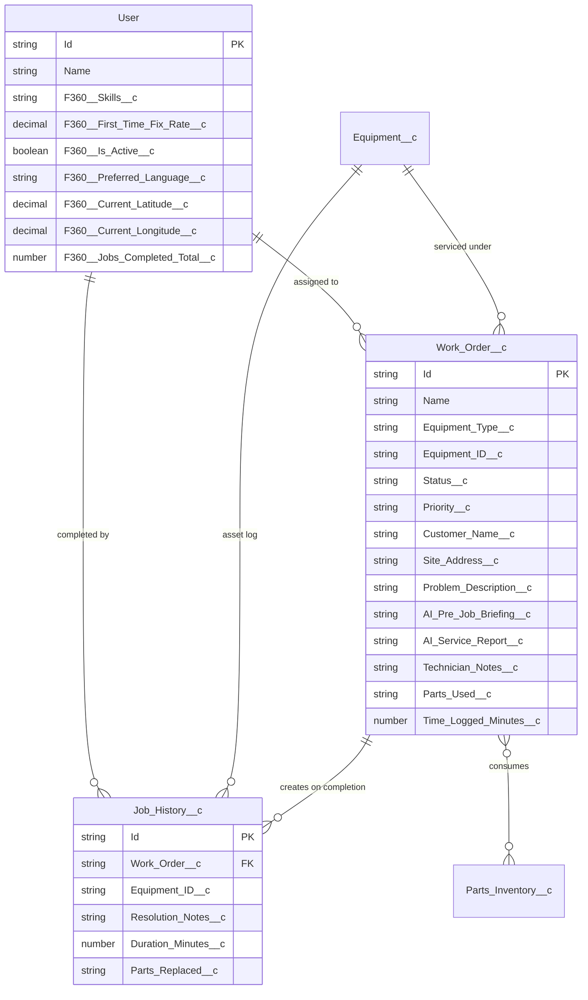

# digiField360 AI: Master Requirements & MCP Server Architecture Specification

> **Document Type**: Master System Architecture, Business Requirements & Technical Implementation Guide  
> **Target Audience**: Solution Architects, Mobile Developers, Salesforce Engineers, DevOps & QA Leads  
> **Platform Version**: Salesforce Lightning Platform | Agentforce | API v66.0 / v67.0  
> **Document Version**: 2.0 (Comprehensive Single-Source-of-Truth)  
> **Date**: August 2026  

---

## 📋 Table of Contents

1. [Executive Summary & Problem Statement](#1-executive-summary--problem-statement)
2. [Exact Business & Technical Requirements](#2-exact-business--technical-requirements)
3. [Architecture Overview & Topology](#3-architecture-overview--topology)
4. [How the Model Context Protocol (MCP) Server Works](#4-how-the-model-context-protocol-mcp-server-works)
5. [Salesforce Data Model & Metadata](#5-salesforce-data-model--metadata)
6. [Apex Invocable Actions & Agentforce AI Agents](#6-apex-invocable-actions--agentforce-ai-agents)
7. [MCP Server & REST API Endpoint Specifications](#7-mcp-server--rest-api-endpoint-specifications)
8. [Offline-First Mobile Architecture & Sync Replay Engine](#8-offline-first-mobile-architecture--sync-replay-engine)
9. [Authentication, Security & Token Lifecycle](#9-authentication-security--token-lifecycle)
10. [Hosting & Deployment Strategies](#10-hosting--deployment-strategies)
11. [Step-by-Step Setup & Verification Guide (From Scratch)](#11-step-by-step-setup--verification-guide-from-scratch)

---

## 1. Executive Summary & Problem Statement

### 1.1 The Business Problem
Field service operations across industrial, HVAC, generator, power, and manufacturing sectors face two fundamental operational hurdles:
1. **Excessive Licensing Overhead**: Traditional Salesforce Field Service (FSL) requires specialized licenses costing **$175/user/month** per field technician, which is cost-prohibitive for large technician fleets.
2. **Connectivity Dead Zones**: Field technicians frequently service equipment in basements, underground vaults, remote industrial plants, and rural zones with zero cellular connectivity. Standard cloud CRM apps fail completely in offline environments.
3. **Inefficient Dispatch & High Callback Rates**: Technicians often arrive on-site without historical context, without recommended replacement parts, or lacking specialized diagnostic manuals for legacy equipment.

### 1.2 The digiField360 Solution
**digiField360 AI** is a field service management platform built natively on standard **Salesforce Lightning Platform (Enterprise Edition)** and **Salesforce Agentforce**, coupled with a lightweight **MCP (Model Context Protocol) Server Gateway** and an **offline-first Mobile Application (React Native / Cross-Platform)**:

- 💰 **Zero FSL License Requirement**: Replaces standard FSL objects (`WorkOrder`, `ServiceAppointment`, `ServiceResource`) with custom objects (`F360__Work_Order__c`, `Technician__c`, `Job_History__c`). Technicians operate on standard **Salesforce Platform User licenses ($25/user/month)**, saving up to **85% in licensing costs**.
- 🔌 **Offline-First Synchronization**: Uses a local SQLite cache and an atomic mutation replay engine (`OfflineMCPGateway.js`) that captures work logs, parts consumed, and status changes offline, automatically syncing with Salesforce once connectivity is restored.
- 🤖 **Agentforce & Generative AI**: Uses Einstein LLM prompt templates and Salesforce Knowledge RAG (Retrieval-Augmented Generation) to deliver:
  - **Automated Pre-Job AI Briefings** before dispatch.
  - **On-Site Multi-Lingual AI Troubleshooting** (English, Hindi, Marathi, Tamil, Telugu).
  - **Automated Post-Job Service Reports & PDF generation**.
  - **Predictive Maintenance & Smart Dispatcher Assignment**.

---

## 2. Exact Business & Technical Requirements

### 2.1 Functional Requirements Checklist

| Module | Requirement Description | Implementation Mechanism |
| :--- | :--- | :--- |
| **FR-01: Shift Start & Morning Cache** | Technicians must download today's assigned jobs, asset history, and troubleshooting guides in < 5 seconds. | `GET /api/sync/morning-payload` via MCP Gateway / Local SQLite |
| **FR-02: Work Order Lifecycle** | Status progression: `New` ➔ `Assigned` ➔ `In Progress` ➔ `Completed` / `Cancelled`. | `F360__Work_Order__c.Status__c` + `sobject_update` |
| **FR-03: Offline Mutation Queue** | Status updates, parts logged, hours, and resolution notes captured offline with guaranteed UUID ordering. | `OfflineMCPGateway.js` ➔ `POST /api/sync/offline-queue` |
| **FR-04: AI Pre-Job Briefing** | AI analyzes equipment history, failure trends, and required tools to prepare the technician before arrival. | `F360_PreJobBriefingAction.cls` / `ai_pre_job_briefing` tool |
| **FR-05: AI Troubleshooting** | Multi-lingual voice/text diagnostic assistant querying Salesforce Knowledge articles. | `F360_TroubleshootingAction.cls` / `POST /api/ai/troubleshoot` |
| **FR-06: Job Completion & AI PDF Report** | Generates customer-facing executive summary, creates `ContentVersion` PDF attachment, and archives to `Job_History__c`. | `F360_ServiceReportAction.cls` / `POST /api/work-orders/:id/complete` |
| **FR-07: Smart Technician Assignment** | Dispatcher scoring algorithm evaluating skill match (40%), proximity (30%), fix rate (20%), and workload (10%). | `F360_SmartAssignmentAction.cls` + LWC Dispatch Board |
| **FR-08: Predictive Maintenance** | Background scheduled jobs flagging high-risk assets and creating proactive work orders. | `F360_PredictiveMaintenanceAction.cls` |
| **FR-09: Live GPS Telemetry** | Mobile app periodically transmits GPS coordinates to update technician proximity in Salesforce. | `POST /api/technician/location` |

---

## 3. Architecture Overview & Topology

```
┌─────────────────────────────────────────────────────────────────────────────────┐
│                          1. MOBILE APPLICATION TIER                             │
│                  (React Native / Flutter / iOS / Android / PWA)                 │
│                                                                                 │
│  ┌───────────────────────┐  ┌──────────────────────┐  ┌──────────────────────┐  │
│  │   UI Screens & Views  │  │ Local SQLite Storage │  │ Mutation Queue (FIFO)│  │
│  │ (Dashboard, WO, AI)   │  │ (Encrypted Cache)    │  │ (UUID, Timestamp)    │  │
│  └───────────┬───────────┘  └──────────┬───────────┘  └──────────┬───────────┘  │
│              │                         │                         │              │
│              └─────────────────────────┼─────────────────────────┘              │
│                                        ▼                                        │
│                         ┌─────────────────────────────┐                         │
│                         │    OfflineMCPGateway.js     │                         │
│                         │ (Network Listener & Replay) │                         │
│                         └──────────────┬──────────────┘                         │
└────────────────────────────────────────┼────────────────────────────────────────┘
                                         │ HTTPS Requests (REST / JSON-RPC 2.0)
                                         ▼
┌─────────────────────────────────────────────────────────────────────────────────┐
│                    2. BACKEND GATEWAY & MCP SERVER TIER                         │
│                       (Node.js / scripts/mcp-server.js)                         │
│                                                                                 │
│    ┌───────────────────────────────────┬───────────────────────────────────┐    │
│    │        REST API ROUTER            │      MCP JSON-RPC 2.0 ROUTER      │    │
│    │  - /api/auth/login                │  - sobject_query                  │    │
│    │  - /api/sync/morning-payload      │  - sobject_update                 │    │
│    │  - /api/sync/offline-queue        │  - sobject_create                 │    │
│    │  - /api/ai/troubleshoot           │  - ai_pre_job_briefing            │    │
│    │  - /api/work-orders/:id/complete  │  - ai_service_report              │    │
│    └─────────────────┬─────────────────┴─────────────────┬─────────────────┘    │
│                      │                                   │                      │
│                      └─────────────────┬─────────────────┘                      │
│                                        ▼                                        │
│                      ┌───────────────────────────────────┐                      │
│                      │  OAuth 2.0 PKCE & Token Relay /   │                      │
│                      │  Mock Data Fallback Controller    │                      │
│                      └─────────────────┬─────────────────┘                      │
└────────────────────────────────────────┼────────────────────────────────────────┘
                                         │ Salesforce REST v66.0 / ConnectApi
                                         ▼
┌─────────────────────────────────────────────────────────────────────────────────┐
│                       3. SALESFORCE CLOUD PLATFORM TIER                         │
│                                                                                 │
│  ┌──────────────────────┐  ┌──────────────────────┐  ┌──────────────────────┐  │
│  │ Custom Data Model    │  │ Apex Invocable Engine│  │ Agentforce & AI      │  │
│  │ - Work_Order__c      │  │ - SmartAssignment    │  │ - Prompt Templates   │  │
│  │ - Technician__c      │  │ - Troubleshooting    │  │ - Einstein LLM       │  │
│  │ - Job_History__c     │  │ - ServiceReport      │  │ - Knowledge Base RAG │  │
│  │ - Parts_Inventory__c │  │ - PreJobBriefing     │  │ - Hosted MCP Server  │  │
│  └──────────────────────┘  └──────────────────────┘  └──────────────────────┘  │
└─────────────────────────────────────────────────────────────────────────────────┘
```

---

## 4. How the Model Context Protocol (MCP) Server Works

### 4.1 What is MCP?
**Model Context Protocol (MCP)** is an open standard created by Anthropic that allows AI agents, LLMs, and client applications to interact with external tools and data sources via structured, standardized protocols (JSON-RPC 2.0 or HTTP REST).

### 4.2 Why digiField360 Uses an MCP Server
1. **Unified Interface**: Both human-facing mobile apps and autonomous Agentforce AI agents consume the exact same tools and endpoints.
2. **Context-Aware AI Invocations**: Agentforce can call `sobject_query` or `ai_pre_job_briefing` using standard tool schemas.
3. **Offline Gateway Abstraction**: Mobile devices speak JSON-RPC / REST to the local MCP gateway, which handles token management, caching, mock simulation, and atomic replay to Salesforce.

### 4.3 Dual-Interface Architecture (`scripts/mcp-server.js`)
The server runs on Node.js and exposes **two complementary interfaces** on port `3000`:
1. **REST Interface (`/api/...`)**: Traditional HTTP endpoints optimized for mobile screens (e.g. `GET /api/user/details`, `POST /api/work-orders/:id/complete`).
2. **MCP JSON-RPC 2.0 Interface (`/mcp`)**: Standard MCP protocol accepting tool executions:
   ```json
   {
     "jsonrpc": "2.0",
     "id": 1,
     "method": "tools/call",
     "params": {
       "name": "sobject_query",
       "arguments": {
         "soql": "SELECT Id, Name, Status__c FROM F360__Work_Order__c"
       }
     }
   }
   ```

### 4.4 Registered MCP Tools Matrix

| MCP Tool Name | Purpose | Key Arguments | Return Value |
| :--- | :--- | :--- | :--- |
| `sobject_query` | Execute SOQL queries against Salesforce objects. | `soql` (string) | Array of Salesforce records |
| `sobject_create` | Insert new records (`Work_Order__c`, `Job_History__c`). | `sobjectName`, `fields` | Record ID (`001...`) |
| `sobject_update` | Update existing record fields. | `sobjectName`, `recordId`, `fields` | `{ success: true, id }` |
| `sobject_describe` | Retrieve field metadata, types, and picklist values. | `sobjectName` | Field schema dictionary |
| `sobject_search` | SOSL search across Knowledge and records. | `searchTerm`, `sobjectName` | Ranked search matches |
| `ai_pre_job_briefing` | Generate AI briefing for an upcoming work order. | `workOrderId`, `language` | Structured briefing text |
| `ai_troubleshoot` | Query AI diagnostic engine with equipment symptoms. | `equipmentType`, `symptoms` | Diagnostic steps + safety rules |
| `ai_service_report` | Generate AI service report summary and PDF metadata. | `workOrderId`, `notes`, `parts` | Final summary + report ID |
| `process_offline_queue` | Atomically replay an array of offline mutations. | `technicianId`, `mutations` | Array of sync outcomes |

### 4.5 Dual Operating Modes: Live Org vs Mock Mode
The MCP server is engineered to support seamless switching between live Salesforce Org execution and Mock Mode:

```
                      Incoming Request
                             │
            ┌────────────────┴────────────────┐
            ▼                                 ▼
   Header `x-mock-mode: true`       Header missing / Live Mode
   or No SF Connection              or SF Credentials Available
            │                                 │
            ▼                                 ▼
   Returns Instant Mock             Executes Live SOQL / REST / ConnectApi
   Fixtures for UI Dev              against Salesforce Org
```

---

## 5. Salesforce Data Model & Metadata

### 5.1 Custom Object Architecture (No FSL Objects)



### 5.2 Mandatory Standard `User` Custom Fields
These 7 fields must exist on the standard `User` object before Apex deployment:
1. `F360__Skills__c` (Long Text Area, 4096 chars): Comma-separated equipment types (`HVAC, Generator, Compressor, Electrical`).
2. `F360__First_Time_Fix_Rate__c` (Percent, 5,1): Historical first-time fix rate (0-100%).
3. `F360__Is_Active__c` (Checkbox, Default: `true`): Availability flag.
4. `F360__Preferred_Language__c` (Picklist): `en` (English), `hi` (Hindi), `mr` (Marathi), `ta` (Tamil), `te` (Telugu).
5. `F360__Current_Latitude__c` (Number, 10,6): Live GPS latitude.
6. `F360__Current_Longitude__c` (Number, 10,6): Live GPS longitude.
7. `F360__Jobs_Completed_Total__c` (Number, 6,0): Cumulative completed jobs counter.

---

## 6. Apex Invocable Actions & Agentforce AI Agents

The backend Apex engine contains 8 invocable classes used by Agentforce, Salesforce Flows, and the MCP Gateway:

| Apex Class Name | Invocable Method | Primary Logic |
| :--- | :--- | :--- |
| `F360_SmartAssignmentAction` | `assignTechnician` | Calculates weighted score: Skills (40 pts) + GPS Distance (30 pts) + Fix Rate (20 pts) + Workload (10 pts). Assigns the highest scoring technician. |
| `F360_PreJobBriefingAction` | `generateBriefing` | Fetches asset job history, executes Einstein LLM prompt template `F360_PreJobBriefing`, saves summary to `AI_Pre_Job_Briefing__c`. |
| `F360_TroubleshootingAction` | `diagnoseIssue` | Searches `Knowledge__kav` articles, queries LLM with technician language preference, returns step-by-step diagnostic guidance. |
| `F360_ServiceReportAction` | `generateReport` | Formats notes, parts, and duration into an executive customer report, creates `ContentVersion` PDF attachment. |
| `F360_PredictiveMaintenanceAction` | `evaluateHealth` | Scans equipment telemetry thresholds, detects impending failures, and creates proactive Work Orders. |
| `F360_BookingAgentAction` | `createWorkOrder` | Conversational booking action allowing customers or dispatchers to log issues via natural language. |
| `F360_NLQueryController` | `executeNLQuery` | Translates natural language questions into SOQL queries for dispatcher dashboards. |
| `F360_DispatchBoardController` | `getDispatchData` | Backs the Lightning Web Component dispatch board with live map coordinates and job queues. |

---

## 7. MCP Server & REST API Endpoint Specifications

### 7.1 Authentication & Profile APIs

#### `POST /api/auth/login`
- **Purpose**: Authenticate technician credentials or mock accounts.
- **Request Body**:
  ```json
  {
    "username": "vikram.sharma@digifield360.com",
    "password": "Password123"
  }
  ```
- **Response (200 OK)**:
  ```json
  {
    "success": true,
    "token": "eyJhbGciOiJIUzI1NiIsInR5cCI6IkpXVCJ9...",
    "tokenType": "Bearer",
    "expiresIn": 7200,
    "instanceUrl": "https://orgfarm-4036b01401-dev-ed.develop.my.salesforce.com",
    "technician": {
      "id": "TECH-001",
      "name": "Vikram Sharma",
      "email": "vikram.sharma@digifield360.com",
      "skills": ["Generator", "HVAC", "Compressor", "Electrical"],
      "firstTimeFixRate": 92.5,
      "isActive": true,
      "preferredLanguage": "en"
    }
  }
  ```

#### `GET /api/user/details`
- **Purpose**: Fetches aggregated profile, work orders, equipment history, and top customer accounts in a single request.
- **Headers**: `Authorization: Bearer <TOKEN>`
- **Response (200 OK)**: Contains `user`, `workOrdersCount`, `workOrders[]`, `equipmentHistory[]`, `accounts[]`.

---

### 7.2 Synchronization & Work Order Lifecycle APIs

#### `GET /api/sync/morning-payload`
- **Purpose**: Pre-load entire shift data into mobile SQLite.
- **Query Params**: `?technicianId=TECH-001`
- **Response (200 OK)**:
  ```json
  {
    "success": true,
    "syncedAt": "2026-08-27T08:00:00Z",
    "technician": { "id": "TECH-001", "name": "Vikram Sharma" },
    "workOrders": [
      {
        "Id": "WO-101",
        "Subject__c": "Main Chiller Low Pressure Alarm",
        "Equipment_Type__c": "HVAC",
        "Status__c": "Assigned",
        "Priority__c": "High",
        "Site_Address__c": "Tower B, Cyber City, Gurugram",
        "AI_Pre_Job_Briefing__c": "ALERT: Chiller #3 has repeated low suction pressure. Check expansion valve."
      }
    ],
    "equipmentHistory": [ ... ],
    "knowledgeBase": [ ... ]
  }
  ```

#### `PATCH /api/work-orders/:id/status`
- **Purpose**: Quick status update (`In Progress`, `On Site`, `On Hold`).
- **Request Body**: `{ "status": "In Progress" }`

#### `POST /api/work-orders/:id/complete`
- **Purpose**: Mark job complete, log parts/hours, trigger AI report and PDF attachment.
- **Request Body**:
  ```json
  {
    "technicianNotes": "Replaced faulty capacitor and calibrated motor speed.",
    "partsUsed": ["Capacitor 45MFD (1x)", "Insulation Foam (2m)"],
    "timeLoggedMinutes": 90,
    "completedDate": "2026-08-27T11:30:00Z",
    "photos": [
      { "fileName": "repaired_motor.jpg", "base64": "/9j/4AAQSkZJRg..." }
    ]
  }
  ```
- **Response (200 OK)**:
  ```json
  {
    "success": true,
    "workOrderId": "WO-101",
    "status": "Completed",
    "serviceReport": "digiField360 AI Service Summary: Successfully replaced 45MFD capacitor...",
    "jobHistoryId": "JH-501",
    "contentVersionId": "068000000001XYZ"
  }
  ```

---

### 7.3 AI Invocations & Troubleshooting APIs

#### `POST /api/ai/troubleshoot`
- **Purpose**: Real-time diagnostic assistant with multi-lingual support.
- **Request Body**:
  ```json
  {
    "equipmentType": "Generator",
    "symptoms": "Generator starts but stalls after 30 seconds with black smoke",
    "preferredLanguage": "en"
  }
  ```
- **Response (200 OK)**:
  ```json
  {
    "success": true,
    "equipmentType": "Generator",
    "diagnosis": "Fuel starvation or severe air filter blockage causing rich combustion stall.",
    "recommendedSteps": [
      "1. Inspect primary air intake and filter cartridge for blockages.",
      "2. Check fuel return valve pressure and fuel filter contamination.",
      "3. Verify governor actuator linkage moves freely without binding."
    ],
    "requiredParts": ["Fuel Filter Element 5-Micron", "Air Filter Primary"],
    "safetyWarning": "Ensure battery isolator is switched OFF before disconnecting fuel lines."
  }
  ```

---

## 8. Offline-First Mobile Architecture & Sync Replay Engine

### 8.1 Offline Data Flow Diagram

```
Technician Performs Actions Offline (Basement / No Signal)
  │
  ├─► Status Changed to "In Progress"  ──► Stored in Local SQLite (Mutation Queue)
  ├─► Parts Logged ("Capacitor 45MFD") ──► Assigned UUID: "UUID-1001"
  └─► Job Marked "Completed"           ──► Assigned UUID: "UUID-1002"
                                              │
                      ┌───────────────────────┘
                      ▼
Connectivity Restored (Cellular / Wi-Fi Active)
  │
  ▼
`OfflineMCPGateway.js` triggers `process_offline_queue`
  │
  ▼
POST /api/sync/offline-queue (Payload containing ordered mutations)
  │
  ▼
MCP Server executes sequential DML updates in Salesforce
  │
  ├─► Resolves WO-101 status and logs parts
  ├─► Archives to Job_History__c
  └─► Generates AI Service Report
  │
  ▼
Returns Sync Confirmation & Updates Local `Last_Synced__c` timestamp
```

### 8.2 Atomic Mutation Payload Schema

```json
{
  "technicianId": "TECH-001",
  "deviceTimestamp": "2026-08-27T12:00:00Z",
  "mutations": [
    {
      "queueId": "UUID-1001",
      "action": "update_status",
      "sobjectName": "Work_Order__c",
      "recordId": "WO-101",
      "fields": { "Status__c": "In Progress" },
      "queuedAt": "2026-08-27T09:15:00Z"
    },
    {
      "queueId": "UUID-1002",
      "action": "complete_job",
      "sobjectName": "Work_Order__c",
      "recordId": "WO-101",
      "fields": {
        "Status__c": "Completed",
        "Technician_Notes__c": "Replaced faulty capacitor",
        "Parts_Used__c": "Capacitor 45MFD (1x)",
        "Time_Logged_Minutes__c": 90
      },
      "queuedAt": "2026-08-27T10:45:00Z"
    }
  ]
}
```

---

## 9. Authentication, Security & Token Lifecycle

### 9.1 Authentication Modes
1. **OAuth 2.0 PKCE Flow (Production Native)**:
   - External Client App: `digiField360_Mobile`
   - Callback URL: `field360://callback`
   - Scopes: `api`, `refresh_token`, `offline_access`
   - Secure token storage in OS Keychain (iOS) / KeyStore (Android).
2. **JWT Bearer Token Relay (Server Gateway)**:
   - Server signs lightweight JWT tokens with `HS256`.
   - Embeds technician ID, name, skills, and instance URL.
   - Automatically refreshed on `401 Unauthorized`.
3. **Salesforce CLI Local Fallback**:
   - For local development, `mcp-server.js` automatically obtains live access tokens using `sf org auth show-access-token`.

---

## 10. Hosting & Deployment Strategies

| Option | Environment | Host Platform | Monthly Cost | Setup Complexity | Best For |
| :--- | :--- | :--- | :--- | :--- | :--- |
| **Option 1** | Local Development | Local PC + `ngrok` | **$0** | 1 minute | UI Development & Emulator Testing |
| **Option 2** | 24/7 Cloud Staging | **Render.com / Railway** | **$0** (Free Tier) | 5 minutes | Team QA, Mobile App Integration & Client Demos |
| **Option 3** | Production Enterprise | **Salesforce Hosted MCP** | Included in SF Org | 15 minutes | Zero-Backend Production Fleet Deployment |

### Deploying to Render.com (Option 2)
The repository includes a ready-to-use [`render.yaml`](file:///c:/digiField%20360/digiFields_360/render.yaml):
1. Connect GitHub repo `kakarot4629-netizen/digiFields_360` to [Render.com](https://render.com).
2. Set Build Command: `npm install`
3. Set Start Command: `node scripts/mcp-server.js`
4. Server URL is instantly live at: `https://digifields-360.onrender.com`

---

## 11. Step-by-Step Setup & Verification Guide (From Scratch)

### Step 1: Clone Repository & Install Dependencies
```powershell
git clone https://github.com/kakarot4629-netizen/digiFields_360.git
cd digiFields_360
npm install
```

### Step 2: Start the MCP Server Locally
```powershell
node scripts/mcp-server.js
```
*Output:*
```
==================================================================
  digiField360 Mobile API & MCP Server running on port 3000
  REST Base URL: http://localhost:3000
  MCP JSON-RPC:  http://localhost:3000/mcp
  Mock Mode:     Pass 'x-mock-mode: true' or '?mock=true'
==================================================================
```

### Step 3: Run Automated API Verification Suite
```powershell
node scripts/test-mobile-apis.js
```
*Runs all 16 integration tests verifying health, auth, work orders, AI troubleshooting, offline sync, and MCP tool protocols.*

### Step 4: Import Postman Collection
1. Open **Postman**.
2. Click **Import** ➔ select [`mobile-developer-package/digiField360_Mobile_APIs.postman_collection.json`](file:///c:/digiField%20360/digiFields_360/mobile-developer-package/digiField360_Mobile_APIs.postman_collection.json).
3. Select environment [`mobile-developer-package/digiField360_Local_Live.postman_environment.json`](file:///c:/digiField%20360/digiFields_360/mobile-developer-package/digiField360_Local_Live.postman_environment.json).
4. Run folder `1. Authentication & Profile` ➔ `1.1 Health Check`.

---

## 🏁 Summary Checklist

- [x] **No FSL Licenses Needed**: Architecture validated with custom `F360__` objects and Platform licenses.
- [x] **MCP Server Operational**: Dual REST and JSON-RPC 2.0 interface implemented in `scripts/mcp-server.js`.
- [x] **Offline-First Ready**: `OfflineMCPGateway.js` handles queuing, SQLite caching, and atomic batch sync.
- [x] **AI Agentforce Integrated**: Pre-job briefings, troubleshooting, and service reports powered by Einstein LLM.
- [x] **Postman & Mock Support**: Full developer package with 20+ tested endpoints ready for mobile team handover.
