# digiField360 — End-to-End Implementation Documentation
## Case Creation, Work Order Lifecycle, Technician Assignment & Mobile Service Execution

> **Document Type**: Master End-to-End Implementation & Functional Specification Document (FSD)  
> **Target Audience**: Solution Architects, Salesforce Developers, Mobile Engineers (React Native / Flutter), Business Analysts, Project Managers, and Executive Stakeholders  
> **Platform Stack**: Salesforce Enterprise Edition (API v61.0 / v66.0 / v67.0) | Agentforce AI | Node.js MCP Gateway Server | Offline-First Cross-Platform Mobile Client  
> **Repository Root**: `c:\digiField 360\digiFields_360`  
> **Status**: Verified Implementation Reference (v2.0 Enterprise)

---

## 1. Document Overview and Purpose

### 1.1 Purpose
This document provides a single, authoritative reference explaining the complete end-to-end lifecycle of a field service interaction within **digiField360**—from customer Case creation and intelligent technician assignment to on-site mobile app execution and final job closure.

The goal is to provide **both technical and non-technical stakeholders** with a clear understanding of:
- How business processes execute across systems.
- How the Salesforce platform and the Mobile Application communicate via the integration gateway.
- Which specific standard and custom Salesforce objects, fields, and relationships store operational data.
- Which APIs and payloads are exchanged at each lifecycle step.
- How business rules, validation logic, geofencing, SLA tracking, and offline sync operate under real-world conditions.

### 1.2 System Context & Strategic Design Principle
Legacy field service solutions typically require **Salesforce Field Service (FSL)** licenses costing **$175/user/month** or depend on fragmented third-party dispatch tools. **digiField360** is built directly on standard **Salesforce Lightning Enterprise Edition (using standard $25/user/month Platform licenses)** combined with **Agentforce AI** and an **Offline-First Node.js MCP (Model Context Protocol) API Gateway**. This architecture delivers:
1. **85% reduction in licensing overhead** for large field technician fleets.
2. **Autonomous 60-second dispatch** using heuristic AI scoring.
3. **Guaranteed offline execution** in zero-connectivity environments (basements, remote industrial facilities) with transactional replay synchronization.
4. **Zero-app customer engagement** through automated Meta WhatsApp Business milestone notifications.

---

## 2. Business Process Overview

### 2.1 The Field Service Lifecycle at a Glance
The digiField360 workflow follows five chronological operational phases:

#### Visual Process Flow Diagram:
```text
┌─────────────────────────┐       ┌─────────────────────────┐       ┌─────────────────────────┐
│        PHASE 1:         │       │        PHASE 2:         │       │        PHASE 3:         │
│  Case Creation & Intake ├──────►│  Work Order & Dispatch  ├──────►│   Mobile Sync & Travel  │
│                         │       │                         │       │                         │
│ • WhatsApp / Phone / Web│       │ • Warranty & SLA Match  │       │ • Morning SQLite Sync   │
│ • Validate Customer Site│       │ • Agentforce AI Scoring │       │ • Geofenced Attendance  │
│ • Initial Case Created  │       │ • 60s Tech Assignment   │       │ • WhatsApp En-Route ETA │
└─────────────────────────┘       └─────────────────────────┘       └────────────┬────────────┘
                                                                                 │
                                  ┌─────────────────────────┐       ┌────────────▼────────────┐
                                  │        PHASE 5:         │       │        PHASE 4:         │
                                  │   Closure & CSAT Loop   │◄──────┤   On-Site Execution     │
                                  │                         │       │                         │
                                  │ • Digital Signature URL │       │ • Geofence Check-In     │
                                  │ • ContentVersion Upload │       │ • PPE & Safety Check    │
                                  │ • WhatsApp 1-5 Star CSAT│       │ • Dynamic Checklist     │
                                  │ • Nightly Metric Rollup │       │ • Parts / GuruAI Help   │
                                  └─────────────────────────┘       └─────────────────────────┘
```

#### Architecture Flowchart (Mermaid):
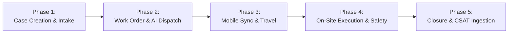

1. **Intake & Qualification**: A customer breakdown is reported (via WhatsApp, Call Center, Web Portal, or IoT Telemetry). A Salesforce `Case` and corresponding `Work_Order__c` / `Service_Job__c` are created, validating customer warranty and SLA tier.
2. **Autonomous / Assisted Dispatch**: The dispatch engine (`F360_SmartAssignmentAction` / `DF360_DispatchController`) scores all eligible technicians based on skill certifications, geographic proximity, current active workload, and First-Time Fix Rate (FTFR). The optimal technician is assigned within 60 seconds.
3. **Mobile Shift Ingestion & Journey**: The technician starts their shift, logs geofenced attendance, and synchronizes today's jobs to the local SQLite database. When the technician marks `En Route`, the customer receives an automated WhatsApp notification with an arrival ETA.
4. **On-Site Service Execution**: The technician arrives at the site, passes a mandatory GPS geofence check-in, clears an OSHA-compliant pre-job safety risk inspection, completes diagnostic checklists, requests or replaces spare parts, and consults **GuruAI** for real-time troubleshooting assistance.
5. **Customer Sign-Off & Automated Closure**: The technician captures a digital customer signature and proof-of-work photos, logs labor hours, and marks the job completed. The gateway pushes data to Salesforce, updates parent records, and triggers an automated 1–5 star WhatsApp CSAT survey to the customer 15 minutes later.

### 2.2 System Actors and Responsibilities

| Actor / Persona | Primary Interface | Core Responsibilities |
| :--- | :--- | :--- |
| **Customer (B2B / B2C)** | WhatsApp Messaging / Phone | Reports issues, receives automated milestone updates (booking confirmation, technician en route, arrival), signs digital completion sign-off, and rates service via WhatsApp. |
| **Call Center / Support Agent** | Salesforce Service Console | Receives inbound calls/emails, creates initial `Case` records, verifies customer account details, and escalates to field service. |
| **Service Coordinator / Dispatcher** | Salesforce Dispatch Board LWC (`df360DispatchBoard`) | Monitors real-time technician fleet on GPS maps, reviews AI technician assignment recommendations, and overrides assignments when necessary. |
| **Field Service Technician** | digiField360 Mobile App (Offline-First) | Receives daily job roster, logs GPS shift attendance, navigates to customer sites, executes safety checklists, performs equipment repairs, consumes parts, and captures signatures. |
| **Depot / Inventory Manager** | Parts Inventory LWC (`df360PartsInventory`) | Manages warehouse stock levels, fulfills parts requisitions, tracks reorder points, and inspects returned defective parts. |
| **Agentforce AI Agents** | Autonomous System Processors | Executes dispatch scoring (`DF360-001`), monitors SLA clocks (`DF360-002`), expedites spare parts (`DF360-003`), summarizes manager analytics (`DF360-004`), and generates pre-job briefings. |

---

## 3. System Architecture Diagram

### 3.1 Overall System Architecture

#### Visual End-to-End System Diagram:
```text
┌────────────────────────────────────────────────────────────────────────────────────────┐
│                               1. MOBILE CLIENT TIER                                    │
│                    (Flutter / React Native - 24 Standard Screens)                      │
│                                                                                        │
│   ┌─────────────────────┐    ┌───────────────────────────┐    ┌────────────────────┐   │
│   │  UI Screens & Views │    │   Local SQLite Database   │    │ FIFO Mutation Queue│   │
│   │  (Jobs, Parts, GPS) │◄──►│  (Offline Cache Engine)   │    │  (Replay on Sync)  │   │
│   └──────────┬──────────┘    └─────────────┬─────────────┘    └─────────┬──────────┘   │
│              └─────────────────────────────┼────────────────────────────┘              │
│                                            ▼                                           │
│                              ┌───────────────────────────┐                             │
│                              │   OfflineMCPGateway.js    │                             │
│                              └─────────────┬─────────────┘                             │
└────────────────────────────────────────────┼───────────────────────────────────────────┘
                                             │ HTTPS REST / JSON-RPC 2.0 (Bearer JWT)
                                             ▼
┌────────────────────────────────────────────────────────────────────────────────────────┐
│                           2. BACKEND & GATEWAY INTEGRATION TIER                        │
│                     (Node.js MCP Gateway Server - scripts/mcp-server.js)               │
│                                                                                        │
│   ┌──────────────────────────┐  ┌──────────────────────────┐  ┌────────────────────┐   │
│   │  OAuth2 PKCE / JWT Auth  │  │ 15-Module RESTful Router │  │ JSON-RPC MCP Tools │   │
│   │  (Bearer Token Relay)    │  │ (/api/work-orders, sync) │  │ (sobject_query, etc│   │
│   └─────────────┬────────────┘  └─────────────┬────────────┘  └─────────┬──────────┘   │
└─────────────────┼─────────────────────────────┼─────────────────────────┼──────────────┘
                  │                             │                         │
                  ├─────────────────────────────┼─────────────────────────┘
                  │ HTTPS REST / OAuth v66.0    │ Outbound Webhooks / Messaging
                  ▼                             ▼
┌─────────────────────────────────────────┐  ┌──────────────────────────────────────────┐
│      3. EXTERNAL CLOUD CHANNELS         │  │ 4. SALESFORCE ENTERPRISE LIGHTNING PLATFORM│
│                                         │  │                                          │
│ • Meta WhatsApp Cloud API               │  │ • Standard REST API & Custom Apex REST    │
│   (Milestone messaging & CSAT surveys)  │  │ • 26 Custom SObjects + 3 Platform Events  │
│ • Google Maps Distance Matrix API       │  │ • Agentforce AI Suite (5 Autonomous Agents│
│   (Proximity scoring & travel ETAs)     │  │ • 14 Apex Controllers + 4 Triggers       │
│ • Firebase Cloud Messaging (FCM)        │  │ • 12 Desktop Lightning Web Components     │
│   (Instant mobile assignment push alerts│  │ • 8 Declarative Business Process Flows    │
└─────────────────────────────────────────┘  └──────────────────────────────────────────┘
```

#### Architecture Diagram (Mermaid):
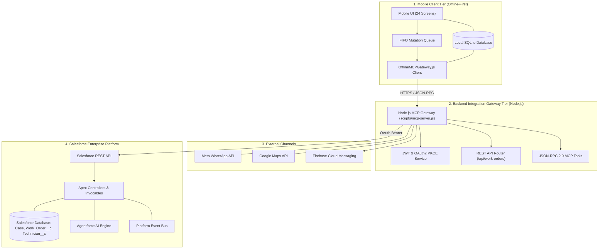

---

## 4. Salesforce Architecture & Internal Processing

Inside the Salesforce Lightning Platform, automation operates across declarative flows, Apex controllers, asynchronous batch jobs, and the Platform Event Bus:

#### Visual Processing Flowchart:
```text
┌──────────────────┐
│ Case Created     │
└────────┬─────────┘
         │
         ▼
┌──────────────────┐      Match SLA Config
│ Work_Order__c /  ├────────────────────────────► SLA_Deadline__c Calculated
│ Service_Job__c   │
└────────┬─────────┘
         │
         ▼
┌──────────────────────────────────────────────┐
│ F360_SmartAssignmentAction (Invocable Apex)   │
│ Heuristic Ranking: Skill (40%) + Dist (30%)  │
│                    + FTFR (20%) + Load (10%) │
└────────┬─────────────────────────────────────┘
         │
         ▼
┌──────────────────┐      Publishes Event
│ Status='Assigned'├────────────────────────────► DF360_Job_Assigned__e (Fires Push)
└────────┬─────────┘
         │
         ▼
┌──────────────────────────────────────────────┐
│ F360_WO_Assigned_Generate_Briefing (Flow)    │
│ Invokes Agentforce GenAI Prompt Template     ├► AI_Pre_Job_Briefing__c Saved
└──────────────────────────────────────────────┘
```

#### Salesforce Architecture Diagram (Mermaid):
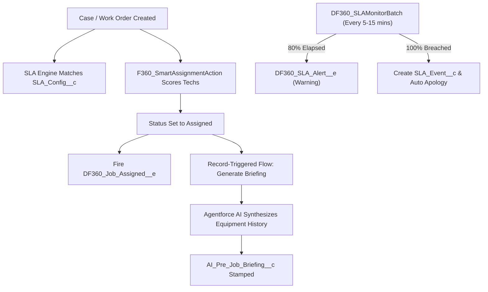

---

## 5. Mobile Application Architecture & Synchronization

The digiField360 mobile app is engineered for **offline-first reliability**, ensuring field technicians can complete tasks regardless of network coverage.

#### Visual Mobile Architecture:
```text
┌────────────────────────────────────────────────────────────────────────┐
│                        MOBILE APPLICATION CONTAINER                    │
├────────────────────────────────────────────────────────────────────────┤
│ 1. Morning Sync: Pre-loads today's jobs, asset history, parts catalog  │
│ 2. Local Database: SQLite stores all schemas, records & cached guides  │
│ 3. Offline Mutation Queue: Captures edits (status, hours, photos)      │
│    with UUID, timestamp, and replay order                              │
│ 4. Replay Worker: Upon 4G/WiFi reconnect, replays queue via            │
│    OfflineMCPGateway.js -> MCP Server -> Salesforce REST APIs          │
└────────────────────────────────────────────────────────────────────────┘
```

#### Mobile Offline Engine Diagram (Mermaid):
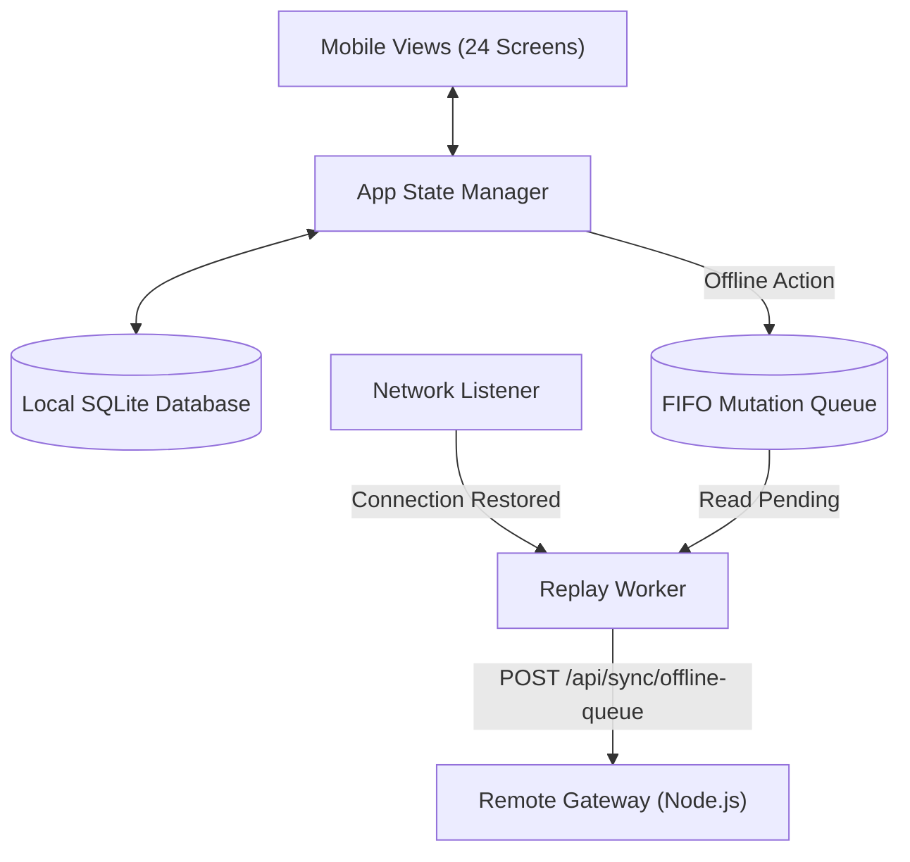

### 5.1 The 4-Stage Offline Synchronization Protocol
1. **Morning Pre-Load (Shift Start)**: While connected to cellular or office Wi-Fi, the app calls `GET /api/sync/morning-payload`. It downloads the technician profile, assigned work orders, customer site addresses, asset specifications, safety checklists, and recent repair histories into local SQLite.
2. **Local Write & Instant UI Reflection**: When offline, any technician action (updating status to `On Site`, logging parts, or capturing signatures) writes directly to the local SQLite tables for immediate UI feedback.
3. **FIFO Mutation Logging**: The mutation is assigned a unique client UUID and appended to the `queue_transactions` SQLite table with a timestamp, action type (`update_status`, `log_activity`, `submit_safety`, `complete_job`), and JSON payload.
4. **Automatic Replay on Reconnection**: A network listener monitors connectivity. When signal returns, `OfflineMCPGateway.js` reads all pending mutations in chronological order and posts them to `POST /api/sync/offline-queue`. The gateway updates Salesforce in sequence and returns transaction confirmation timestamps.

---

## 6. Salesforce Object Structure and Comprehensive Data Model

### 6.1 Complete Object Portfolio & Architecture Overview
In standard Salesforce Field Service (FSL), organizations are forced to license costly FSL objects (`WorkOrder`, `ServiceAppointment`, `ServiceResource`, `AssignedResource`).

In **digiField360**, the entire solution operates natively on standard **Salesforce Lightning Enterprise Platform Licenses ($25/user/month)** using:
1. **Core Standard CRM Objects with Custom Schema Extensions**: `User`, `Case`, `Account`, `Contact`, `ContentVersion`.
2. **Workforce, Skills & Territory Management**: `Technician__c`, `Skill__c`, `Technician_Skill__c`, `Service_Zone__c`, `Attendance__c`, `GPS_Log__c`.
3. **Asset & Equipment Registry**: `Asset__c`, `Equipment__c`.
4. **Contract & SLA Governance**: `Service_Contract__c`, `SLA_Config__c`, `SLA_Event__c`.
5. **Work Order Execution & Scheduling**: `Work_Order__c`, `Service_Job__c`, `Job_Schedule__c`, `Job_Activity__c`, `Job_History__c`, `Work_Order_Pause_Log__c`.
6. **Multi-Depot Supply Chain & Van Stock**: `Depot__c`, `Part__c`, `Parts_Stock__c`, `Parts_Request__c`, `Parts_Inventory__c`.
7. **Agentforce Predictive AI & Customer Experience**: `Maintenance_Alert__c`, `Maintenance_Recommendation__c`, `CSAT__c`, `WhatsApp_Message__c`.
8. **Real-Time Streaming Event Bus**: `DF360_Job_Assigned__e`, `DF360_Parts_Approved__e`, `DF360_SLA_Alert__e`.

---

### 6.2 Master Object Inventory Table (All 34 Objects)

| # | Object Name | API Name | Type | Purpose in Solution |
| :--- | :--- | :--- | :--- | :--- |
| **1** | **User** | `User` | Standard (Custom Fields) | Salesforce login user holding technician GPS, language, and skill flags. |
| **2** | **Case** | `Case` | Standard Core | Customer breakdown intake ticket from Phone, Web, Portal, or WhatsApp. |
| **3** | **Account** | `Account` | Standard Core | Customer commercial organization, site location, and billing details. |
| **4** | **Contact** | `Contact` | Standard Core | Customer on-site facility contact person and phone number. |
| **5** | **ContentVersion** | `ContentVersion` | Standard Content | Storage of customer digital signatures and proof-of-work photos. |
| **6** | **Technician** | `Technician__c` | Custom Master | Master technician profile linked 1:1 to User; tracks active jobs, CSAT & FTFR. |
| **7** | **Skill** | `Skill__c` | Custom Config | Master catalogue of certified skills (e.g., 5G Fiber Splicing, HVAC Repair). |
| **8** | **Technician Skill** | `Technician_Skill__c` | Junction (M-D) | Maps technician capabilities, proficiency levels, and certification expiry. |
| **9** | **Service Zone** | `Service_Zone__c` | Custom Territory | Service territory boundaries, postal pin codes, and zone manager assignments. |
| **10** | **Attendance** | `Attendance__c` | Custom Workforce | Daily shift check-in/out records with geofenced GPS verification. |
| **11** | **GPS Log** | `GPS_Log__c` | Custom Telemetry | 5-minute periodic technician GPS snapshots (retained for 365 days). |
| **12** | **Asset** | `Asset__c` | Custom Master | Master customer machine registry, serial numbers, warranty, and install date. |
| **13** | **Equipment** | `Equipment__c` | Custom Equipment | Physical machinery specifications, operational status, and geolocation. |
| **14** | **Service Contract** | `Service_Contract__c` | Custom Contract | Warranty and AMC service agreements governing customer SLA obligations. |
| **15** | **SLA Config** | `SLA_Config__c` | Custom Matrix | SLA tier matrix defining acknowledgment, response, and resolution limits. |
| **16** | **SLA Event** | `SLA_Event__c` | Custom Audit Log | Immutable milestone audit trail for SLA forensics and compliance reporting. |
| **17** | **Work Order** | `Work_Order__c` | Custom Master | Primary operational work order for mobile app execution and Agentforce AI. |
| **18** | **Service Job** | `Service_Job__c` | Custom Master | Enterprise dispatch job ticket for Kanban boards and automated SLA monitoring. |
| **19** | **Job Schedule** | `Job_Schedule__c` | Custom Scheduling | Scheduled appointment time slots linking technician to a work order. |
| **20** | **Job Activity** | `Job_Activity__c` | Master-Detail | Chronological tasks, labor hours, parts consumed, and activity photos. |
| **21** | **Job History** | `Job_History__c` | Custom Knowledge | Historical repair archives used by Agentforce RAG for diagnostic guidance. |
| **22** | **Pause Log** | `Work_Order_Pause_Log__c` | Custom Audit Log | Tracks work order pause durations, reason codes, and team ownership. |
| **23** | **Depot** | `Depot__c` | Custom Warehouse | Regional warehouse facility storing physical spare parts. |
| **24** | **Part** | `Part__c` | Custom Catalogue | Master catalogue of replacement parts, SKUs, costs, and compatibility. |
| **25** | **Parts Stock** | `Parts_Stock__c` | Junction (M-D) | Live ledger of on-hand and reserved parts per depot warehouse. |
| **26** | **Parts Request** | `Parts_Request__c` | Custom Requisition | Field parts requisitions with automated and supervisory approval thresholds. |
| **27** | **Parts Inventory** | `Parts_Inventory__c` | Custom Van Stock | Mobile truck/van inventory assigned directly to an individual technician. |
| **28** | **Maintenance Alert** | `Maintenance_Alert__c` | Custom AI Telemetry | AI predictive maintenance alerts generated from equipment performance patterns. |
| **29** | **Recommendation** | `Maintenance_Recommendation__c` | Custom AI Advisory | AI-recommended preventive service actions and scheduling advice. |
| **30** | **CSAT** | `CSAT__c` | Custom Survey | Customer satisfaction feedback (1–5 stars) captured via WhatsApp. |
| **31** | **WhatsApp Message** | `WhatsApp_Message__c` | Custom Comms Log | Outbound and inbound WhatsApp message ledger with delivery statuses. |
| **32** | **Job Assigned Event**| `DF360_Job_Assigned__e`| Platform Event | Real-time push alert broadcasting new job assignments to mobile devices. |
| **33** | **Parts Approved** | `DF360_Parts_Approved__e`| Platform Event | Broadcasts notification to technician when requested parts are ready. |
| **34** | **SLA Alert Event** | `DF360_SLA_Alert__e` | Platform Event | Streaming amber/red SLA breach warnings to supervisor command centers. |

---

### 6.3 Simplified Object Architecture & Modular ERDs

To make the system architecture easy to understand for both technical and non-technical readers, the object structure is organized into **one simple 30-second Core Backbone diagram** followed by **four focused functional modules**.

---

#### 1. The Core 30-Second Backbone (The Essential Service Journey)
Every service call in digiField360 connects six basic concepts:

```text
┌─────────────────┐       ┌─────────────────┐       ┌─────────────────┐
│ 1. WHO is it?   │       │ 2. WHAT broke?  │       │ 3. THE TICKET   │
│    Account      ├──────►│    Asset__c     ├──────►│  Work_Order__c  │
│   (Customer)    │       │ (The Machine)   │       │   (The Job)     │
└─────────────────┘       └─────────────────┘       └────────┬────────┘
                                                             │
                                                             ▼
┌─────────────────┐       ┌─────────────────┐       ┌─────────────────┐
│ 6. HOW was it?  │       │ 5. WHAT was done│       │ 4. WHO fixes it?│
│     CSAT__c     │◄──────┤ Job_Activity__c │◄──────┤  Technician__c  │
│ (1-5 Star Rate) │       │ (Labor & Parts) │       │  (The Engineer) │
└─────────────────┘       └─────────────────┘       └─────────────────┘
```

#### Core Backbone Flowchart (Mermaid):
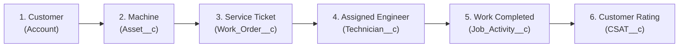

---

#### Module A: Workforce, Skills & Attendance
*How field engineers are authenticated, mapped to skills, tracked by GPS, and rostered.*

```text
               ┌───────────────────────┐
               │         User          │ (Standard Salesforce Login)
               │ (Latitude, Skills, Lang)
               └───────────┬───────────┘
                           │ 1:1 Link
                           ▼
               ┌───────────────────────┐
               │     Technician__c     │ (Master Profile: CSAT, FTFR, Active Jobs)
               └─────┬─────┬─────┬─────┘
                     │     │     │
         ┌───────────┘     │     └───────────┐
         ▼                 ▼                 ▼
┌──────────────────┐┌──────────────┐┌──────────────────┐
│  Attendance__c   ││  GPS_Log__c  ││Technician_Skill__│
│ (Shift Punch-In) ││ (5-min Trail)││        c         │
└──────────────────┘└──────────────┘└────────┬─────────┘
                                             │ Maps Certs
                                             ▼
                                    ┌──────────────────┐
                                    │     Skill__c     │
                                    │(Master Catalogue)│
                                    └──────────────────┘
```

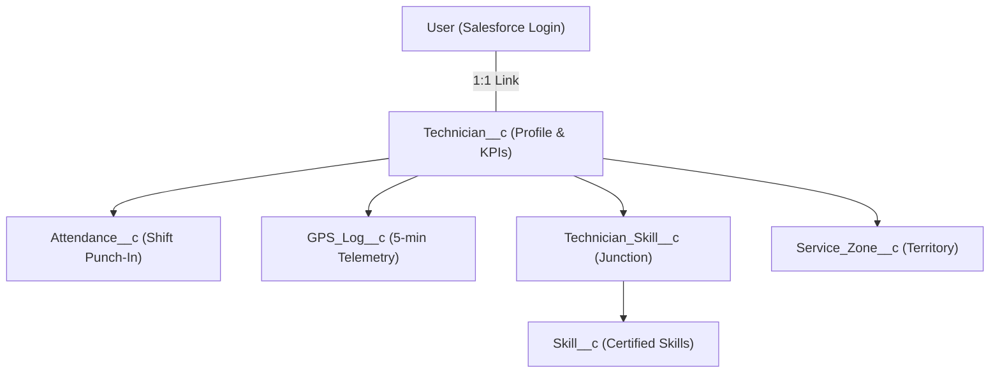

---

#### Module B: Customer, Machine & Warranty
*How customer accounts link to installed machines, equipment specifications, and warranty contracts.*

```text
┌───────────────────────┐
│        Account        │ (Customer Organization)
└───┬───────────────┬───┘
    │               │
    ▼               ▼
┌──────────────┐┌───────────────────────┐
│   Contact    ││       Asset__c        │ (Customer Installed Machine)
│(Site Contact)││(Serial #, Warranty)   │
└──────────────┘└───┬───────────────┬───┘
                    │               │
                    ▼               ▼
        ┌──────────────────┐┌───────────────────────┐
        │   Equipment__c   ││  Service_Contract__c  │
        │(Model, GPS Specs)││(AMC Terms & Visit Cap)│
        └──────────────────┘└───────────────────────┘
```

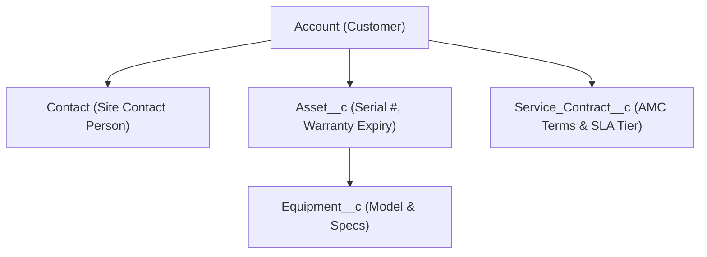

---

#### Module C: Work Orders, Scheduling & Execution
*How incoming tickets turn into scheduled jobs, work activities, and pause logs.*

```text
┌───────────────────────┐
│         Case          │ (Customer Intake Issue)
└───────────┬───────────┘
            │ Spawns
            ▼
┌───────────────────────┐         SLA Governance
│     Work_Order__c     │◄─────────────────────────────┐
│ (Mobile Ticket & AI)  │                              │
└─────┬───────────┬─────┘                              │
      │           │                             ┌──────────────┐
      │           ▼                             │ SLA_Config__c│
      │   ┌──────────────┐                      └──────┬───────┘
      │   │Job_Schedule__│ (Appointment Slots)         │
      │   │      c       │                             ▼
      │   └──────────────┘                      ┌──────────────┐
      ▼                                         │ SLA_Event__c │
┌────────────────────────┐                      │ (Audit Log)  │
│     Service_Job__c     ├─────────────────────►└──────────────┘
│(Desktop Dispatch & SLA)│
└─────┬───────────┬──────┘
      │           │
      ▼           ▼
┌──────────────┐┌────────────────────────┐
│Job_Activity__││Work_Order_Pause_Log__c │
│      c       ││ (Clock Paused for Part)│
└──────────────┘└────────────────────────┘
```

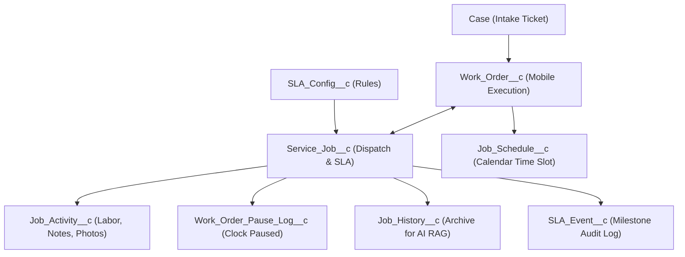

---

#### Module D: Spare Parts, Depots & Technician Van Stock
*How warehouse inventory is tracked, requested from the field, and stocked in technician trucks.*

```text
┌───────────────────────┐                   ┌───────────────────────┐
│       Depot__c        │                   │        Part__c        │
│ (Regional Warehouse)  │                   │(Master Catalogue SKU) │
└───────────┬───────────┘                   └───────────┬───────────┘
            │                                           │
            └─────────────────────┬─────────────────────┘
                                  ▼
                    ┌───────────────────────────┐
                    │      Parts_Stock__c       │
                    │(Warehouse Inventory Level)│
                    └─────────────┬─────────────┘
                                  │ Requisitioned
                                  ▼
                    ┌───────────────────────────┐
                    │     Parts_Request__c      │ (Field Request > ₹5,000)
                    └─────────────┬─────────────┘
                                  │ Stocked in Van
                                  ▼
                    ┌───────────────────────────┐
                    │    Parts_Inventory__c     │ (Technician Truck Stock)
                    └───────────────────────────┘
```

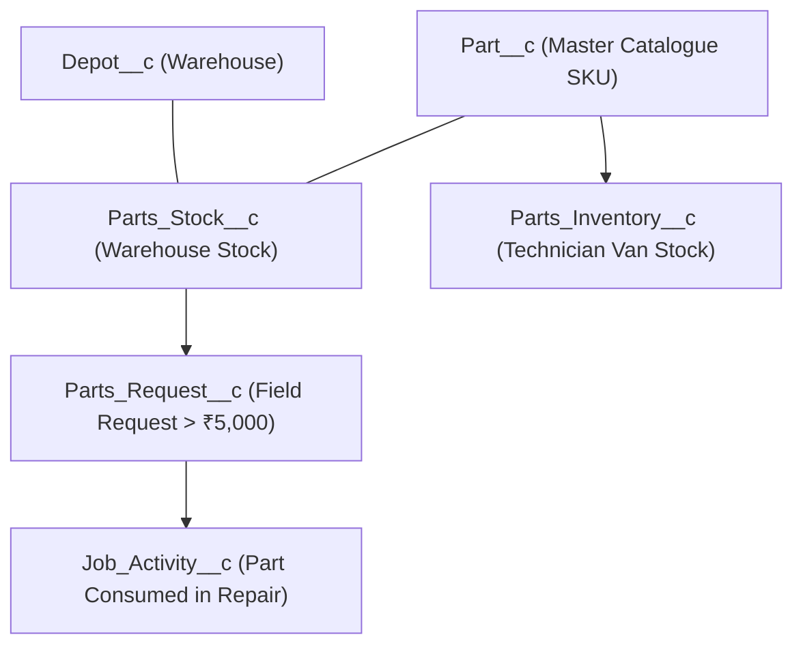

---

### 6.4 Comprehensive Schema Dictionary (All Objects & Fields)

#### 1. `User` (Standard Salesforce User Object with Custom Schema)
- **API Name**: `User`
- **Purpose**: Authenticated user record in Salesforce. For field engineers, the User object stores operational identity, live mobile telemetry, and skill profiles queried by Agentforce and MCP APIs.
- **Custom Fields Configured**:
  - `Skills__c` (Text 255): Semicolon-separated skills list (e.g., `Generator;HVAC;Compressor;Electrical`).
  - `First_Time_Fix_Rate__c` (Percent 5,2): Performance percentage score based on historic single-visit completions.
  - `Current_Latitude__c` (Number 18,6): Last reported latitude from the mobile device.
  - `Current_Longitude__c` (Number 18,6): Last reported longitude from the mobile device.
  - `Jobs_Completed_Total__c` (Number 10,0): Cumulative lifetime count of completed service jobs.
  - `Preferred_Language__c` (Picklist): Language for GuruAI and AI briefings (`English`, `Hindi`, `Marathi`, `Tamil`, `Telugu`).
  - `Is_Active__c` (Checkbox): Whether the technician is available for dispatch.

#### 2. `Technician__c` (Field Workforce Master)
- **API Name**: `Technician__c`
- **Purpose**: Dedicated workforce profile record linked 1:1 to standard `User`. Tracks active workloads, zone assignments, and rolling 30-day KPIs used by the heuristic dispatch algorithm.
- **Key Fields**:
  - `User__c` (Lookup $\rightarrow$ `User`): 1:1 foreign key linking to Salesforce User login.
  - `Employee_Code__c` (Text 50): Unique employee identifier (e.g., `TECH-001`).
  - `Zone__c` (Lookup $\rightarrow$ `Service_Zone__c`): Primary operating geographical territory.
  - `Mobile__c` (Phone): WhatsApp/SMS enabled contact phone number.
  - `Availability_Status__c` (Picklist): `Available`, `On Job`, `Travelling`, `On Leave`, `Off Duty`.
  - `Current_GPS_Latitude__c` / `Current_GPS_Longitude__c` (Number 18,6): Live coordinates for proximity dispatching.
  - `Active_Job_Count__c` (Number 5,0): Active in-flight jobs (used to penalize overloaded technicians).
  - `CSAT_Avg_30d__c` (Number 3,2): Rolling 30-day customer satisfaction average (1.00 to 5.00).
  - `FTFR_Pct__c` (Percent 5,2): Rolling 30-day First-Time Fix Rate.
  - `FCM_Token__c` (Text 255): Firebase Cloud Messaging push token for mobile alerts.
  - `Is_Active__c` (Checkbox): Active employment indicator.

#### 3. `Skill__c` (Skills & Certifications Catalogue)
- **API Name**: `Skill__c`
- **Purpose**: Master repository of skills, equipment proficiencies, and safety certifications required for work orders.
- **Key Fields**:
  - `Skill_Name__c` (Text 100): Descriptive name (e.g., `5G BTS Fiber Splicing`, `Cummins Diesel Maintenance`).
  - `Category__c` (Picklist): `Telecom`, `HVAC`, `Power Systems`, `Industrial Equipment`, `Electronics`.
  - `Cert_Required__c` (Checkbox): True if formal OEM certification is legally mandated.
  - `Description__c` (TextArea): Detailed scope of the skill.

#### 4. `Technician_Skill__c` (Technician Skills Junction)
- **API Name**: `Technician_Skill__c`
- **Purpose**: Master-detail junction mapping `Technician__c` to `Skill__c`, tracking individual capabilities and certificate expirations.
- **Key Fields**:
  - `Technician__c` (Master-Detail $\rightarrow$ `Technician__c`): Linked technician.
  - `Skill__c` (Master-Detail $\rightarrow$ `Skill__c`): Certified capability.
  - `Proficiency__c` (Picklist): `Beginner`, `Intermediate`, `Expert`.
  - `Cert_Expiry__c` (Date): Certificate expiration date (monitored by `DF360_CertExpiryBatch`).
  - `Is_Active__c` (Checkbox): Whether certification is currently valid.

#### 5. `Service_Zone__c` (Territories & Pin Codes)
- **API Name**: `Service_Zone__c`
- **Purpose**: Defines regional operating boundaries and postal code clusters for localized fleet routing.
- **Key Fields**:
  - `Name` (Text 80): Zone name (e.g., `West Pune Industrial Corridor`).
  - `Manager__c` (Lookup $\rightarrow$ `User`): Territory service supervisor.
  - `Pin_Codes__c` (TextArea): Comma-separated list of covered postal codes.
  - `Technician_Count__c` (Number): Active personnel operating in this territory.
  - `Is_Active__c` (Checkbox): Territory operational indicator.

#### 6. `Case` (Standard CRM Intake Ticket)
- **API Name**: `Case`
- **Purpose**: Initial customer intake ticket captured via call center, email, customer portal, or WhatsApp.
- **Key Fields**:
  - `CaseNumber` (AutoNumber): Customer-facing reference number.
  - `AccountId` (Lookup $\rightarrow$ `Account`): Linked customer organization.
  - `ContactId` (Lookup $\rightarrow$ `Contact`): Contact person reporting the breakdown.
  - `Subject` (Text 255): Summary problem description.
  - `Status` (Picklist): `New`, `Working`, `Pending Field Service`, `Closed`.
  - `Priority` (Picklist): `Critical`, `High`, `Medium`, `Low`.

#### 7. `Work_Order__c` (Operational Ticket for Mobile & AI)
- **API Name**: `Work_Order__c`
- **Purpose**: Primary operational work order ticket used by the Mobile Application and Agentforce AI.
- **Key Fields**:
  - `Name` (AutoNumber): Work order number (e.g., `WO-001001`).
  - `Subject__c` (Text 255): Operational summary title.
  - `Account__c` (Lookup $\rightarrow$ `Account`): Customer site account.
  - `Assigned_Technician__c` (Lookup $\rightarrow$ `Technician__c`): Assigned field engineer.
  - `Asset__c` (Lookup $\rightarrow$ `Asset__c`): Machine being repaired.
  - `Equipment_ID__c` (Text 100): Unique serial or tag identifier.
  - `Equipment_Type__c` (Text 100): E.g., `Generator`, `HVAC`, `Compressor`.
  - `Status__c` (Picklist): `New`, `Assigned`, `En Route`, `On Site`, `In Progress`, `Temporarily Paused`, `Completed`, `Cancelled`.
  - `Priority__c` (Picklist): `Critical`, `High`, `Medium`, `Low`.
  - `Site_Address__c` (TextArea): Physical address where service is required.
  - `Scheduled_Date__c` (DateTime): Scheduled arrival window.
  - `Completed_Date__c` (DateTime): Actual resolution timestamp.
  - `AI_Pre_Job_Briefing__c` (LongTextArea): GenAI synthesis of fault symptoms, equipment history, and tools.
  - `AI_Service_Report__c` (LongTextArea): GenAI executive summary of repair work performed.
  - `AI_Risk_Score__c` (Number 3,0): 0–100 probability score of SLA breach or repeat visit.
  - `AI_Assignment_Reason__c` (Text 255): Explainable AI rationale for technician selection.
  - `Current_Pause_Reason__c` (Picklist): `Waiting for Part`, `Customer Unavailable`, `Site Access Issue`.
  - `Paused_DateTime__c` (DateTime): Timestamp when SLA clock paused.
  - `Total_Paused_Minutes__c` (Number): Cumulative paused minutes.
  - `Time_Logged_Minutes__c` (Number): Total labor minutes logged by technician.
  - `Parts_Used__c` (TextArea): Comma-separated parts list.
  - `Customer_Signature_URL__c` (URL): Digital sign-off URL in Salesforce Files.
  - `Offline_Queue_ID__c` (Text 100): Client UUID for offline idempotency.

#### 8. `Service_Job__c` (Enterprise Dispatch & SLA Ticket)
- **API Name**: `Service_Job__c`
- **Purpose**: Operational dispatch and SLA tracking record powering the desktop Dispatch Board and automated escalation batches.
- **Key Fields**:
  - `Name` (AutoNumber): E.g., `JOB-0042`.
  - `Account__c` (Lookup $\rightarrow$ `Account`): Customer organization.
  - `Asset__c` (Lookup $\rightarrow$ `Asset__c`): Machine under repair.
  - `Technician__c` (Lookup $\rightarrow$ `Technician__c`): Assigned field engineer.
  - `Zone__c` (Lookup $\rightarrow$ `Service_Zone__c`): Territory.
  - `Service_Contract__c` (Lookup $\rightarrow$ `Service_Contract__c`): Governing warranty agreement.
  - `Status__c` (Picklist): `New`, `Assigned`, `En Route`, `On Site`, `In Progress`, `Parts Awaited`, `Completed`, `Cancelled`.
  - `Priority__c` (Picklist): `Critical`, `High`, `Medium`, `Low`.
  - `SLA_Deadline__c` (DateTime): Contractual deadline for resolution.
  - `SLA_Status__c` (Picklist): `Within SLA`, `At Risk`, `Breached`, `Paused`.
  - `Check_In_Time__c` (DateTime): Geofenced check-in timestamp.
  - `Check_In_GPS__c` (Geolocation): Coordinates recorded upon arrival.
  - `Is_First_Time_Fix__c` (Checkbox): Single-visit fix indicator.

#### 9. `Asset__c` & `Equipment__c` (Machinery Masters)
- **`Asset__c` Fields**:
  - `Name` (Text 80): Machine name (e.g., `Cummins Diesel Generator 250kVA`).
  - `Account__c` (Lookup $\rightarrow$ `Account`): Owner company.
  - `Serial_Number__c` (Text 100): Unique serial number.
  - `Product_Category__c` (Picklist): `Generator`, `HVAC`, `Compressor`, `Solar Inverter`.
  - `Install_Date__c` (Date): Commissioning date.
  - `Warranty_Expiry__c` (Date): Expiry date.
  - `Is_Under_Warranty__c` (Formula Checkbox): Active warranty indicator.
  - `Visit_Count_30d__c` (Number): 30-day visit counter (flags repeat visits if $\ge 3$).
- **`Equipment__c` Fields**:
  - `Equipment_ID__c` (Text 100): Hardware tag identifier.
  - `Manufacturer__c` / `Model__c` (Text): OEM specifications.
  - `Current_Latitude__c` / `Current_Longitude__c` (Number 18,6): Physical asset coordinates.
  - `Status__c` (Picklist): `Active`, `Under Maintenance`, `Decommissioned`.

#### 10. `Job_Schedule__c` (Time Slot Scheduling)
- **API Name**: `Job_Schedule__c`
- **Purpose**: Defines time reservations on a technician's calendar.
- **Key Fields**:
  - `Work_Order__c` (Lookup $\rightarrow$ `Work_Order__c`): Linked work order.
  - `Technician__c` (Lookup $\rightarrow$ `Technician__c`): Booked technician.
  - `Scheduled_Date__c` (Date): Date of appointment.
  - `Start_Time__c` / `End_Time__c` (Time): Appointment window.
  - `Duration_Hours__c` (Number 4,2): Total allocated hours.
  - `Status__c` (Picklist): `Confirmed`, `In Progress`, `Completed`, `Rescheduled`.

#### 11. `Job_Activity__c` (Labor & Task Audit)
- **API Name**: `Job_Activity__c`
- **Purpose**: Master-detail child of `Service_Job__c`, tracking individual tasks and labor minutes.
- **Key Fields**:
  - `Service_Job__c` (Master-Detail $\rightarrow$ `Service_Job__c`): Parent job ticket.
  - `Activity_Type__c` (Picklist): `Diagnosis`, `Repair`, `Part Replaced`, `Inspection`, `Travel`.
  - `Duration_Min__c` (Number 5,0): Minutes spent.
  - `Part__c` (Lookup $\rightarrow$ `Part__c`): Replacement part installed (optional).
  - `Quantity_Used__c` (Number 4,0): Quantity consumed.
  - `Photo_URL__c` (URL): Proof-of-work photo URL.
  - `Description__c` (TextArea): Technical observations.

#### 12. `Job_History__c` (Knowledge Base & RAG Archive)
- **API Name**: `Job_History__c`
- **Purpose**: Historic repair archive queried by Agentforce to generate diagnostic guidance and briefings.
- **Key Fields**:
  - `Work_Order__c` (Lookup $\rightarrow$ `Work_Order__c`): Completed order.
  - `Equipment_ID__c` (Text 100): Serial number.
  - `Fault_Description__c` (TextArea): Symptom reported.
  - `Resolution_Notes__c` (TextArea): Fix performed.
  - `Parts_Replaced__c` (TextArea): Consumed parts list.
  - `First_Time_Fix__c` (Checkbox): Solved on initial trip.

#### 13. Multi-Depot Supply Chain & Van Stock Objects
- **`Depot__c`**:
  - `Name` (Text 80): Regional warehouse name.
  - `Zone__c` (Lookup $\rightarrow$ `Service_Zone__c`): Operating zone.
  - `Address__c` (TextArea): Street address.
  - `GPS_Location__c` (Geolocation): Warehouse coordinates.
- **`Part__c`**:
  - `Part_Code__c` (Text 50): OEM part number.
  - `Category__c` (Picklist): `Electrical`, `Mechanical`, `Filter`, `Sensor`.
  - `Unit_Cost__c` (Currency): Standard cost (hidden from technicians).
  - `Compatible_Products__c` (TextArea): Compatible equipment models.
  - `Is_Warranty_Item__c` (Checkbox): Covered under warranty.
- **`Parts_Stock__c`** (Master-Detail junction linking `Depot__c` and `Part__c`):
  - `Quantity_Available__c` (Number): On-shelf stock available for dispatch.
  - `Quantity_Reserved__c` (Number): Reserved for approved requests.
  - `Reorder_Level__c` (Number): Minimum safety threshold.
- **`Parts_Request__c`**:
  - `Service_Job__c` (Lookup $\rightarrow$ `Service_Job__c`): Associated job.
  - `Technician__c` (Lookup $\rightarrow$ `Technician__c`): Requesting technician.
  - `Part__c` (Lookup $\rightarrow$ `Part__c`): Requested part.
  - `Quantity__c` (Number): Units requested.
  - `Status__c` (Picklist): `Requested`, `Approved`, `Rejected`, `Dispatched`, `Delivered`.
  - `Approved_By__c` (Lookup $\rightarrow$ `User`): Approving manager.
- **`Parts_Inventory__c`** (Van Stock carried directly by technician):
  - `Technician__c` (Lookup $\rightarrow$ `Technician__c`): Technician truck owner.
  - `Part_Name__c` / `Part_Number__c` (Text): Carried SKU.
  - `Quantity__c` (Number): On-hand van stock.
  - `Minimum_Stock__c` (Number): Mobile reorder alert limit.

#### 14. Contract & SLA Governance Objects
- **`Service_Contract__c`**:
  - `Account__c` (Lookup $\rightarrow$ `Account`): Customer company.
  - `Contract_Type__c` (Picklist): `Comprehensive AMC`, `Non-Comprehensive`, `Standard Warranty`.
  - `Start_Date__c` / `End_Date__c` (Date): Active coverage term.
  - `SLA_Resolution_Hrs__c` (Number): Contractual resolution window.
  - `Max_Visits_Per_Year__c` (Number): Annual visit cap.
- **`SLA_Config__c`**:
  - `Customer_Tier__c` (Picklist): `VIP`, `Enterprise`, `Standard`.
  - `Product_Category__c` (Picklist): Equipment category.
  - `Priority__c` (Picklist): `Critical`, `High`, `Medium`, `Low`.
  - `Resolution_SLA_Hrs__c` (Number): Target resolution time.
- **`SLA_Event__c`**:
  - `Service_Job__c` (Lookup $\rightarrow$ `Service_Job__c`): Associated job ticket.
  - `Event_Type__c` (Picklist): `Acknowledged`, `En Route`, `Checked In`, `80% Warning`, `Breached`.
  - `Event_Timestamp__c` (DateTime): Immutable milestone timestamp.

#### 15. Agentforce Predictive AI Telemetry Objects
- **`Maintenance_Alert__c`**:
  - `Account__c` (Lookup $\rightarrow$ `Account`): Customer site.
  - `Equipment_ID__c` (Text 100): Serial number.
  - `Risk_Score__c` (Number 3,0): 0–100 predicted failure probability.
  - `Days_Since_Last_Service__c` (Number): Service aging counter.
  - `AI_Explanation__c` (LongTextArea): GenAI rationale for failure prediction.
  - `Resulting_Work_Order__c` (Lookup $\rightarrow$ `Work_Order__c`): Spawned proactive work order.
- **`Maintenance_Recommendation__c`**:
  - `Equipment__c` (Lookup $\rightarrow$ `Equipment__c`): Machine reference.
  - `Recommended_Action__c` (Text 255): E.g., `Replace Alternator Bearings`.
  - `Recommended_Date__c` (Date): Suggested service date.
  - `Priority__c` (Picklist): `High`, `Medium`, `Low`.

#### 16. Workforce Telemetry & Customer Engagement Objects
- **`Attendance__c`**:
  - `Technician__c` (Lookup $\rightarrow$ `Technician__c`): Technician.
  - `Attendance_Date__c` (Date): Shift date.
  - `Check_In_Time__c` / `Check_Out_Time__c` (DateTime): Shift punch timestamps.
  - `Check_In_Latitude__c` / `Longitude__c` (Number 18,6): Geofenced punch location.
  - `Hours_Worked__c` (Number 5,2): Calculated shift hours.
- **`GPS_Log__c`**:
  - `Technician__c` (Lookup $\rightarrow$ `Technician__c`): Technician.
  - `Latitude__c` / `Longitude__c` (Number 18,6): Live coordinates.
  - `Battery_Pct__c` (Number 3,0): Device battery health.
  - `Active_Job__c` (Lookup $\rightarrow$ `Service_Job__c`): Associated job in flight.
  - `Log_Timestamp__c` (DateTime): Periodic breadcrumb timestamp.
- **`CSAT__c`**:
  - `Service_Job__c` (Lookup $\rightarrow$ `Service_Job__c`): Parent job.
  - `Rating__c` (Number 1,0): 1 to 5 stars.
  - `Comment__c` (TextArea): Customer text remarks.
  - `Is_Responded__c` (Checkbox): Survey submission flag.
- **`WhatsApp_Message__c`**:
  - `Service_Job__c` (Lookup $\rightarrow$ `Service_Job__c`): Linked job.
  - `Customer_Mobile__c` (Phone): Recipient mobile number.
  - `Template__c` (Text 100): E.g., `job_confirmation`, `tech_enroute`, `job_completed`.
  - `Message_Body__c` (LongTextArea): Outbound message text.
  - `Status__c` (Picklist): `Sent`, `Delivered`, `Read`, `Failed`.

#### 17. Platform Event Definitions (Streaming Event Bus)
- **`DF360_Job_Assigned__e`**:
  - `Job_Id__c` (Text 20): Work order or job identifier.
  - `Technician_Id__c` (Text 20): Assigned technician ID.
  - `SLA_Deadline__c` (DateTime): Target completion deadline.
  - `Zone_Id__c` (Text 20): Territory identifier.
- **`DF360_Parts_Approved__e`**:
  - `Request_Id__c` (Text 20): Approved requisition ID.
  - `Job_Id__c` (Text 20): Associated job ticket.
  - `Depot_Id__c` (Text 20): Fulfilling warehouse ID.
  - `Part_Code__c` (Text 50): Ready spare part code.
- **`DF360_SLA_Alert__e`**:
  - `Job_Id__c` (Text 20): Job record ID.
  - `Severity__c` (Text 20): `Warning` (80% elapsed) or `Breached` (100% elapsed).
  - `Remaining_Minutes__c` (Number 10,0): Minutes left on the clock.
  - `Escalation_Level__c` (Text 20): `Supervisor` or `Director`.

---

## 7. API Inventory and Integration Details

The digiField360 architecture uses a tiered API strategy:
1. **Node.js Gateway REST Endpoints (`scripts/mcp-server.js`)**: Consumed by the Mobile Application.
2. **Salesforce REST API v66.0/v67.0**: Called by the Gateway to interact with standard and custom objects.
3. **Custom Apex REST Resource (`DF360_MobileAPIController.cls`)**: Direct mobile-to-Apex alternative.
4. **Model Context Protocol (MCP) JSON-RPC 2.0**: Tool calling interface for Agentforce and AI agents.

### 7.1 API Inventory Matrix

| # | Endpoint / Resource | HTTP Method | Source System | Receiving System | Purpose | Trigger Point |
| :--- | :--- | :--- | :--- | :--- | :--- | :--- |
| **1** | `/api/auth/login` | `POST` | Mobile App | Node.js Gateway | Authenticates technician credentials and issues JWT token | App launch / user login |
| **2** | `/api/sync/morning-payload` | `GET` | Mobile App | Node.js Gateway | Downloads today's assigned jobs, asset records, and parts | Shift start / Wi-Fi sync |
| **3** | `/api/work-orders` | `GET` | Mobile App | Node.js Gateway | Fetches work orders assigned to authenticated technician | Job list pull-to-refresh |
| **4** | `/api/work-orders/:id` | `GET` | Mobile App | Node.js Gateway | Retrieves full work order details and equipment history | Opening Job Detail view |
| **5** | `/api/work-orders/:id/status` | `PATCH` | Mobile App | Node.js Gateway | Updates work order lifecycle status | Technician taps status button |
| **6** | `/api/work-orders/:id/safety-check`| `GET` | Mobile App | Node.js Gateway | Retrieves required PPE and site hazard protocols | Opening Safety Check screen |
| **7** | `/api/work-orders/:id/safety-check`| `POST`| Mobile App | Node.js Gateway | Submits technician safety declaration and PPE checks | Prior to starting physical work |
| **8** | `/api/work-orders/:id/safety-escalation`| `POST`| Mobile App | Node.js Gateway | Escalates critical safety hazards and halts job | Unsafe on-site conditions |
| **9** | `/api/work-orders/:id/checklist`| `GET` | Mobile App | Node.js Gateway | Fetches dynamic inspection tasks and measurement limits| Opening Checklist screen |
| **10**| `/api/work-orders/:id/checklist/submit`| `POST`| Mobile App | Node.js Gateway | Submits completed checklist responses in batch | Checklist completion |
| **11**| `/api/work-orders/:id/pause` | `POST` | Mobile App | Node.js Gateway | Pauses work order and freezes SLA clock | Awaiting parts or site access |
| **12**| `/api/work-orders/:id/resume`| `POST` | Mobile App | Node.js Gateway | Resumes paused work order and restarts SLA clock | Blocking condition resolved |
| **13**| `/api/attachments/upload` | `POST` | Mobile App | Node.js Gateway | Uploads photos and signatures as `ContentVersion` | After photo capture / sign-off |
| **14**| `/api/work-orders/:id/complete`| `POST`| Mobile App | Node.js Gateway | Marks job completed and triggers AI service report | Final customer sign-off |
| **15**| `/api/sync/offline-queue` | `POST` | Mobile App | Node.js Gateway | Replays queued offline mutations chronologically | Network connection restored |
| **16**| `/api/ai/troubleshoot` | `POST` | Mobile App | Node.js Gateway | Requests real-time troubleshooting steps from GuruAI | On-site diagnostics |
| **17**| `/df360/mobile/*` | `POST` | Mobile App | Apex REST | Direct Salesforce Apex sync for check-in and activities | Direct Salesforce mode |

---

### 7.2 Detailed API Specifications with Realistic Payloads

#### API 1: Technician Login & Token Exchange
- **Method & Path**: `POST /api/auth/login`
- **Request Headers**: `Content-Type: application/json`
- **Request Payload**:
```json
{
  "username": "piyush.channe.3868c7575da5@agentforce.com",
  "password": "Password123"
}
```
- **Success Response (`200 OK`)**:
```json
{
  "success": true,
  "token": "eyJhbGciOiJIUzI1NiIsInR5cCI6IkpXVCJ9.eyJzdWIiOiJhMDJnNTAwMDAwQnZmOW1BQUIiLCJuYW1lIjoiUGl5dXNoIENoYW5uZSIsImVtYWlsIjoicGl5dXNoLmNoYW5uZUBkaWdpZmllbGQzNjAuY29tIiwiaXNzIjoiZGlnaUZpZWxkMzYwX0JhY2tlbmRfR2F0ZXdheSIsImlhdCI6MTc2OTc1MDAwMCwiZXhwIjoxNzY5NzU3MjAwfQ.signature",
  "tokenType": "Bearer",
  "expiresIn": 7200,
  "instanceUrl": "https://orgfarm-4036b01401-dev-ed.develop.my.salesforce.com",
  "technician": {
    "id": "a02g500000Bvf9mAAB",
    "name": "Piyush Channe",
    "email": "piyush.channe@digifield360.com",
    "skills": ["Generator", "HVAC", "Compressor", "Electrical"],
    "firstTimeFixRate": 95.0,
    "isActive": true,
    "preferredLanguage": "en"
  }
}
```

#### API 2: Morning Pre-Load Sync
- **Method & Path**: `GET /api/sync/morning-payload?technicianId=a02g500000Bvf9mAAB`
- **Request Headers**:
  - `Authorization: Bearer <ACCESS_TOKEN>`
  - `Content-Type: application/json`
- **Database Operations**: Queries `Work_Order__c` where `Assigned_Technician__c = :techId` and `Status__c != 'Completed'`, alongside related `Asset__c` and `Job_History__c` records.
- **Success Response (`200 OK`)**:
```json
{
  "success": true,
  "syncTimestamp": "2026-10-12T08:00:00.000Z",
  "technician": {
    "id": "a02g500000Bvf9mAAB",
    "name": "Piyush Channe"
  },
  "workOrders": [
    {
      "Id": "a03g500000WO101AAA",
      "Name": "WO-001001",
      "Subject__c": "Emergency Overheating Diagnostics on Diesel Generator",
      "Status__c": "Assigned",
      "Priority__c": "Critical",
      "Equipment_Type__c": "Generator",
      "Equipment_ID__c": "EQ-GEN-001",
      "Site_Address__c": "Serum BioTech Campus, Gate 4, Pune, Maharashtra",
      "Scheduled_Date__c": "2026-10-12T09:30:00.000Z",
      "AI_Pre_Job_Briefing__c": "ALERT: Asset EQ-GEN-001 overheated 3 months ago due to coolant leakage. Prior technician replaced hose clamp. Check water pump gasket and carry 45MFD capacitor.",
      "Account__r": {
        "Name": "Serum BioTech Campus",
        "Phone": "+91 20 2690 0000"
      }
    }
  ],
  "equipmentHistory": [
    {
      "Id": "JH-0041",
      "Equipment_ID__c": "EQ-GEN-001",
      "Service_Date__c": "2026-07-15",
      "Resolution_Notes__c": "Replaced radiator hose clamp and refilled 5L ethylene glycol.",
      "Parts_Replaced__c": "Coolant Hose Clamp (1x), Ethylene Glycol 5L"
    }
  ]
}
```

#### API 3: Pre-Job Safety Verification
- **Method & Path**: `POST /api/work-orders/a03g500000WO101AAA/safety-check`
- **Request Headers**: `Authorization: Bearer <ACCESS_TOKEN>`
- **Request Payload**:
```json
{
  "technicianId": "a02g500000Bvf9mAAB",
  "siteRiskLevel": "HIGH",
  "ppeVerified": {
    "dielectricGloves": true,
    "safetyGoggles": true,
    "steelToeBoots": true,
    "hardHat": true
  },
  "hazardChecks": [
    { "hazardCode": "LOTO_APPLIED", "verified": true },
    { "hazardCode": "ZERO_ENERGY_STATE", "verified": true }
  ],
  "technicianDeclaration": "I confirm that all safety protocols and Lockout/Tagout measures have been verified before servicing.",
  "latitude": 18.520430,
  "longitude": 73.856743
}
```
- **Success Response (`200 OK`)**:
```json
{
  "success": true,
  "message": "Pre-job safety inspection cleared successfully. Work authorization granted.",
  "assessment": {
    "safetyCheckId": "SAF-849201",
    "workOrderId": "a03g500000WO101AAA",
    "status": "CLEARED",
    "clearedAt": "2026-10-12T10:15:00.000Z"
  }
}
```

#### API 4: Pause Work Order (Waiting for Part)
- **Method & Path**: `POST /api/work-orders/a03g500000WO101AAA/pause`
- **Request Headers**: `Authorization: Bearer <ACCESS_TOKEN>`
- **Request Payload**:
```json
{
  "reason": "Waiting for Part",
  "description": "Awaiting replacement coolant pump gasket from depot.",
  "dependency": "PR-000492",
  "expectedResumeDate": "2026-10-13T10:00:00.000Z",
  "responsibleTeam": "Procurement"
}
```
- **Business Logic Executed**:
  1. Updates `Work_Order__c`: `Status__c = 'Temporarily Paused'`, `Current_Pause_Reason__c = 'Waiting for Part'`, `Paused_DateTime__c = System.now()`.
  2. Creates child record in `Work_Order_Pause_Log__c` capturing pause start time, reason, and owner team.
  3. Freezes SLA clock calculation in `DF360_SLAMonitorBatch`.
- **Success Response (`200 OK`)**:
```json
{
  "success": true,
  "workOrderId": "a03g500000WO101AAA",
  "newStatus": "Temporarily Paused",
  "pauseReason": "Waiting for Part",
  "pauseLogId": "a0Bg500000PAUSE1",
  "slaClockPaused": true
}
```

#### API 5: Job Completion with Signature & Photo Attachments
- **Method & Path**: `POST /api/work-orders/a03g500000WO101AAA/complete`
- **Request Headers**: `Authorization: Bearer <ACCESS_TOKEN>`
- **Request Payload**:
```json
{
  "technicianNotes": "Replaced leaking water pump gasket and calibrated alternator output to 415V.",
  "partsUsed": "Coolant Pump Gasket Kit (1x), Engine Oil 15W-40 (5L)",
  "timeLoggedMinutes": 90,
  "signerName": "Dr. Rajesh Mehta",
  "sendToCustomer": true,
  "customerSignature": {
    "signerName": "Dr. Rajesh Mehta",
    "base64": "iVBORw0KGgoAAAANSUhEUgAAAAEAAAABCAYAAAAfFcSJAAAADUlEQVR42mNk+M9QDwADhgGAWjR9awAAAABJRU5ErkJggg=="
  },
  "photos": [
    {
      "fileName": "repaired_alternator.jpg",
      "base64": "/9j/4AAQSkZJRgABAQEASABIAAD/2wBDAP//////////////////////////////////////////////////////////////////////////////////////wgALCAABAAEBAREA/8QAFBABAAAAAAAAAAAAAAAAAAAAAP/aAAgBAQABPxA="
    }
  ]
}
```
- **Business Logic Executed**:
  1. Creates `ContentVersion` for the customer signature and links it via `ContentDocumentLink` to `Work_Order__c`.
  2. Creates `ContentVersion` records for proof-of-work photos.
  3. Updates `Work_Order__c`: `Status__c = 'Completed'`, `Completed_Date__c = System.now()`, `Time_Logged_Minutes__c = 90`.
  4. Creates historical knowledge entry in `Job_History__c`.
  5. Schedules 15-minute delayed CSAT survey flow (`DF360_Job_Completed_CSAT`).
- **Success Response (`200 OK`)**:
```json
{
  "success": true,
  "workOrderId": "a03g500000WO101AAA",
  "status": "Completed",
  "completedAt": "2026-10-12T12:00:00.000Z",
  "signatureSaved": true,
  "signatureContentVersionId": "068g500000SIG001",
  "photosUploadedCount": 1,
  "photosContentVersionIds": ["068g500000PHT001"],
  "jobHistoryCreated": true,
  "serviceReport": "FIELD360 SERVICE COMPLETION REPORT\nWork Order: WO-001001\nAsset: Cummins Diesel Generator 250kVA\nResolution: Replaced leaking water pump gasket and calibrated alternator output to 415V."
}
```

---

## 8. End-to-End Process and Logic Flow

The following sequence diagram details the end-to-end interactions across systems:

#### Visual Interaction Matrix (Chronological Steps):
```text
  Customer         Salesforce Core      Agentforce AI        Node.js Gateway       Mobile App
     │                    │                   │                     │                  │
 1.  ├─ Report Issue ────►│                   │                     │                  │
 2.  │                    ├─ Create Case/WO ─►│                     │                  │
 3.  │                    │◄─ Top Tech Assigned                     │                  │
 4.  │◄─ WhatsApp Conf ───┤                   │                     │                  │
 5.  │                    ├─ Platform Event: DF360_Job_Assigned ───►├─ Push Alert ────►│
 6.  │                    │                   │                     │◄─ Morning Sync ──┤
 7.  │                    │◄─ Sync Jobs ────────────────────────────┼──────────────────┤
 8.  │                    │                   │                     │◄─ Set En-Route ──┤
 9.  │◄─ WhatsApp ETA ────┤                   │                     │                  │
10.  │                    │                   │                     │◄─ Safety Check ──┤
11.  │                    │                   │                     │◄─ Labor & Fix ───┤
12.  │                    │◄─ Complete Job + ContentVersion ────────┼──────────────────┤
13.  │◄─ WhatsApp CSAT ───┤                   │                     │                  │
14.  ├─ 5-Star Reply ────►│ (CSAT__c Logged)  │                     │                  │
```

#### Sequence Diagram (Mermaid):
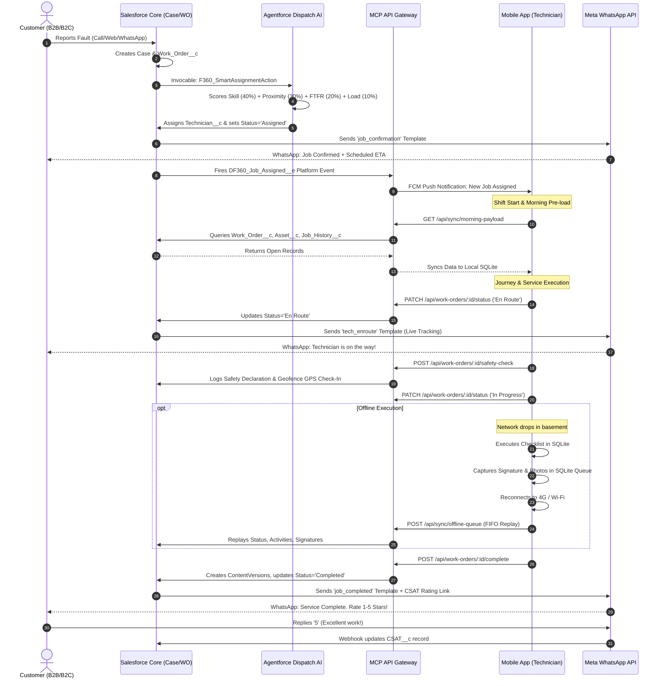

---

## 9. Lookup and Data Retrieval Logic

A critical element of the implementation is how records are linked across relational boundaries:

#### Visual Relational Traversal:
```text
  ┌────────────────────────────────────────────────────────┐
  │ Logged-In User (User.Id / Username)                    │
  └──────────────────────────┬─────────────────────────────┘
                             │ Matches User__c = User.Id
                             ▼
  ┌────────────────────────────────────────────────────────┐
  │ Technician__c Profile (Employee_Code__c = 'TECH-001')  │
  └──────────────────────────┬─────────────────────────────┘
                             │ Matches Assigned_Technician__c = Tech.Id
                             ▼
  ┌────────────────────────────────────────────────────────┐
  │ Work_Order__c (Status != 'Completed')                  │
  └─────────────┬────────────────────────────┬─────────────┘
                │ Account__c                 │ Asset__c
                ▼                            ▼
  ┌──────────────────────────┐  ┌──────────────────────────┐
  │ Account                  │  │ Asset__c                 │
  │ (Name, Phone, Address)   │  │ (Serial_Number, Specs)   │
  └──────────────────────────┘  └────────────┬─────────────┘
                                             │ Equipment_ID__c = Serial
                                             ▼
                                ┌──────────────────────────┐
                                │ Job_History__c           │
                                │ (Past 5 Repairs & Fixes) │
                                └──────────────────────────┘
```

#### Traversal Flowchart (Mermaid):
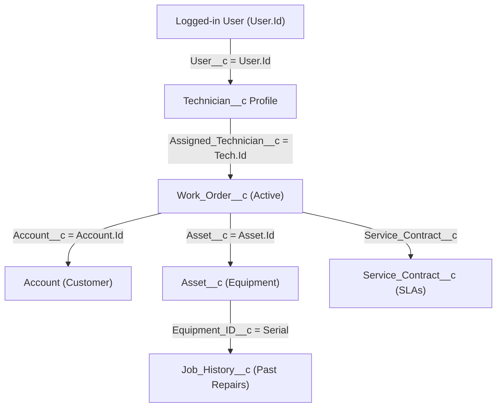

### 9.1 Step-by-Step Traversal Logic
1. **User-to-Technician Resolution**:
   - The mobile client passes a Bearer JWT containing the logged-in Salesforce User ID (`sub`) or username.
   - The Gateway executes:
     ```sql
     SELECT Id, Name, Employee_Code__c, Zone__c, Availability_Status__c, 
            CSAT_Avg_30d__c, FTFR_Pct__c, Current_GPS_Latitude__c, Current_GPS_Longitude__c 
     FROM Technician__c 
     WHERE User__c = :userId OR Email__c = :userEmail 
     LIMIT 1
     ```
2. **Technician-to-Job Retrieval**:
   - Using the resolved `Technician__c.Id`, the gateway fetches assigned jobs:
     ```sql
     SELECT Id, Name, Subject__c, Status__c, Priority__c, Scheduled_Date__c,
            Equipment_Type__c, Equipment_ID__c, Site_Address__c, 
            AI_Pre_Job_Briefing__c, Account__r.Name, Account__r.Phone,
            Asset__r.Name, Asset__r.Serial_Number__c, Asset__r.Warranty_Expiry__c
     FROM Work_Order__c 
     WHERE Assigned_Technician__c = :technicianId 
       AND Status__c NOT IN ('Completed', 'Cancelled')
     ORDER BY Priority__c ASC, Scheduled_Date__c ASC
     ```
3. **Equipment Service History Lookup**:
   - To provide the technician and AI copilot with repair context:
     ```sql
     SELECT Id, Equipment_ID__c, Service_Date__c, Fault_Description__c, 
            Resolution_Notes__c, Parts_Replaced__c, First_Time_Fix__c
     FROM Job_History__c 
     WHERE Equipment_ID__c = :equipmentId 
     ORDER BY Service_Date__c DESC 
     LIMIT 5
     ```
4. **Relevant Parts Compatibility Query**:
   - Rather than returning the full catalog, the mobile app queries parts compatible with the specific equipment category:
     ```sql
     SELECT Id, Name, Part_Code__c, Unit_Cost__c, Is_Warranty_Item__c, Category__c
     FROM Part__c
     WHERE Compatible_Products__c INCLUDES (:equipmentCategory)
       AND Is_Active__c = true
     ORDER BY Name ASC
     ```

---

## 10. Detailed Salesforce Implementation

### 10.1 Apex Classes and Controllers

| Apex Class | Classification | Core Responsibility |
| :--- | :--- | :--- |
| **`DF360_ServiceJobController`** | Controller | Full CRUD operations, status state transitions, GPS check-in validation, and job completion. |
| **`DF360_DispatchController`** | Scoring Service | Heuristic AI scoring engine evaluating skills, proximity, FTFR, and workload. |
| **`F360_SmartAssignmentAction`**| Invocable Action | Exposes technician ranking logic to Agentforce AI and Flow Builder. |
| **`DF360_SLAController`** | SLA Engine | Calculates deadlines based on `SLA_Config__c` and logs immutable `SLA_Event__c` milestones. |
| **`DF360_SLAMonitorBatch`** | Scheduled Batch | Evaluates open jobs every 5–15 minutes, fires 80% warnings and 100% breach alerts. |
| **`DF360_WorkOrderPauseController`**| Controller | Manages pause/resume states, calculates paused duration, and generates dashboard metrics. |
| **`DF360_WhatsAppService`** | Integration Service | Callout client invoking Meta WhatsApp Business API using pre-approved message templates. |
| **`DF360_MobileAPIController`** | `@RestResource` | Direct Apex REST endpoint (`/df360/mobile/*`) for mobile check-in and data synchronization. |
| **`DF360_CSATRollupBatch`** | Nightly Batch | Recalculates rolling 30-day average CSAT and FTFR % for all active technicians. |

### 10.2 Declarative Flow Automations
1. **`DF360_Job_Created_Dispatch`**: Record-triggered after `Service_Job__c` creation. Evaluates customer phone availability and calls `DF360_WhatsAppService` to send a `job_confirmation` template.
2. **`F360_WO_Assigned_Generate_Briefing`**: Record-triggered when `Work_Order__c.Status__c = 'Assigned'`. Calls `F360_PreJobBriefingAction.cls` asynchronously, retrieves asset history, and populates `AI_Pre_Job_Briefing__c`.
3. **`DF360_Job_Status_Changed`**: Fires when job status changes. Triggers milestone WhatsApp notifications (`tech_enroute`, `tech_arrived`, `parts_delay`) and logs `SLA_Event__c`.
4. **`DF360_Job_Completed_CSAT`**: Scheduled path flow executing exactly 15 minutes after job completion to send the WhatsApp survey.
5. **`DF360_Parts_Request_Approval`**: Routes parts requests $> \text{₹}5,000$ to the Service Supervisor for review.
6. **`DF360_Low_CSAT_Alert`**: Triggered when a `CSAT__c` rating $\le 2$ stars is received; alerts the manager and creates an immediate follow-up task.

---

## 11. Detailed Mobile Application Implementation

### 11.1 Key Mobile Functional Views

#### Visual Screen Flowchart:
```text
  ┌────────────────────────┐
  │ Screen 02: Login & Auth├─────────────────────────────────────────┐
  └───────────┬────────────┘                                         │
              ▼                                                      │
  ┌────────────────────────┐                                         │
  │ Screen 04: Tech Home   │ (Shift Overview & Attendance)           │
  └───────────┬────────────┘                                         │
              ▼                                                      │
  ┌────────────────────────┐                                         │
  │ Screen 05: Today's Jobs│ (SLA-Ranked Jobs)                       │
  └───────────┬────────────┘                                         │
              ▼                                                      │
  ┌────────────────────────┐                                         │
  │ Screen 06: Job Detail  │ (Dossier, AI Pre-Job Briefing)          │
  └───────────┬────────────┘                                         │
              ▼                                                      │
  ┌────────────────────────┐                                         │
  │ Screen 08: GPS Check-In│ (Geofenced Radius Validation <= 200m)   │
  └───────────┬────────────┘                                         │
              ▼                                                      │
  ┌────────────────────────┐                                         │
  │ Screen 16.5: Safety    │ (Mandatory PPE & LOTO Clearance)        │
  └───────────┬────────────┘                                         │
              ▼                                                      │
  ┌────────────────────────┐      Consult Diagnostics                │
  │ Screen 17: Checklist   ├────────────────────────────┐            │
  └───────────┬────────────┘                            ▼            │
              ▼                                ┌─────────────────┐   │
  ┌────────────────────────┐                   │ Screen 20:      │   │
  │ Screen 18: Signature   │                   │ GuruAI Copilot  ├───┘
  └───────────┬────────────┘                   └─────────────────┘
              ▼
  ┌────────────────────────┐
  │ Screen 19: Completion  │ (Labor, Photos & Close)
  └────────────────────────┘
```

#### Screen Flowchart (Mermaid):
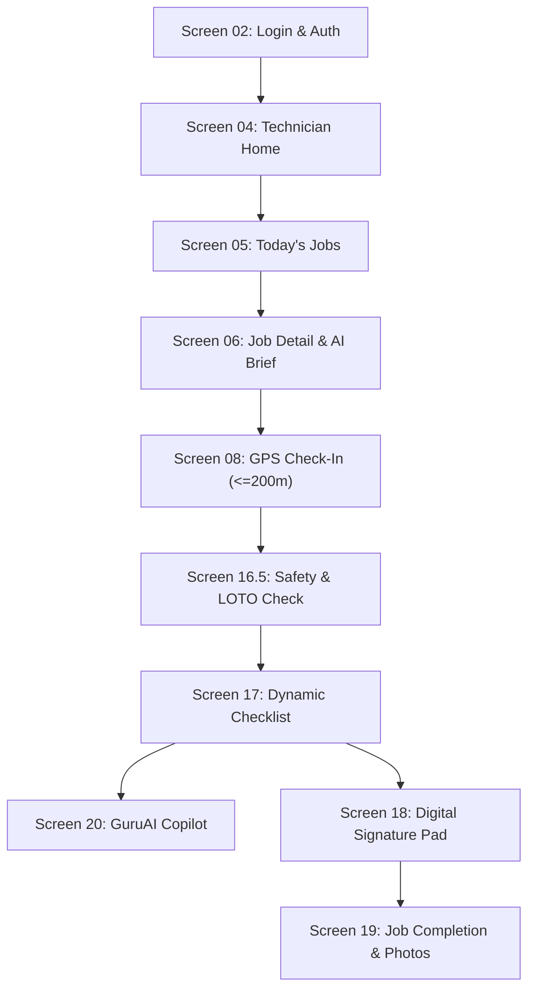

### 11.2 Key Screen Specifications
- **Screen 04 (Home / Dashboard)**: Displays active jobs, shift status, and SLA countdown chips.
- **Screen 06 (Job Detail & AI Briefing)**: Displays customer location, contact details, one-touch call action, and the **Agentforce Pre-Job Briefing** highlighting recurring faults.
- **Screen 08 (Geofenced Check-In)**: Captures device coordinates and calculates straight-line distance to `Asset__c.GPS_Location__c`. Blocks status update if $> 200\text{ meters}$ without supervisor PIN override.
- **Screen 16.5 (Safety Inspection)**: Enforces OSHA/site safety rules. Requires the technician to confirm PPE and Lockout/Tagout measures before physical work begins. Includes emergency escalation button (`POST /api/work-orders/:id/safety-escalation`).
- **Screen 17 (Dynamic Checklist & Telemetry)**: Renders asset-specific tasks. Supports numeric inputs with minimum/maximum limits (e.g., Output Voltage: 395V–435V).
- **Screen 20 (GuruAI Copilot)**: Conversational AI assistant providing troubleshooting guides and wiring schematics in English, Hindi, Marathi, Tamil, and Telugu.
- **Screen 18 & 19 (Signature & Completion)**: Captures on-screen vector signatures and before/after photos, generates a PDF summary, and closes the ticket.

---

## 12. Data Synchronization and Status Management

### 12.1 Lifecycle State Transitions

| Transition | From Status | To Status | Triggering System | Method / API | Side Effects |
| :--- | :--- | :--- | :--- | :--- | :--- |
| **Dispatch** | `New` | `Assigned` | Salesforce / Agentforce | Auto-Dispatch / Kanban | Fires `DF360_Job_Assigned__e`, sends WhatsApp confirmation |
| **Travel** | `Assigned` | `En Route` | Mobile App | `PATCH /status` | Sends `tech_enroute` WhatsApp with live ETA |
| **Arrival** | `En Route` | `On Site` | Mobile App | `POST /check-in` | Validates geofence ($\le 200\text{m}$), sends `tech_arrived` WhatsApp |
| **Safety Clear** | `On Site` | `In Progress` | Mobile App | `POST /safety-check` | Unlocks diagnostic checklist and labor timer |
| **Pause** | `In Progress` | `Temporarily Paused`| Mobile App | `POST /pause` | Pauses SLA clock, creates `Work_Order_Pause_Log__c` |
| **Resume** | `Temporarily Paused`| `In Progress` | Mobile App | `POST /resume` | Calculates paused minutes, resumes SLA clock |
| **Completion** | `In Progress` | `Completed` | Mobile App | `POST /complete` | Uploads signature/photos, triggers 15-min CSAT flow |

---

## 13. Error Handling and Exception Scenarios

### 13.1 Common Exceptions and Recovery Workflows

| Exception Scenario | Detection Mechanism | Immediate System Action | Resolution Workflow |
| :--- | :--- | :--- | :--- |
| **Geofence Check-In Failure** | Mobile app GPS distance $> 200\text{ meters}$ from customer site. | Check-in blocked; warning displayed on mobile screen. | Technician moves closer to asset or enters supervisor PIN override with mandatory reason. |
| **Critical Safety Hazard Detected** | Technician taps emergency hazard escalation button on mobile. | Immediate `POST /safety-escalation`; job marked `Safety Escalated`. | Job halted, alert dispatched to zone safety supervisor, customer notified of work suspension. |
| **SLA 80% Warning** | `DF360_SLAMonitorBatch` detects 80% elapsed time on open job. | Publishes `DF360_SLA_Alert__e`; status flips to `At Risk`. | Supervisor dashboard displays yellow banner; GuruAI suggests diagnostic shortcuts. |
| **SLA 100% Breach** | `DF360_SLAMonitorBatch` detects deadline expiration. | Creates immutable `SLA_Event__c`; status flips to `Breached`. | Auto-generates apology WhatsApp to customer; priority escalation to Service Director. |
| **Parts Stock Depleted** | Parts request raised for depot with `Quantity_Available__c = 0`. | Auto-approval rejected; `Parts Expeditor Agent` invoked. | AI identifies nearest alternative depot with inventory and proposes transfer request. |
| **Low CSAT Rating ($\le 2$)** | Customer replies 1 or 2 stars to WhatsApp survey. | `DF360_CSATTrigger` fires; `Alert_Sent__c = true`. | Immediate high-priority case created for Service Manager; follow-up call scheduled. |
| **Network Loss During Job** | Mobile connectivity listener detects offline state. | App switches to local SQLite; actions queued in FIFO table. | Replay worker processes queued actions sequentially upon connection restoration. |

---

## 14. Security, Access Control, and Governance

### 14.1 Role-Based Permission Architecture

#### Visual Permissions Diagram:
```text
┌─────────────────────────────────┐
│     DF360_Technician Profile    ├──────► Read/Write Assigned Jobs, Work_Order__c,
└─────────────────────────────────┘        Job_Activity__c, Attendance__c (Parts Costs Hidden)

┌─────────────────────────────────┐
│   DF360_ServiceManager Profile  ├──────► Full Read/Write across all Zone Objects,
└─────────────────────────────────┘        Approve Parts Requests > ₹5,000 (No Audit Deletion)

┌─────────────────────────────────┐
│     DF360_PartsAdmin Profile    ├──────► Full Control: Part__c, Parts_Stock__c, Depot__c,
└─────────────────────────────────┘        Fulfill Requisitions (No Access to CSAT or GPS)

┌─────────────────────────────────┐
│    DF360_AgentRuntime Profile   ├──────► Autonomous AI Updates: Assign Technicians,
└─────────────────────────────────┘        Update Statuses, Stamp AI Briefs (No Deletion)
```

#### Permission Architecture (Mermaid):
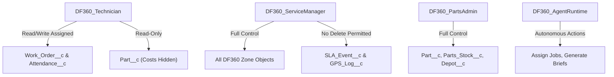

### 14.2 Core Security Guardrails
1. **Zero Secret Exposure**: Mobile clients never store Salesforce consumer secrets or master credentials. Authentication uses OAuth2 PKCE or short-lived (2-hour TTL) JWT tokens issued by the gateway.
2. **Field-Level Security (FLS)**: Sensitive commercial fields (`Unit_Cost__c`, parts margins) are hidden from technician mobile profiles.
3. **Immutable Audit Trails**: `SLA_Event__c` and `WhatsApp_Message__c` records cannot be updated or deleted by any user profile, ensuring regulatory compliance.
4. **Data Retention & Storage Limits**: `GPS_Log__c` records are purged automatically after 365 days by `DF360_GPSLogRetentionBatch` to manage database storage.

---

## 15. End-to-End Example Scenario: Industrial Generator Overheating

To illustrate how these components interact in practice, consider the following real-world scenario:

### Scenario Context
- **Customer**: Serum BioTech Campus, Pune (Account ID: `0010000001`).
- **Asset**: Cummins Diesel Generator 250kVA (Asset ID: `AST-0000002`, Serial: `SN-CUM-8899`).
- **Fault**: High-temperature alarm (Code `E-402`); generator shuts down after 30 seconds.

### Visual Timeline Journey:
```text
  08:30 AM ──► Customer reports fault via WhatsApp -> Case 00010482 created -> SLA set (4 hrs)
  08:31 AM ──► Agentforce scores techs -> Assigned to Vikram Sharma (Score: 94.2)
  08:35 AM ──► Vikram starts shift -> Pre-loads jobs via Morning Sync -> Reads AI Briefing
  09:00 AM ──► Vikram taps 'En Route' -> Customer receives WhatsApp live ETA link
  09:25 AM ──► Vikram arrives -> Geofenced check-in passed (45m) -> Clears LOTO safety check
  09:40 AM ──► Inspects generator -> Coolant leak found -> Consults GuruAI for replacement steps
  10:05 AM ──► Replaces pump gasket -> Calibrates voltage to 415V -> Completes checklist
  10:30 AM ──► Customer signs digital canvas -> Labor logged (65 mins) -> WO Marked Completed
  10:45 AM ──► Customer receives WhatsApp CSAT survey -> Rates 5 Stars -> Metrics updated
```

#### Timeline Diagram (Mermaid):
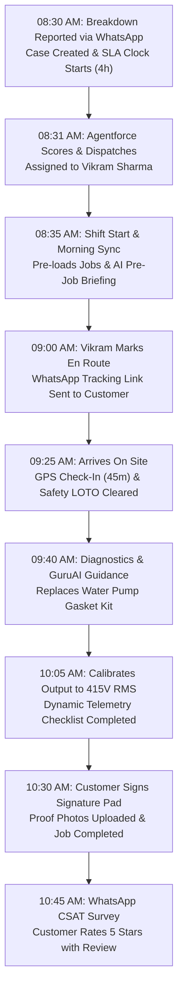

---

## 16. Assumptions, Dependencies, and Open Questions

### 16.1 Verified Implementation Facts
- All 26 custom objects, 3 platform events, and standard User custom fields are fully verified and present in the codebase.
- The Node.js Gateway Server (`scripts/mcp-server.js`) handles both RESTful routes and JSON-RPC 2.0 MCP tools.
- Agentforce Invocable Actions (`F360_SmartAssignmentAction`, `F360_PreJobBriefingAction`, `F360_TroubleshootingAction`, `F360_ServiceReportAction`) are implemented in Apex.

### 16.2 Technical Dependencies
- **Meta WhatsApp Business Account**: Requires verified WhatsApp Business Cloud API credentials configured in Salesforce Named Credentials (`DF360_MetaWhatsApp`).
- **Google Maps API**: Requires valid Distance Matrix API keys for precise travel time routing.
- **Firebase Cloud Messaging (FCM)**: Mobile devices must register valid FCM tokens on login to receive real-time push notifications.

### 16.3 Open Configuration Questions for Deployment
1. **Case-to-Work-Order Automation**: Confirm whether `Work_Order__c` records should be generated automatically via an Apex trigger on `Case` insertion or manually created by call center agents.
2. **Standard FSL Coexistence**: If the client org already uses standard Salesforce Field Service objects (`WorkOrder`, `ServiceAppointment`), clarify whether a bidirectional synchronization trigger is required or if digiField360 operates as a standalone platform.

---

## 17. Glossary of Technical Terms

| Term | Plain English Definition |
| :--- | :--- |
| **Agentforce** | Salesforce's autonomous AI platform that executes multi-step business actions without requiring custom code for every scenario. |
| **AMC** | Annual Maintenance Contract; a service agreement guaranteeing ongoing maintenance and SLA response times. |
| **ContentVersion** | Salesforce standard object used to store binary files, images, PDFs, and customer digital signatures. |
| **CSAT** | Customer Satisfaction Score; a metric (typically 1 to 5 stars) measuring client satisfaction with a service visit. |
| **FIFO Queue** | First-In, First-Out; a processing queue where offline transactions are replayed in the exact chronological order they occurred. |
| **First-Time Fix Rate (FTFR)**| The percentage of field service visits resolved on the initial trip without requiring a return visit. |
| **Geofencing** | A virtual geographic boundary defined by GPS coordinates used to verify whether a technician is physically present on site. |
| **Invocable Action** | An Apex method annotated with `@InvocableMethod` that can be called directly by Agentforce AI agents or Flow Builder. |
| **JSON-RPC 2.0** | A lightweight remote procedure call protocol formatted in JSON, used by the Model Context Protocol (MCP) server. |
| **LOTO** | Lockout / Tagout; a standard safety procedure ensuring dangerous machinery is completely powered down before maintenance begins. |
| **MCP** | Model Context Protocol; an open standard that allows AI agents and clients to securely query data and execute tools across backend systems. |
| **Platform Event** | An event-driven messaging architecture in Salesforce used to broadcast notifications (such as new job assignments) in real time. |
| **RAG** | Retrieval-Augmented Generation; an AI technique combining knowledge articles and repair histories with large language models to deliver accurate technical advice. |
| **SLA** | Service Level Agreement; a contractual commitment defining maximum permitted response and resolution times for service jobs. |
| **SOQL** | Salesforce Object Query Language; a query language used to search and retrieve data from Salesforce databases. |

---

*End of Implementation Specification — digiField360.ai Enterprise Edition*
