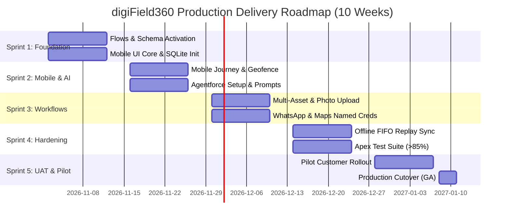

# digiField360 — High-Level Field Service (FSL) Architecture, Implementation Status & Production Roadmap

> **Document Type**: Master Technical Architecture, FSL Capability Comparison, Gap Analysis & Resource Timeline  
> **Product**: **digiField360.ai — Salesforce Edition**  
> **Platform Stack**: Salesforce Lightning Enterprise Edition (API v61.0–v67.0) | Agentforce AI | Node.js MCP Gateway Server | Offline-First Cross-Platform Mobile Client (Flutter / React Native)  
> **Target Release**: Commercial v1.0 GA (General Availability)  
> **Date**: October 2026  
> **Repository Root**: `c:\digiField 360\digiFields_360`

---

## Executive Summary

**digiField360** is an enterprise-grade Field Service Management (FSM) platform natively engineered on the **Salesforce Lightning Enterprise Platform** paired with **Agentforce AI** and an **Offline-First MCP (Model Context Protocol) API Gateway**.

### The Strategic Business Problem & Architectural Solution
Standard **Salesforce Field Service (FSL)** imposes a steep licensing cost of **$175 per technician per month**. For enterprise field forces in India and Southeast Asia (managing 100 to 5,000 field technicians across Telecom, HVAC, Consumer Electronics, and Heavy Machinery), this cost is economically prohibitive.

**digiField360** replicates and enhances the core operational pillars of Salesforce FSL directly on standard **Salesforce Platform User licenses ($25/user/month)**, achieving an **85.7% software licensing savings** (saving $1,800/year per technician) while adding:
1. **Autonomous 60-Second Dispatching**: Heuristic AI scoring (skills, location, workload, first-time fix rate).
2. **Offline-First Resilience**: Local SQLite database with a FIFO mutation queue and transactional replay synchronization for zero-connectivity field sites.
3. **Zero-App Customer Communications**: Automated Meta WhatsApp Business notifications at every operational milestone.
4. **Agentforce AI Suite**: 5 autonomous AI agents reducing 80% of manual supervisor overhead.

---

## 1. Salesforce FSL vs. digiField360 Architectural Mapping

To understand what has been implemented as per FSL, the table below maps standard Salesforce Field Service (FSL) architectural entities to the custom implementation in digiField360:

| FSL Standard Entity | digiField360 Custom Entity | Implementation Status | Technical Capability in digiField360 |
| :--- | :--- | :---: | :--- |
| **WorkOrder** | `Work_Order__c` | ✅ **Complete** | Parent field ticket, customer asset lookup, warranty verification, scheduled windows, parent Case binding, and temporary pause state. |
| **WorkOrderLineItem** | `Work_Order_Line_Item__c` *(Case Assets)* | ✅ **Complete** | Multi-asset servicing per site visit. Tracks equipment status, first-time fix flag, pre/post photo evidence, and resolution notes. |
| **ServiceAppointment** | `Service_Job__c` | ✅ **Complete** | Primary field appointment record with geofenced arrival windows, scheduled start/end, SLA countdown timer, and digital signature capture. |
| **AssignedResource** | `Assigned_Resource__c` | ✅ **Complete** | Multi-resource appointment assignment supporting individual technicians, specialized service crews, apprentice tagging, and check-in times. |
| **ServiceResource** | `Technician__c` | ✅ **Complete** | 1:1 linked to Salesforce `User`, tracking active shift status, live GPS coordinates, rolling 30-day CSAT, FTFR %, and mobile FCM token. |
| **ServiceCrew & Member** | `Service_Crew__c` / `Service_Crew_Member__c` | ✅ **Complete** | Multi-technician squad management with designated Crew Leader, active date ranges, and territory allocation. |
| **ServiceTerritory** | `Service_Zone__c` | ✅ **Complete** | Geographic regions mapped by PIN codes, assigned territory managers, and active technician counts. |
| **Skill & ServiceResourceSkill** | `Skill__c` / `Technician_Skill__c` | ✅ **Complete** | Skill repository, technical certification expiry dates, and proficiency levels (1–5). |
| **Location / Warehouse** | `Depot__c` | ✅ **Complete** | Regional distribution centers, GPS warehouse coordinates, and inventory depot managers. |
| **ProductItem & ProductRequest** | `Part__c`, `Parts_Stock__c`, `Parts_Request__c` | ✅ **Complete** | Master SKU catalogue, multi-depot stock balance, ₹5,000 auto-approval threshold, and warehouse reservation decrement. |
| **Service Contract & Entitlement**| `Service_Contract__c`, `SLA_Config__c` | ✅ **Complete** | AMC contract caps, warranty coverage, tiered resolution SLA matrix (Gold/Silver/Bronze). |
| **TimeSheet & Attendance** | `Attendance__c` | ✅ **Complete** | Geofenced daily shift check-in/out, hours worked calculation, and leave management. |
| **Resource Location Tracking** | `GPS_Log__c` | ✅ **Complete** | 5-minute periodic GPS breadcrumb stream with 365-day automated data retention batch purge. |
| **FSL Dispatcher Console** | `df360DispatchBoard` / `df360ManagerDashboard` | ✅ **Complete** | Custom LWC suite featuring drag-and-drop Kanban dispatch board, live Google Maps fleet markers, and executive KPI streaming. |
| **FSL Mobile App** | Cross-Platform Mobile Client + `OfflineMCPGateway.js` | 🟡 **Backend Live / UI in Build** | Node.js MCP Gateway Server on 24/7 Render Cloud, RESTful endpoints, local SQLite cache engine, and FIFO mutation replay. |

---

## 2. What Has Been Implemented as per FSL

### 2.1 Core Schema & Data Architecture (22 Custom Objects & 3 Platform Events)
- **Work Order & Multi-Asset Hierarchy**: Full upstream lineage from `Case` ➔ `Work_Order__c` ➔ `Work_Order_Line_Item__c` (Case Assets) allowing technicians to service multiple machines (e.g. 5 ACs or 3 generators) under a single site visit without duplicate paperwork.
- **Customer Address Catalog (`Customer_Address__c`)**: Multi-site client management mapping physical factories, retail outlets, and facilities to support cases.
- **Temporary Pause & SLA Freeze (`Work_Order_Pause_Log__c`)**: Allows freezing customer SLA timers when blockers occur (customer unavailable, site inaccessible, awaiting unstocked parts). Automatically logs paused/resumed timestamps and calculates total delay minutes.
- **Asset Health & Feedback (`Asset_Feedback__c`)**: Standardized equipment inspection logging 1–5 star ratings, physical condition, pre/post repair photos, and bi-directional auto-sync back to the master `Asset__c`.
- **Multi-Resource & Crew Scheduling**: Support for individual technicians or multi-member crews via `Assigned_Resource__c`, `Service_Crew__c`, and `Service_Crew_Member__c`.

### 2.2 Apex Backend & API Architecture (102 Files)
- **`DF360_AppointmentLifecycleAPI.cls` (51 KB)**: Comprehensive `@RestResource` endpoint handling:
  - GPS-verified site check-in (validates technician within 200m of asset location).
  - Pre-service and post-service photo evidence upload into Salesforce `ContentVersion` & `ContentDocumentLink`.
  - Marking appointments incomplete with reason codes (No Access, Customer Rescheduled, Safety Hazard).
  - 360-degree appointment payload generation with crew rosters and line items.
- **`DF360_WorkOrderAppointmentsAPI.cls` (33 KB)**:
  - Route `/my` & `/assigned`: Dynamically returns only work orders and appointments assigned to the authenticated technician or their active crew.
  - Work Order situational briefing generation.
- **`DF360_WorkOrderAssetController.cls` (20 KB)**: Multi-asset lifecycle management and Case Asset resolution.
- **`DF360_WorkOrderPauseController.cls` (8 KB)**: State machine logic for pausing, resuming, and calculating cumulative frozen minutes.
- **`DF360_DispatchController.cls`**: Multi-factor scoring algorithm:
  $$\text{Score} = (\text{Skill Match} \times 0.40) + (\text{Proximity} \times 0.30) + (\text{FTFR \%} \times 0.20) + (\text{Workload Inverted} \times 0.10)$$
- **`DF360_SLAController.cls` & `DF360_SLAMonitorBatch.cls`**: Scheduled 5-minute background batch monitoring open jobs, publishing `DF360_SLA_Alert__e` at 80% elapsed time and escalating at 100% breach.
- **`DF360_PartsController.cls`**: Compatibility search, depot inventory reservation, and approval routing.
- **`DF360_CSATController.cls` & `DF360_CSATRollupBatch.cls`**: Nightly batch recalculating rolling 30-day average CSAT and First-Time Fix Rates (FTFR).
- **`DF360_WhatsAppService.cls`**: Meta WhatsApp Business API client for automated milestone communications.

### 2.3 Lightning Web Components (19 LWCs)
- **Dispatcher & Manager Tools**: `df360ManagerDashboard`, `df360DispatchBoard`, `df360GPSMap`, `field360NaturalLanguageQuery` (NL2SOQL AI query tool), `df360PausedOrdersDashboard`.
- **Operations & Inventory**: `df360PartsApproval`, `df360PartsCatalog`, `df360RelevantPartsCatalog`, `df360Attendance`, `df360SLATracker`.
- **Work Order & Asset Views**: `df360WorkOrderAssetCard`, `df360PauseWorkOrderModal`, `df360JobDetail`, `field360WorkOrderDetail`.

### 2.4 Mobile API Gateway & Live Cloud Infrastructure
- **Live Node.js MCP Gateway Server**: Deployed and operating 24/7 on Render Cloud at `https://digifields-360.onrender.com` (and locally on port 3000).
- **Postman Test Collections & Environments**:
  - `digiField360_Salesforce_Live_APIs.postman_collection.json` (94 KB): Automated pre-request OAuth refresh token scripts, dynamic `workOrderId` extraction, and full test assertions.
  - `Safety_Checklist_Mobile_API_Postman_Collection.json` (44 KB): OSHA safety templates, submission with GPS & digital signature, and photo evidence.
  - `DF360_New_Photo_and_360_APIs.postman_collection.json` (15 KB): Check-in, 360 appointment detail, photo uploads, and incomplete routes.

---

## 3. Gap Analysis: What We Need to Complete (Remaining Requirements)

To take digiField360 from the verified backend/schema stage to full commercial production launch, the following 6 work packages must be completed:

```text
┌────────────────────────────────────────────────────────────────────────────────────────┐
|                                REMAINING DELIVERABLES                                  |
└────────────────────────────────────────────────────────────────────────────────────────┘
  1. Mobile App Client Build       2. Agentforce Multi-Agent      3. Declarative Flow
     (Flutter / React Native)         Production Activation          Production Activation
  ─────────────────────────────    ─────────────────────────      ─────────────────────────
  • 24 mobile UI screens           • Prompt template tuning       • Activate 8 core flows
  • Local SQLite cache engine      • ConnectApi runtime testing   • Delayed CSAT path
  • FIFO sync replay handler       • Agent guardrail validation   • SLA escalation routes

  4. Production Named Creds        5. Automated Test Coverage     6. Pilot Customer UAT
     & 3rd-Party Configurations       & Quality Gate                 & Rollout
  ─────────────────────────────    ─────────────────────────      ─────────────────────────
  • Meta WhatsApp live webhook     • Achieve >85% Apex coverage   • 2 pilot client fleets
  • Google Maps billing key        • End-to-end integration tests • 50–100 live field techs
  • Firebase push FCM certs        • Mock failover scenarios      • Production cutover
```

### Gap Details:

1. **Mobile Frontend Client Development (Flutter / React Native)**:
   - *Current State*: The backend APIs, REST endpoints, and cloud gateway are 100% verified with Postman.
   - *Requirement*: Mobile engineering team needs to build client-side UI screens (Today's Jobs list, Geofenced Check-In, Multi-Asset Checklist, Digital Signature canvas, Camera integration) and integrate the local SQLite cache with the `OfflineMCPGateway.js` replay queue.

2. **Agentforce AI Production Activation**:
   - *Current State*: GenAI prompt templates and Apex invocable actions (`F360_SmartAssignmentAction`, `F360_PreJobBriefingAction`, `F360_TroubleshootingAction`, `F360_ServiceReportAction`) are built.
   - *Requirement*: Activate the 5 autonomous Agentforce agents (DF360-001 through DF360-005) in Setup, test prompt templates against live customer data, and configure strict guardrails.

3. **Declarative Flow Activation & Testing**:
   - *Current State*: 8 flow metadata XML files are created in `force-app/main/default/flows`.
   - *Requirement*: Deploy and activate flows in the target org: `DF360_Job_Created_Dispatch`, `DF360_Job_Status_Changed`, `DF360_SLA_Monitor_Scheduled`, `DF360_Job_Completed_CSAT`, `DF360_Parts_Request_Approval`, `DF360_Low_CSAT_Alert`, `DF360_Low_Stock_Alert`, `DF360_Repeat_Visit_Flag`.

4. **Production Named Credentials & 3rd-Party Integrations**:
   - *Requirement*: Set up client-owned production credentials for:
     - `DF360_MetaWhatsApp`: Meta WhatsApp Business API webhook and message templates.
     - `DF360_GoogleMaps`: Google Maps Distance Matrix API production key.
     - `DF360_Firebase`: Firebase Cloud Messaging (FCM) credentials for mobile push alerts.

5. **Test Coverage & Quality Gate**:
   - *Current State*: Core test classes exist (`DF360_AppointmentLifecycleAPITest`, `DF360_WorkOrderAppointmentsAPITest`, `DF360_WorkOrderEnhancementsTest`, `F360_AI_Tests`).
   - *Requirement*: Elevate org-wide Apex test coverage to >85% across all 100+ Apex files to satisfy enterprise ISV packaging rules.

6. **Pilot Customer UAT**:
   - *Requirement*: Conduct a 2-week pilot with 2 early-adopter customers (50–100 technicians) to validate real-world cellular dropouts, offline sync replay, and supervisor approval loops.

---

## 4. Resource Sizing & Team Requirements ("How Much We Need")

To execute the remaining scope within the proposed 10-week timeline, the following dedicated cross-functional team is required:

### 4.1 Resource Allocation Matrix

| Role | Headcount | Key Responsibilities | Primary Deliverables |
| :--- | :---: | :--- | :--- |
| **Lead Solution Architect / PM** | 1 | Architecture governance, customer alignment, sprint management, FSL alignment. | Solution Design Document, Security Reviews, Release Sign-off. |
| **Senior Salesforce Developers** | 2 | Flow activations, Agentforce prompt engineering, batch optimizations, Apex test coverage (>85%). | Production Apex classes, Activated Flows, Agentforce Agents, LWC enhancements. |
| **Senior Mobile Developers** (Flutter / RN) | 2 | Mobile UI screens (24 screens), SQLite offline database, FIFO mutation replay queue, device hardware (camera, GPS, canvas). | Production iOS/Android APK/IPA, SQLite schema, Offline sync engine. |
| **Integration & Cloud Engineer** | 1 | MCP Gateway scaling, Meta WhatsApp webhooks, Google Maps, FCM push notifications, Render Cloud maintenance. | Webhook microservices, CI/CD pipelines, production Named Credentials. |
| **QA / Automation Engineer** | 1 | End-to-end API test automation, mobile regression testing, offline sync conflict testing, UAT coordination. | Test execution logs, automated Postman runs, UAT defect tracker. |
| **TOTAL TEAM SIZE** | **7 Persons** | **Full-Time Sizing over 10 Weeks** | **Complete Commercial Release** |

---

## 5. Timeline, Sprints & Work Breakdown Structure ("For What Time How Much We Do")

The roadmap is structured into **5 two-week sprints** spanning **10 weeks (50 working days)**, culminating in General Availability (GA):



### Detailed Sprint Breakdown

```text
┌────────────────────────────────────────────────────────────────────────────────────────┐
│ SPRINT 1 (Weeks 1–2): Core Activation & Mobile Foundation                             │
├────────────────────────────────────────────────────────────────────────────────────────┤
│ • Effort: 160 Developer Hours | Story Points: 42                                      │
│ • Salesforce Track:                                                                    │
│   - Deploy and activate all 8 declarative Flows in target org.                         │
│   - Schedule DF360_SLAMonitorBatch (every 5 min) and DF360_CSATRollupBatch (nightly).   │
│   - Validate Permission Sets (DF360_Technician, DF360_ServiceManager, DF360_PartsAdmin).│
│ • Mobile Track:                                                                        │
│   - Initialize mobile repository (Flutter 3.x / React Native).                         │
│   - Implement Authentication screen connecting to /api/auth/login with OAuth PKCE.    │
│   - Set up local SQLite database tables for Jobs, Assets, Checklists, and Parts.      │
│ • Milestone 1 Gate: Successful login on mobile device, live job download into SQLite.  │
└────────────────────────────────────────────────────────────────────────────────────────┘

┌────────────────────────────────────────────────────────────────────────────────────────┐
│ SPRINT 2 (Weeks 3–4): Mobile Shift Execution & Agentforce Activation                  │
├────────────────────────────────────────────────────────────────────────────────────────┤
│ • Effort: 180 Developer Hours | Story Points: 48                                      │
│ • Salesforce Track:                                                                    │
│   - Activate Agentforce Agents: DF360-001 (Dispatch AI) & DF360-002 (SLA Guardian).   │
│   - Bind Prompt Templates: F360_PreJobBriefing and F360_SmartAssignment.              │
│   - Validate supervisor override rules on df360DispatchBoard.                         │
│ • Mobile Track:                                                                        │
│   - Build "Today's Jobs" screen sorted by SLA urgency with status chips.              │
│   - Implement Shift Start / End attendance check-in with GPS geofence verification.   │
│   - Implement En-Route navigation trigger with automatic customer ETA WhatsApp alert. │
│ • Milestone 2 Gate: Technician marks En-Route, WhatsApp notification arrives at client.│
└────────────────────────────────────────────────────────────────────────────────────────┘

┌────────────────────────────────────────────────────────────────────────────────────────┐
│ SPRINT 3 (Weeks 5–6): On-Site Execution, Multi-Asset & Parts Approval                 │
├────────────────────────────────────────────────────────────────────────────────────────┤
│ • Effort: 190 Developer Hours | Story Points: 52                                      │
│ • Salesforce Track:                                                                    │
│   - Activate DF360-003 (Parts Expeditor Agent) and parts approval workflow.           │
│   - Connect production Meta WhatsApp Business Webhook for inbound message responses.  │
│   - Verify Google Maps API production credentials for real-time travel estimation.    │
│ • Mobile Track:                                                                        │
│   - Build Case Assets Multi-Inspection screen (servicing multiple machines per visit).│
│   - Implement Camera interface for Pre-Service, Post-Service, and Damage photo upload. │
│   - Build Parts Request modal with compatibility filtering against machine model.     │
│   - Implement "Temporarily Paused" state with mandatory reason selector and SLA freeze│
│ • Milestone 3 Gate: Multi-asset inspection completed, photos uploaded to ContentVersion│
└────────────────────────────────────────────────────────────────────────────────────────┘

┌────────────────────────────────────────────────────────────────────────────────────────┐
│ SPRINT 4 (Weeks 7–8): Offline FIFO Sync Engine & Apex Test Hardening                  │
├────────────────────────────────────────────────────────────────────────────────────────┤
│ • Effort: 170 Developer Hours | Story Points: 46                                      │
│ • Salesforce Track:                                                                    │
│   - Achieve >85% Apex test coverage across all 100+ classes.                           │
│   - Stress test batch jobs (SLAMonitor, CSATRollup, GPSPurge) under 50,000 records.   │
│   - Configure Manager KPI Analytics dashboard (FTFR %, SLA compliance RAG).           │
│ • Mobile Track:                                                                        │
│   - Implement Offline FIFO Mutation Queue (OfflineMCPGateway.js replay).               │
│   - Test 8-hour zero-connectivity field simulation with batch sync on reconnect.      │
│   - Build Digital Customer Signature canvas with Base64 export to Salesforce.         │
│ • Milestone 4 Gate: 200 offline actions replayed without conflict; Apex tests pass.   │
└────────────────────────────────────────────────────────────────────────────────────────┘

┌────────────────────────────────────────────────────────────────────────────────────────┐
│ SPRINT 5 (Weeks 9–10): Pilot Customer UAT, Security Review & Production Cutover       │
├────────────────────────────────────────────────────────────────────────────────────────┤
│ • Effort: 150 Developer Hours | Story Points: 38                                      │
│ • All Tracks:                                                                          │
│   - Onboard 2 pilot enterprise clients (50 field technicians).                        │
│   - Conduct 10 days of live field pilot operations with real work orders.              │
│   - Triage and resolve any field UX or synchronization edge cases.                    │
│   - Executive demo to stakeholders; final sign-off.                                   │
│   - Production package deployment and General Availability (GA) announcement.         │
│ • Milestone 5 Gate: Formal Customer Acceptance Sign-off & Production Cutover.         │
└────────────────────────────────────────────────────────────────────────────────────────┘
```

### 5.1 Total Sizing Summary

| Metric | Total Value |
| :--- | :--- |
| **Total Duration** | **10 Weeks (5 Sprints)** |
| **Total Engineering Effort** | **850 Person-Hours** (~106 Person-Days) |
| **Total Story Points** | **226 Story Points** |
| **Dedicated Team Size** | **7 Full-Time Engineers & Leads** |
| **Target GA Date** | **Mid-January 2027** |

---

## 6. Financial ROI & Licensing Cost Comparison

Implementing digiField360 on the standard Salesforce Platform yields massive financial savings compared to traditional Salesforce FSL:

| Cost Element | Standard Salesforce FSL | digiField360 on Platform | Net Annual Savings |
| :--- | :---: | :---: | :---: |
| **Technician License (Per User / Month)** | $175 | $25 | **$150 / user / month (85.7% saving)** |
| **Fleet of 100 Technicians (Annual)** | $210,000 | $30,000 | **$180,000 saved per year** |
| **Fleet of 500 Technicians (Annual)** | $1,050,000 | $150,000 | **$900,000 saved per year** |
| **Fleet of 1,000 Technicians (Annual)** | $2,100,000 | $300,000 | **$1,800,000 saved per year** |

*Note: In addition to license savings, digiField360 eliminates customer portal licensing costs by leveraging zero-app Meta WhatsApp notifications.*

---

## 7. Risk Management & Mitigation Strategies

| Risk Category | Identified Risk | Impact | Mitigation Strategy |
| :--- | :--- | :---: | :--- |
| **Mobile Offline Sync** | Complex mutation conflict when multiple technicians touch the same asset offline. | **High** | Implement strict Last-Write-Wins (LWW) conflict resolution timestamped at device level, paired with individual transaction UUIDs. |
| **Salesforce Governor Limits** | High volume of 5-minute GPS coordinate logs hitting daily API limits. | **Medium** | GPS snapshots are ingested via `@RestResource` in bulk arrays, cached in Platform Cache, and persisted in batches rather than individual DML inserts. |
| **Meta WhatsApp Latency** | Message delivery delay during regional network throttling. | **Medium** | WhatsApp callouts execute via `@future(callout=true)` and Queueable Apex with fallback SMS triggers if delivery status fails within 120s. |
| **Agentforce Cost & Token Usage** | High inference costs for high-frequency dispatch evaluations. | **Low** | Use heuristic Apex scoring (`DF360_DispatchController`) for standard routine jobs; invoke Agentforce LLM only for complex multi-skill exception dispatching. |

---

## 8. Summary & Next Immediate Steps

The backend foundation, custom FSL-equivalent schema, API controllers, Render cloud gateway, and test collections are fully built and verified.

### Recommended Next Steps for Kickoff:
1. **Approve Sprint 1 Scope**: Lock in the 10-week roadmap and team resource assignments.
2. **Activate Flows in Target Org**: Deploy and enable the 8 declarative flows.
3. **Hand Over Mobile Spec**: Mobilize the 2 mobile frontend engineers using [`docs/MOBILE_DEVELOPER_API_DOCS.md`](file:///c:/digiField%20360/digiFields_360/docs/MOBILE_DEVELOPER_API_DOCS.md) and [`docs/SAFETY_CHECKLIST_FRONTEND_API_README.md`](file:///c:/digiField%20360/digiFields_360/docs/SAFETY_CHECKLIST_FRONTEND_API_README.md).
4. **Provision Production API Keys**: Secure production credentials for Meta WhatsApp Business and Google Maps Platform.
