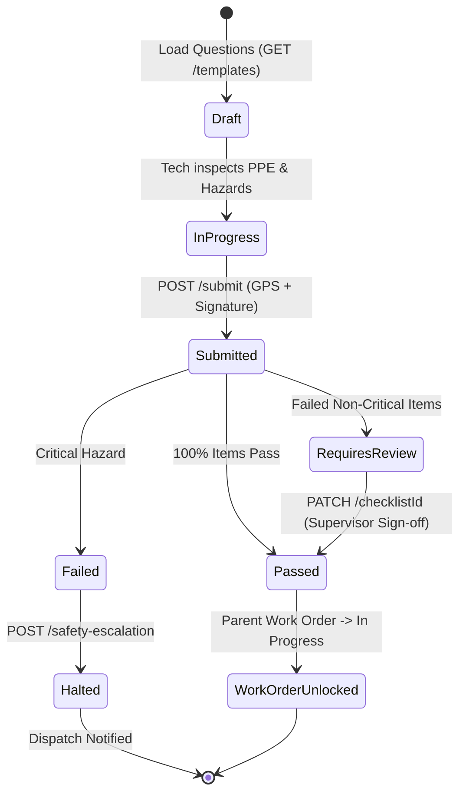

# 🛡️ Work Order Safety & Checklist API — Frontend & Mobile Developer Guide

Comprehensive integration guide and API reference for **Frontend (Web / React / Vue / Angular)** and **Mobile (React Native / Flutter / iOS / Android)** developers to connect with the **digiField360 Safety & Checklist APIs**.

---

## 📋 Table of Contents
1. [Architecture & Base URLs](#-architecture--base-urls)
2. [Authentication & Headers](#-authentication--headers)
3. [API Endpoints Quick Reference](#-api-endpoints-quick-reference)
4. [TypeScript Data Models & Interfaces](#-typescript-data-models--interfaces)
5. [Complete Endpoint Reference & cURL Requests](#-complete-endpoint-reference--curl-requests)
   - [1. OAuth2 Authentication](#1-oauth2-authentication)
   - [2. Get Checklist Templates & Questions](#2-get-checklist-templates--questions-offline-cache)
   - [3. Get Checklists by Work Order ID](#3-get-checklists-by-work-order-id)
   - [4. Get Single Checklist Detail](#4-get-single-checklist-detail)
   - [5. Submit Complete Safety Inspection (GPS + Signature)](#5-submit-complete-safety-inspection-items--gps--signature)
   - [6. Upload Checklist Photo Evidence](#6-upload-checklist-item-photo-evidence-base64)
   - [7. Update Work Order Safety Check Status (Supervisor Sign-off)](#7-update-work-order-safety-check-status--supervisor-sign-off)
   - [8. Direct Gateway Safety Check](#8-direct-gateway-safety-check)
   - [9. Emergency Safety Escalation & Hazard Alert](#9-emergency-safety-escalation--hazard-alert)
   - [10. Get Work Order Attachments & Photos](#10-get-work-order-attachments--photos)
   - [11. Delete Draft Checklist](#11-delete-draft-checklist)
6. [Frontend Code Examples](#-frontend-code-examples)
   - [TypeScript / React Native (Axios Service)](#typescript--react-native-axios-service)
   - [Flutter / Dart Service](#flutter--dart-service)
7. [Safety Check Lifecycle & Status Transitions](#-safety-check-lifecycle--status-transitions)
8. [Postman Collection Setup](#-postman-collection-setup)
9. [Error Codes & Troubleshooting](#-error-codes--troubleshooting)

---

## 🌐 Architecture & Base URLs

The mobile/frontend app can connect via two supported base URLs:

| Environment | Base URL | Usage |
|:---|:---|:---|
| **Direct Salesforce Apex REST** | `https://orgfarm-4036b01401-dev-ed.develop.my.salesforce.com` | Production / Live Org transactions |
| **Node.js API Gateway (Local)** | `http://localhost:3000` | Local development & testing |
| **Android Emulator Gateway** | `http://10.0.2.2:3000` | Android Studio Emulator |
| **Cloud Gateway (Render/Staging)** | `https://digifields-360.onrender.com` | Cloud staging & remote QA |

---

## 🔑 Authentication & Headers

All requests (except authentication) require a standard **OAuth2 / JWT Bearer Token** in the HTTP `Authorization` header:

```http
Authorization: Bearer <YOUR_ACCESS_TOKEN>
Content-Type: application/json
Accept: application/json
```

---

## ⚡ API Endpoints Quick Reference

| # | Action | HTTP Method | Path | Status |
|:---:|:---|:---:|:---|:---:|
| **1** | Get OAuth2 Access Token | `POST` | `/services/oauth2/token` (or `/api/auth/login`) | `200 OK` |
| **2** | Get Checklist Templates (Offline Cache) | `GET` | `/services/apexrest/api/safety-checklist/templates` | `200 OK` |
| **3** | Get Checklists by Work Order | `GET` | `/services/apexrest/api/safety-checklist/work-order/:workOrderId` | `200 OK` |
| **4** | Get Single Checklist Detail | `GET` | `/services/apexrest/api/safety-checklist/:checklistId` | `200 OK` |
| **5** | Submit Inspection (GPS + Signature) | `POST` | `/services/apexrest/api/safety-checklist/submit` | `201 Created` |
| **6** | Upload Checklist Photo Evidence | `POST` | `/services/apexrest/api/safety-checklist/evidence` | `201 Created` |
| **7** | **Update Safety Check Status** | `PATCH` | `/services/apexrest/api/safety-checklist/:checklistId` | `200 OK` |
| **8** | Gateway Safety Verification | `POST` | `/api/work-orders/:workOrderId/safety-check` | `200 OK` |
| **9** | Emergency Safety Escalation | `POST` | `/api/work-orders/:workOrderId/safety-escalation` | `201 Created` |
| **10**| Get Work Order Attachments & Photos | `GET` | `/api/attachments?workOrderId=:workOrderId` | `200 OK` |
| **11**| Delete Draft Checklist | `DELETE`| `/services/apexrest/api/safety-checklist/:checklistId` | `200 OK` |

---

## 📐 TypeScript Data Models & Interfaces

Use these TypeScript interfaces in your frontend/mobile app:

```typescript
// 1. Template Item
export interface ChecklistTemplateItem {
  orderIndex: number;
  itemName: string;
  question: string;
  severity: 'Low' | 'Medium' | 'High' | 'Critical';
  defaultStatus: 'Pass' | 'Fail' | 'N/A';
}

export interface ChecklistCategory {
  category: string;
  items: ChecklistTemplateItem[];
}

// 2. Submission Item
export interface SafetyChecklistItemSubmission {
  itemName: string;
  category: string;
  question: string;
  status: 'Pass' | 'Fail' | 'N/A';
  severity: 'Low' | 'Medium' | 'High' | 'Critical';
  remarks?: string;
  orderIndex: number;
}

// 3. Complete Checklist Submission Payload
export interface SafetyChecklistSubmitPayload {
  workOrderId: string;
  assetId?: string;
  technicianName: string;
  technicianId: string;
  siteLocation: string;
  latitude: number;
  longitude: number;
  inspectionDate: string; // ISO 8601
  overallComments?: string;
  signatureBase64?: string; // Data URI: data:image/png;base64,...
  items: SafetyChecklistItemSubmission[];
}

// 4. Update Status / Sign-off Payload
export interface SafetyStatusUpdatePayload {
  status: 'Draft' | 'Pending Review' | 'Passed' | 'Requires Review' | 'Failed' | 'Rejected';
  overallComments?: string;
  supervisorNotes?: string;
  siteLocation?: string;
}

// 5. Photo Evidence Upload Payload
export interface SafetyEvidenceUploadPayload {
  checklistItemId?: string;
  checklistId: string;
  fileName: string;
  contentType: 'image/jpeg' | 'image/png';
  base64Data: string; // Clean Base64 string
}

// 6. Safety Escalation Payload
export interface SafetyEscalationPayload {
  hazardType: 'ELECTRICAL_ARCING' | 'GAS_LEAK' | 'STRUCTURAL_UNSTABLE' | 'CHEMICAL_SPILL' | 'PRESSURE_VESSEL';
  severity: 'HIGH' | 'CRITICAL';
  hazardDetails: string;
  immediateActionTaken?: string;
  evacuatedSite?: boolean;
  technicianId: string;
}
```

---

## 🚀 Complete Endpoint Reference & cURL Requests

---

### 1. OAuth2 Authentication
Fetches the `access_token` and `instance_url` to authorize subsequent requests.

- **Method**: `POST`
- **Path**: `/services/oauth2/token`
- **Content-Type**: `application/x-www-form-urlencoded`

#### cURL:
```bash
curl --location 'https://login.salesforce.com/services/oauth2/token' \
--header 'Content-Type: application/x-www-form-urlencoded' \
--data-urlencode 'grant_type=password' \
--data-urlencode 'client_id=YOUR_CLIENT_ID' \
--data-urlencode 'client_secret=YOUR_CLIENT_SECRET' \
--data-urlencode 'username=piyush.channe.3868c7575da5@agentforce.com' \
--data-urlencode 'password=YOUR_PASSWORD_AND_SECURITY_TOKEN'
```

#### Response (200 OK):
```json
{
  "access_token": "00D5g000000TEST!AR0AQNx_ExampleAccessToken_...",
  "instance_url": "https://orgfarm-4036b01401-dev-ed.develop.my.salesforce.com",
  "id": "https://login.salesforce.com/id/00D5g000000TEST/0055g000000USER",
  "token_type": "Bearer",
  "issued_at": "1727076400000"
}
```

---

### 2. Get Checklist Templates & Questions (Offline Cache)
Downloads standard PPE checklist, Lockout/Tagout (LOTO) protocols, and environmental hazard questions to cache in mobile storage (SQLite / WatermelonDB / AsyncStorage).

- **Method**: `GET`
- **Path**: `/services/apexrest/api/safety-checklist/templates`

#### cURL:
```bash
curl --location 'https://orgfarm-4036b01401-dev-ed.develop.my.salesforce.com/services/apexrest/api/safety-checklist/templates' \
--header 'Authorization: Bearer YOUR_ACCESS_TOKEN' \
--header 'Content-Type: application/json'
```

#### Response (200 OK):
```json
{
  "success": true,
  "totalCategories": 3,
  "data": [
    {
      "category": "Personal Protective Equipment (PPE)",
      "items": [
        {
          "orderIndex": 1,
          "itemName": "PPE - Helmet & Steel-Toe Boots",
          "question": "Is certified hard hat and safety shoes worn by all team members?",
          "severity": "High",
          "defaultStatus": "Pass"
        },
        {
          "orderIndex": 2,
          "itemName": "Eye & Face Shield Protection",
          "question": "Are safety goggles/shields worn near cutting or grinding equipment?",
          "severity": "Medium",
          "defaultStatus": "Pass"
        }
      ]
    },
    {
      "category": "Electrical Safety & Lockout",
      "items": [
        {
          "orderIndex": 3,
          "itemName": "Lockout / Tagout (LOTO)",
          "question": "Is LOTO applied and verified zero-energy state on main switchboard?",
          "severity": "Critical",
          "defaultStatus": "Pass"
        }
      ]
    },
    {
      "category": "Site & Environmental Clearance",
      "items": [
        {
          "orderIndex": 4,
          "itemName": "Fire Extinguisher Availability",
          "question": "Is a tested ABC fire extinguisher available within 10 meters?",
          "severity": "Critical",
          "defaultStatus": "Pass"
        }
      ]
    }
  ]
}
```

---

### 3. Get Checklists by Work Order ID
Retrieves all safety inspections linked to a Work Order, including pass/fail statistics, technician details, and signature state.

- **Method**: `GET`
- **Path**: `/services/apexrest/api/safety-checklist/work-order/:workOrderId`

#### cURL:
```bash
curl --location 'https://orgfarm-4036b01401-dev-ed.develop.my.salesforce.com/services/apexrest/api/safety-checklist/work-order/WO-100482' \
--header 'Authorization: Bearer YOUR_ACCESS_TOKEN' \
--header 'Content-Type: application/json'
```

#### Response (200 OK):
```json
{
  "success": true,
  "workOrderId": "WO-100482",
  "totalChecklists": 1,
  "data": [
    {
      "id": "a0X5g000000AbCdEAI",
      "name": "CHK-00042",
      "workOrderId": "WO-100482",
      "technicianName": "Vikram Sharma",
      "status": "Passed",
      "inspectionDate": "2026-09-23T11:45:00.000Z",
      "siteLocation": "Solar Power Plant Site #3, Pune",
      "latitude": 18.52043,
      "longitude": 73.856744,
      "totalItems": 4,
      "passedItems": 4,
      "failedItems": 0,
      "signatureCaptured": true
    }
  ]
}
```

---

### 4. Get Single Checklist Detail
Fetches full inspection record including all question responses, remarks, severity ratings, and photo evidence flags.

- **Method**: `GET`
- **Path**: `/services/apexrest/api/safety-checklist/:checklistId`

#### cURL:
```bash
curl --location 'https://orgfarm-4036b01401-dev-ed.develop.my.salesforce.com/services/apexrest/api/safety-checklist/a0X5g000000AbCdEAI' \
--header 'Authorization: Bearer YOUR_ACCESS_TOKEN' \
--header 'Content-Type: application/json'
```

---

### 5. Submit Complete Safety Inspection (Items + GPS + Signature)
Submits technician pre-job safety sign-off, PPE verification, and hazard checks with GPS coordinates and digital signature. Automatically attaches the signature to Salesforce Files (`ContentVersion`).

- **Method**: `POST`
- **Path**: `/services/apexrest/api/safety-checklist/submit`

#### cURL:
```bash
curl --location 'https://orgfarm-4036b01401-dev-ed.develop.my.salesforce.com/services/apexrest/api/safety-checklist/submit' \
--header 'Authorization: Bearer YOUR_ACCESS_TOKEN' \
--header 'Content-Type: application/json' \
--data '{
  "workOrderId": "WO-100482",
  "assetId": "AST-SOLAR-09",
  "technicianName": "Vikram Sharma",
  "technicianId": "TECH-5021",
  "siteLocation": "Solar Power Plant Site #3, Pune",
  "latitude": 18.520430,
  "longitude": 73.856744,
  "inspectionDate": "2026-09-23T11:45:00Z",
  "overallComments": "Site clearance completed. All high voltage panels isolated and locked before beginning inverter maintenance.",
  "signatureBase64": "data:image/png;base64,iVBORw0KGgoAAAANSUhEUgAAAAEAAAABCAYAAAAfFcSJAAAADUlEQVR42mNk+M9QDwADhgGAWjR9awAAAABJRU5ErkJggg==",
  "items": [
    {
      "itemName": "PPE - Helmet & Steel-Toe Boots",
      "category": "Personal Protective Equipment (PPE)",
      "question": "Is certified hard hat and safety shoes worn by all team members?",
      "status": "Pass",
      "severity": "High",
      "remarks": "Verified on entry",
      "orderIndex": 1
    },
    {
      "itemName": "Eye & Face Shield Protection",
      "category": "Personal Protective Equipment (PPE)",
      "question": "Are safety goggles/shields worn near cutting or grinding equipment?",
      "status": "Pass",
      "severity": "Medium",
      "remarks": "Equipped on technician",
      "orderIndex": 2
    },
    {
      "itemName": "Lockout / Tagout (LOTO)",
      "category": "Electrical Safety & Lockout",
      "question": "Is LOTO applied and verified zero-energy state on main switchboard?",
      "status": "Pass",
      "severity": "Critical",
      "remarks": "Padlock #401 applied with technician key.",
      "orderIndex": 3
    },
    {
      "itemName": "Fire Extinguisher Availability",
      "category": "Site & Environmental Clearance",
      "question": "Is a tested ABC fire extinguisher available within 10 meters?",
      "status": "Pass",
      "severity": "Critical",
      "remarks": "Cylinder pressure gauge verified green.",
      "orderIndex": 4
    }
  ]
}'
```

#### Response (201 Created):
```json
{
  "success": true,
  "message": "Safety checklist submitted successfully.",
  "data": {
    "checklistId": "a0X5g000000AbCdEAI",
    "name": "CHK-00042",
    "workOrderId": "WO-100482",
    "status": "Passed",
    "totalItems": 4,
    "passedItems": 4,
    "failedItems": 0,
    "signatureAttached": true
  }
}
```

---

### 6. Upload Checklist Item Photo Evidence (Base64)
Uploads photo proof (e.g. LOTO padlocks, PPE compliance) linked directly to the checklist item and parent Work Order in Salesforce Files.

- **Method**: `POST`
- **Path**: `/services/apexrest/api/safety-checklist/evidence`

#### cURL:
```bash
curl --location 'https://orgfarm-4036b01401-dev-ed.develop.my.salesforce.com/services/apexrest/api/safety-checklist/evidence' \
--header 'Authorization: Bearer YOUR_ACCESS_TOKEN' \
--header 'Content-Type: application/json' \
--data '{
  "checklistItemId": "a0Y5g000000Xyz2EAA",
  "checklistId": "a0X5g000000AbCdEAI",
  "fileName": "site_safety_lockout_proof.jpg",
  "contentType": "image/jpeg",
  "base64Data": "iVBORw0KGgoAAAANSUhEUgAAAAEAAAABCAYAAAAfFcSJAAAADUlEQVR42mNk+M9QDwADhgGAWjR9awAAAABJRU5ErkJggg=="
}'
```

#### Response (201 Created):
```json
{
  "success": true,
  "message": "Evidence photo uploaded successfully.",
  "data": {
    "contentDocumentId": "0695g000000TuvwAAC",
    "contentVersionId": "0685g000000XyzaAAC",
    "fileName": "site_safety_lockout_proof.jpg",
    "linkedToRecordId": "a0Y5g000000Xyz2EAA"
  }
}
```

---

### 7. Update Work Order Safety Check Status / Supervisor Sign-off
Updates the safety check status (e.g. `Passed`, `Requires Review`, `Failed`, `Approved`) and adds supervisor review comments. Automatically synchronizes parent `Work_Order__c.Safety_Status__c`.

- **Method**: `PATCH`
- **Path**: `/services/apexrest/api/safety-checklist/:checklistId`

#### cURL:
```bash
curl --location --request PATCH 'https://orgfarm-4036b01401-dev-ed.develop.my.salesforce.com/services/apexrest/api/safety-checklist/a0X5g000000AbCdEAI' \
--header 'Authorization: Bearer YOUR_ACCESS_TOKEN' \
--header 'Content-Type: application/json' \
--data '{
  "status": "Passed",
  "overallComments": "Reviewed and approved by Site Safety Supervisor: All LOTO and PPE verified on-site.",
  "siteLocation": "Solar Power Plant Station #3, Pune"
}'
```

#### Response (200 OK):
```json
{
  "success": true,
  "message": "Safety checklist updated successfully.",
  "data": {
    "checklistId": "a0X5g000000AbCdEAI",
    "status": "Passed",
    "overallComments": "Reviewed and approved by Site Safety Supervisor: All LOTO and PPE verified on-site."
  }
}
```

---

### 8. Direct Gateway Safety Check
Mobile Gateway REST endpoint providing combined validation and instant clearance for the technician mobile screen.

- **Method**: `POST`
- **Path**: `/api/work-orders/:workOrderId/safety-check`

#### cURL:
```bash
curl --location 'http://localhost:3000/api/work-orders/WO-100482/safety-check' \
--header 'Authorization: Bearer YOUR_AUTH_TOKEN' \
--header 'Content-Type: application/json' \
--data '{
  "technicianId": "TECH-5021",
  "siteRiskLevel": "HIGH",
  "ppeVerified": {
    "dielectricGloves": true,
    "safetyGoggles": true,
    "steelToeBoots": true,
    "hardHat": true,
    "hearingProtection": true
  },
  "hazardChecks": [
    { "hazardCode": "LOTO_APPLIED", "verified": true },
    { "hazardCode": "ZERO_ENERGY_STATE", "verified": true },
    { "hazardCode": "BATTERY_ISOLATION", "verified": true },
    { "hazardCode": "FUEL_GAS_CLEAR", "verified": true },
    { "hazardCode": "EXHAUST_VENTILATION", "verified": true }
  ],
  "technicianDeclaration": "I confirm that all safety protocols and Lockout/Tagout measures have been verified before servicing this equipment.",
  "latitude": 18.520430,
  "longitude": 73.856743
}'
```

#### Response (200 OK):
```json
{
  "success": true,
  "message": "Pre-job safety inspection cleared successfully. Work authorization granted.",
  "assessment": {
    "safetyCheckId": "SAF-849201",
    "status": "CLEARED",
    "riskLevel": "HIGH",
    "verifiedAt": "2026-09-23T11:45:00.000Z",
    "technicianId": "TECH-5021",
    "complianceScore": "100%"
  }
}
```

---

### 9. Emergency Safety Escalation & Hazard Alert
Immediately halts all work on the Work Order, sets status to `Halted - Safety Escalation`, and pushes high-priority alerts to dispatch.

- **Method**: `POST`
- **Path**: `/api/work-orders/:workOrderId/safety-escalation`

#### cURL:
```bash
curl --location 'http://localhost:3000/api/work-orders/WO-100482/safety-escalation' \
--header 'Authorization: Bearer YOUR_AUTH_TOKEN' \
--header 'Content-Type: application/json' \
--data '{
  "hazardType": "ELECTRICAL_ARCING",
  "severity": "CRITICAL",
  "hazardDetails": "Active electrical arcing detected at main 415V distribution busbar with visible insulation scorch.",
  "immediateActionTaken": "Tripped upstream substation breaker and cordoned off 10-meter perimeter.",
  "evacuatedSite": true,
  "technicianId": "TECH-5021"
}'
```

#### Response (201 Created):
```json
{
  "success": true,
  "message": "CRITICAL SAFETY ESCALATION: Work order execution halted immediately. Dispatch and Safety Officer alerted.",
  "escalation": {
    "escalationId": "ESC-99210",
    "workOrderId": "WO-100482",
    "hazardType": "ELECTRICAL_ARCING",
    "severity": "CRITICAL",
    "workHalted": true,
    "timestamp": "2026-09-23T11:50:00.000Z"
  }
}
```

---

### 10. Get Work Order Attachments & Photos
Fetches all photo attachments, safety proofs, and signatures uploaded to Salesforce `ContentVersion` linked to the Work Order.

- **Method**: `GET`
- **Path**: `/api/attachments?workOrderId=:workOrderId`

#### cURL:
```bash
curl --location 'http://localhost:3000/api/attachments?workOrderId=WO-100482' \
--header 'Authorization: Bearer YOUR_ACCESS_TOKEN' \
--header 'Accept: application/json'
```

---

### 11. Delete Draft Checklist
Deletes an unsubmitted draft checklist record and its associated child items.

- **Method**: `DELETE`
- **Path**: `/services/apexrest/api/safety-checklist/:checklistId`

#### cURL:
```bash
curl --location --request DELETE 'https://orgfarm-4036b01401-dev-ed.develop.my.salesforce.com/services/apexrest/api/safety-checklist/a0X5g000000AbCdEAI' \
--header 'Authorization: Bearer YOUR_ACCESS_TOKEN'
```

---

## 💻 Frontend Code Examples

### TypeScript / React Native (Axios Service)

```typescript
import axios from 'axios';
import {
  ChecklistCategory,
  SafetyChecklistSubmitPayload,
  SafetyStatusUpdatePayload,
  SafetyEvidenceUploadPayload
} from './types';

const apiClient = axios.create({
  baseURL: 'https://orgfarm-4036b01401-dev-ed.develop.my.salesforce.com',
  headers: {
    'Content-Type': 'application/json',
    Accept: 'application/json',
  },
});

// Set token dynamically on login
export const setAuthToken = (token: string) => {
  apiClient.defaults.headers.common['Authorization'] = `Bearer ${token}`;
};

export const SafetyService = {
  // 1. Fetch safety templates for offline forms
  getTemplates: async (): Promise<ChecklistCategory[]> => {
    const response = await apiClient.get('/services/apexrest/api/safety-checklist/templates');
    return response.data.data;
  },

  // 2. Fetch checklists for a work order
  getWorkOrderChecklists: async (workOrderId: string) => {
    const response = await apiClient.get(`/services/apexrest/api/safety-checklist/work-order/${workOrderId}`);
    return response.data;
  },

  // 3. Submit completed safety inspection
  submitChecklist: async (payload: SafetyChecklistSubmitPayload) => {
    const response = await apiClient.post('/services/apexrest/api/safety-checklist/submit', payload);
    return response.data;
  },

  // 4. Update checklist status (Supervisor Sign-off / Review)
  updateStatus: async (checklistId: string, payload: SafetyStatusUpdatePayload) => {
    const response = await apiClient.patch(`/services/apexrest/api/safety-checklist/${checklistId}`, payload);
    return response.data;
  },

  // 5. Upload photo evidence
  uploadEvidence: async (payload: SafetyEvidenceUploadPayload) => {
    const response = await apiClient.post('/services/apexrest/api/safety-checklist/evidence', payload);
    return response.data;
  },

  // 6. Emergency hazard escalation
  escalateHazard: async (workOrderId: string, hazardDetails: string) => {
    const response = await apiClient.post(`/api/work-orders/${workOrderId}/safety-escalation`, {
      hazardType: 'ELECTRICAL_ARCING',
      severity: 'CRITICAL',
      hazardDetails,
      evacuatedSite: true,
      technicianId: 'TECH-5021'
    });
    return response.data;
  }
};
```

---

### Flutter / Dart Service

```dart
import 'dart:convert';
import 'package:http/http.dart' as http;

class SafetyService {
  final String baseUrl;
  final String accessToken;

  SafetyService({required this.baseUrl, required this.accessToken});

  Map<String, String> get _headers => {
    'Authorization': 'Bearer $accessToken',
    'Content-Type': 'application/json',
    'Accept': 'application/json',
  };

  // 1. Fetch Templates
  Future<Map<String, dynamic>> fetchTemplates() async {
    final res = await http.get(
      Uri.parse('$baseUrl/services/apexrest/api/safety-checklist/templates'),
      headers: _headers,
    );
    if (res.statusCode == 200) {
      return jsonDecode(res.body);
    }
    throw Exception('Failed to load safety templates: ${res.body}');
  }

  // 2. Submit Checklist
  Future<Map<String, dynamic>> submitChecklist(Map<String, dynamic> payload) async {
    final res = await http.post(
      Uri.parse('$baseUrl/services/apexrest/api/safety-checklist/submit'),
      headers: _headers,
      body: jsonEncode(payload),
    );
    if (res.statusCode == 201 || res.statusCode == 200) {
      return jsonDecode(res.body);
    }
    throw Exception('Checklist submission failed: ${res.body}');
  }

  // 3. Update Status
  Future<Map<String, dynamic>> updateStatus(String checklistId, String newStatus, String comments) async {
    final res = await http.patch(
      Uri.parse('$baseUrl/services/apexrest/api/safety-checklist/$checklistId'),
      headers: _headers,
      body: jsonEncode({
        'status': newStatus,
        'overallComments': comments,
      }),
    );
    if (res.statusCode == 200) {
      return jsonDecode(res.body);
    }
    throw Exception('Status update failed: ${res.body}');
  }
}
```

---

## 🔄 Safety Check Lifecycle & Status Transitions



### Status Picklist Values:
- **`Draft`**: Checklist initialized in mobile local storage.
- **`Pending Review`**: Submitted with remarks requiring safety officer inspection.
- **`Passed`**: All mandatory items passed. Unlocks technician execution on the Work Order.
- **`Requires Review`**: Supervisor manual sign-off required.
- **`Failed`**: Safety breach detected. Blocks job execution.
- **`Halted`**: Emergency halt triggered via safety escalation.

---

## 📦 Postman Collection Setup

1. Open Postman & Click **Import**.
2. Select [`Safety_Checklist_Mobile_API_Postman_Collection.json`](file:///c:/digiField%20360/digiFields_360/mobile-developer-package/Safety_Checklist_Mobile_API_Postman_Collection.json).
3. Import [`digiField360_Salesforce_Live.postman_environment.json`](file:///c:/digiField%20360/digiFields_360/mobile-developer-package/digiField360_Salesforce_Live.postman_environment.json).
4. Run request **#1 (Authenticate)** first — it automatically sets `{{accessToken}}` in your environment.
5. All subsequent requests will execute with live variable chaining!

---

## ⚠️ Error Codes & Troubleshooting

| HTTP Status | Error Code | Reason | Resolution |
|:---|:---|:---|:---|
| `400 Bad Request` | `INVALID_REQUEST` | Missing `workOrderId` or body is empty | Ensure `workOrderId` is passed in payload |
| `401 Unauthorized` | `INVALID_SESSION_ID` | Access token expired or invalid | Re-run Request #1 (Authenticate) to refresh token |
| `403 Forbidden` | `INSUFFICIENT_ACCESS` | User lacks SObject permissions | Verify Salesforce profile has CRUD permissions |
| `404 Not Found` | `NOT_FOUND` | Checklist ID or Work Order ID doesn't exist | Check record ID validity |
| `500 Server Error` | `SERVER_ERROR` | Internal server or Apex exception | Check Salesforce Apex Debug Logs |
